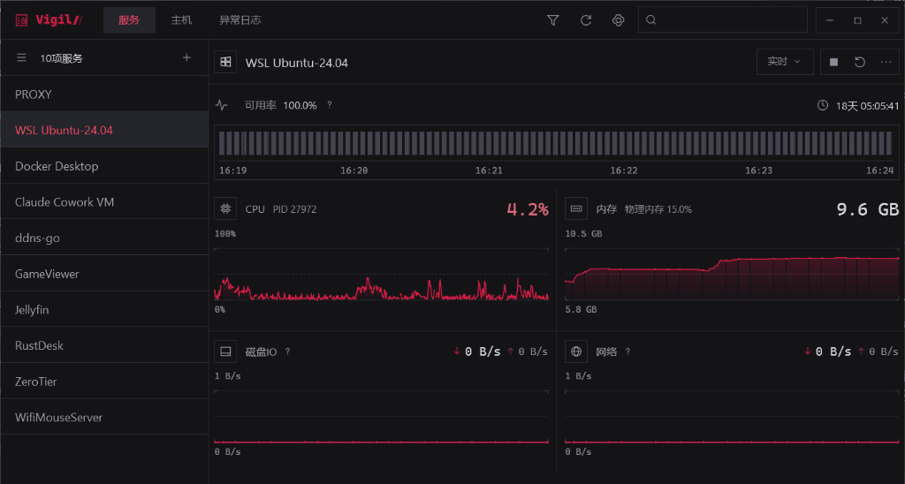

<p align="center">
  
</p>

<h1 align="center">Vigil</h1>

<p align="center">面向 Windows 家庭服务器的原生监控、常驻看护与开机自启控制台。</p>

<p align="center">
  <a href="https://github.com/AngleNaris/Vigil/releases/latest"></a>
  
  
  
</p>

<p align="center">
  <a href="https://github.com/AngleNaris/Vigil/releases/tag/v1.0.0"><strong>下载 v1.0.0</strong></a>
  &nbsp;·&nbsp;
  <a href="#三视图工作流">三视图工作流</a>
  &nbsp;·&nbsp;
  <a href="#共享-cli-控制平面">共享 CLI</a>
  &nbsp;·&nbsp;
  <a href="#安全与运行边界">安全边界</a>
  &nbsp;·&nbsp;
  <a href="#自己构建">自己构建</a>
</p>

<p align="center">
  
</p>

---

## 这是什么

Vigil 是一个面向 Windows 家庭服务器与常驻桌面环境的原生控制控制台。它将进程健康监控、资源趋势采样、异常日志聚合与系统自启治理统一在同一条工作流中，由常驻后台 `Vigil.Agent.exe` 独立采集状态，并与 GUI 与 CLI（`vigil.exe`）共享同一配置与 Named Pipe 控制平面。

界面采用零圆角 1px 结构线网格、高信噪比信息层级以及可切换的深色／浅色主题与 6 套强调色板，适合全天候驻留系统托盘与低干扰运维观察。

<table>
  <tr>
    <td width="33%" valign="top"><b>常驻工作负载</b>   <sub>纳管 Windows 程序、Windows 服务、WSL 发行版、systemd 服务与 WSL 命令，支持依赖链、延迟启动及 Process / TCP / WSL 健康探测。</sub></td>
    <td width="33%" valign="top"><b>主机与趋势基线</b>   <sub>以 0.5s / 1s 窗口采样并持久化 CPU、物理内存、磁盘读写速率与 IPv4 网络吞吐，支持实时、24 小时、7 天与 30 天时间窗切换。</sub></td>
    <td width="33%" valign="top"><b>异常日志与高占用预警</b>   <sub>集中聚合 Agent、任务与控制日志中的严重／错误／警告计数器；当服务或主机持续高 CPU／高内存占用时在列表高亮预警。</sub></td>
  </tr>
  <tr>
    <td valign="top"><b>共享控制平面</b>   <sub>GUI 与无 WPF 的控制台工具 <code>vigil.exe</code> 直连同一个当前用户 Named Pipe，共用配置修订版本（SHA-256 CAS）与操作回执。</sub></td>
    <td valign="top"><b>启动项审阅与自启闭环</b>   <sub>只读检查 <code>HKCU/Run</code>、计划任务与原生启动槽位；通过版本封存与操作日志安全开关当前用户登录自启。</sub></td>
    <td valign="top"><b>瑞士网格与双主题</b>   <sub>1px 边界约束、去装饰线条骨架、主题色实时热切换及 Windows 原生窗口阴影与动画集成。</sub></td>
  </tr>
</table>

## 三视图工作流

Vigil 主窗口收束为顶栏三个平级工作视图与按需弹出的独立工具窗口：

1. **服务（Workloads）**：左侧列出全部纳管工作负载、状态过滤、关键词检索及持续高资源占用提醒；右侧展示可用率时间轴、运行时长、CPU / 工作集内存曲线，并可直接启动、停止、重启、查看详情与切换统计窗口。
2. **主机（Hosts）**：集中观测本机 CPU、内存、固定磁盘与 IPv4 接口吞吐四联图，并支持通过顶部主机 Tab 只读切换已配置的远程 Windows / Linux（OpenSSH）主机资源概况。
3. **异常日志（Exceptions）**：按「总条数 / 严重 / 错误 / 警告」四段计数栏快速过滤近期异常条目、定位来源并导出诊断快照。

常用治理能力保留在独立模态工具窗中，主视图不长期堆砌表单：添加工作负载、开机启动项管理与纳管、自身登录自启、恢复状态管理、系统诊断（Doctor）与远程 SSH 主机配置。

## 共享 CLI 控制平面

安装包随附独立 CUI 工具 `cli\vigil.exe`（不加载 WPF，运行时与 GUI、Agent 隔离封装），并在内置帮助（`vigil help skill` / `vigil --help`）中直接附带供 AI Agent 与自动化脚本使用的 `autorun.yaml` 完整结构、JSON DTO 字段规范与防重放工作流。所有写操作基于配置 SHA-256 修订与 `--yes` / `--operation-id` 防重放契约：

| 命令组 | 主要子命令 | 说明 |
| --- | --- | --- |
| `help` | `--help` / `help COMMAND` / `help skill` | 本地只读帮助与内置 AI 配置 Skill（完整 YAML 与 JSON DTO 规范） |
| `task` | `list` / `show` / `start` / `stop` / `restart` / `add` / `remove` / `enable` / `disable` / `track` / `untrack` | 查询与控制本工作区纳管工作负载 |
| `config` | `path` / `show [--raw]` / `validate --file YAML` / `apply --expected-revision SHA256 --yes` | 读取、校验并原子替换保留注释与格式的 `autorun.yaml` |
| `settings` | `get` / `set` / `patch` | 管理 `autoRecoverFailedTasks`、`autoStartMissingOnLaunch` 等全局策略 |
| `monitor` | `status` / `watch` / `history` | 订阅当前进程资源快照或查询长周期历史分桶 |
| `logs` | `logs` / `sources` / `path` / `exceptions` | 有界分页读取控制与业务日志（支持 `--follow` / `--export`） |
| `startup` | `list` / `inspect [--native]` / `adopt` / `self` / `boot` / `operation inspect` | 只读巡检系统启动项、纳管任务与安全启用登录自启 |
| `host` | `list` / `show` / `add` / `update` / `upsert` / `remove` / `status [ID]` | 配置并只读查询本机与远程 SSH 主机资源状态 |
| `daemon` | `start` / `status` / `stop` | 显式启停后台监控守护进程 `Vigil.Agent.exe` |

```powershell
# 设置工作区（安装程序默认写入 VIGIL_ROOT，并把 cli 加入用户 PATH）
$env:VIGIL_ROOT = "$env:LOCALAPPDATA\Vigil\workspace"

vigil daemon start --json
vigil task list
vigil monitor watch --count 3 --json
vigil logs exceptions --level error --json
vigil host status --json

# 修改全局策略（使用当前配置修订 SHA-256 进行 CAS 提交）
$cfg = vigil config show --json | ConvertFrom-Json
'{"autoRecoverFailedTasks":true}' | vigil settings patch --file - --expected-revision $cfg.revision --json

vigil daemon stop --json
```

## 安全与运行边界

- **用户态隔离通信**：`Vigil.Agent.exe` 仅创建当前 Windows 用户可访问的本地 `NamedPipe`（`Vigil.Agent.v*`），不监听任何 TCP 端口。
- **最小权限与白名单提权**：日常监控与配置均运行于当前用户权限；仅修改受保护的 SYSTEM 开机引导（`C:\ProgramData\Vigil\Boot` 与计划任务 `\Vigil\Boot`）时，才触发固定命令白名单的 `Vigil.Elevated.exe` 请求 UAC。
- **受约束的只读 SSH 探针**：仅调用系统固定目录 OpenSSH，强制启用 `BatchMode` 与 `StrictHostKeyChecking`，只读指定 `known_hosts.vigil` / 私钥路径；远程主机当前仅做资源只读观测，不执行远程写操作或任意脚本拼接。
- **配置与数据分离**：安装程序与运行程序彻底分离——程序二进制部署至 `Program Files\Vigil`，配置（`autorun.yaml`）、日志（`logs/`）与配置备份（`backups/`）均保存在工作区目录。

## 下载哪个版本

| 安装包 | 说明 |
| --- | --- |
| [`Vigil-Setup-1.0.0-win-x64.exe`](https://github.com/AngleNaris/Vigil/releases/download/v1.0.0/Vigil-Setup-1.0.0-win-x64.exe) | 自包含单文件安装程序（内置 `.NET 10` 运行时、`Vigil.exe`、`vigil.exe`、后台 Agent 与配套卸载器 `Vigil-Uninstall.exe`） |

支持命令行静默部署与卸载：

```powershell
# 静默安装
.\Vigil-Setup-1.0.0-win-x64.exe --silent

# 静默卸载（保留配置与日志；如需一并删除可追加 --remove-data）
.\Vigil-Uninstall.exe --uninstall --silent
```

安装包未附加商业代码签名，请仅从本仓库 [GitHub Releases](https://github.com/AngleNaris/Vigil/releases) 获取，并校验 SHA-256：

```text
e86a6fa763ebc5401c127e568cd0e72f934734cee331d86c45c41a254181a05c
```

## 自己构建

构建环境需要 Windows 10 19041+（x64）与 `.NET SDK 10.0.302`：

```powershell
# 运行单元测试与集成测试
dotnet test SystemAutorun.sln --configuration Release

# 发布自包含应用包到 artifacts\publish\win-x64
.\scripts\publish-native.ps1

# 封装单文件图形安装器到 artifacts\installer\Vigil-Setup-1.0.0-win-x64.exe
.\scripts\build-installer.ps1
```

## 许可

本项目目前未附带项目级开源许可证，第三方依赖保留其各自的许可声明。

项目仓库：[AngleNaris/Vigil](https://github.com/AngleNaris/Vigil)
