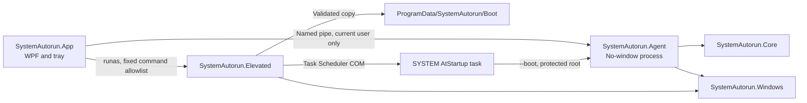

# SystemAutorun Architecture

## Goals

The native rewrite keeps the existing YAML contract and compact dark design
system while removing Python and PowerShell from the normal runtime path. It
provides a visible WPF manager, a no-window per-user Agent, narrowly scoped
elevation, user-logon background startup, and a protected SYSTEM boot path.

## Runtime Topology



## Projects

| Project | Responsibility |
| --- | --- |
| `SystemAutorun.App` | WPF window, tray icon, view models, caches, single-instance behavior, HKCU logon startup, and elevation requests |
| `SystemAutorun.Agent` | Named-pipe command server, task orchestration, health checks, and serialized task mutations |
| `SystemAutorun.Elevated` | `requireAdministrator` helper with a fixed command allowlist for boot-task and machine-wide startup mutations |
| `SystemAutorun.Core` | Configuration, models, IPC protocol, override storage, and shared contracts |
| `SystemAutorun.Windows` | Native process launch, process identity, WSL integration, health probes, startup-item management, and Task Scheduler COM |

All three executable entry points use the Windows GUI PE subsystem (`WinExe`).
The Agent and Elevated helper therefore do not allocate a console window.

## Startup Modes

### Interactive

`SystemAutorun.exe --root <configuration-root>` creates the WPF window, tray,
single-instance listener, and Agent. Closing the window hides it to the tray;
the explicit Exit command owns application shutdown.

### User Logon Background

The HKCU Run registration stores:

```text
"<install>\SystemAutorun.exe" --background --root "<configuration-root>"
```

`--background` creates the tray and Agent but never calls `Show` on the main
window. A second background instance exits successfully without activating the
first instance.

### SYSTEM Boot

The elevated helper accepts an administrator-approved source configuration,
validates it, and deploys it to `C:\ProgramData\SystemAutorun\Boot`. The boot
root and its data directories receive protected ACLs for Administrators and
SYSTEM. The Task Scheduler action can reference only the Agent located beside
the elevated helper under Program Files and only the fixed protected boot root.

Portable or development builds may run the user-level manager, but boot-task
installation is intentionally rejected before ProgramData is changed.

## Configuration And State

- `autorun.yaml` remains the source of truth.
- `ConfigurationLoader` maps versions 1 and 2 and validates task fields,
  dependencies, cycles, health checks, and launch settings.
- `ConfigurationFileEditor` performs text-preserving edits so comments,
  unknown fields, line endings, and UTF-8 without BOM survive add/remove.
- Enable/disable overrides are stored atomically in
  `autorun.overrides.json`.
- GUI and startup-manager caches are disposable local state and render before
  asynchronous refresh.
- Boot deployment validates a staging copy, swaps the config pair, verifies the
  protected result, and restores the previous files if deployment fails.

## Process And Window Semantics

`normal`, `minimized`, `hidden`, `no_console`, and `tray` are distinct launch
modes. `hidden` and `tray` use native `CreateProcessW` flags and `SW_HIDE`.
Console suppression is deterministic for SystemAutorun entry points and console
children. A third-party GUI can show a window again after launch; fully silent
startup then requires a supported command-line switch from that application.

The App stops only the Agent process it started. It does not kill an Agent that
was already running, which prevents one UI instance from terminating a shared
or boot-owned process.

## Release Layout

```text
win-x64/
  SystemAutorun.exe
  SystemAutorun.Core.dll
  SystemAutorun.Windows.dll
  ... WPF self-contained runtime ...
  runtime/
    SystemAutorun.Agent.exe
    SystemAutorun.Elevated.exe
    ... non-WPF self-contained runtime ...
  publish-manifest.json
```

The split avoids collisions between WPF Windows Desktop runtime assemblies and
the regular .NET runtime while keeping Agent and Elevated beside each other for
the SYSTEM trust check.

## Security Boundaries

- Named pipes use current-user-only access and per-user names.
- Elevated commands are allowlisted; no arbitrary executable command exists.
- The SYSTEM executable must be the fixed Agent beside Elevated under Program
  Files, with reparse-point checks through the trusted path.
- Boot config and data paths must remain below the protected ProgramData root.
- Source and protected config files cannot be reparse points.
- Boot deployment keeps a rollback copy until post-deploy validation succeeds.
- Startup-item mutations preserve privilege boundaries between HKCU/user
  Startup and HKLM/Common Startup.
