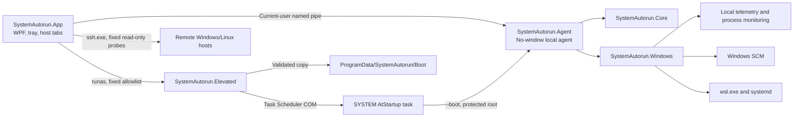

# SystemAutorun Architecture

> 当前修订入口：2026-10-31 的「简化 GUI + 完整 CLI + 服务监测」见本文末尾
> `SA-20261031 / G1-r1`。G1-r1 与主屏 G2-r4 已批准，实施仍在进行；下文原有运行架构
> 保留为基线，具体增量见末尾。证据以 [验证记录](<../verification.md>) 为准，不将旧通过记录移用到新修订。

## Goals

SystemAutorun 是以本机 Windows 家庭服务器为控制中心的原生运维控制台。它负责本机
资源、工作负载生命周期、健康检查、依赖、常驻追踪、异常日志、恢复、启动项与诊断，
并以只读 SSH 方式展示其他 Windows/Linux 服务器概况。

本机 Agent 继续使用当前用户专用 Named Pipe，不暴露网络监听端口。远程能力是应用
主动发起的只读 SSH 查询，不把本机控制面扩展成远程命令服务。

## Product Scope

- 监控本机及远程主机的 CPU、内存、磁盘、网络、系统、运行时间、核心、进程和线程。
- 管理本机 Windows 程序、Windows 服务、WSL 发行版、WSL systemd 服务和 WSL 命令。
- 执行本机 process、TCP、Windows service、WSL、systemd 和 WSL process 健康检查。
- 通过 `expected_running` 追踪用户指定的持续运行工作负载，不依赖其实现类型。
- 聚合 Agent、任务和应用日志中的严重、错误与警告事件。
- 管理依赖顺序、补启动、受限自动恢复、Windows 启动项和 SYSTEM 启动执行器。
- 通过主机 Tab 只读查看保存的 Windows/Linux SSH 主机。

远程工作负载控制、Docker 生命周期、NAS 权限、存储池、SMART、UPS 和外部告警不在
当前范围内。

## Runtime Topology



## Projects

| Project | Responsibility |
| --- | --- |
| `SystemAutorun.App` | WPF UI, tray, host Tabs, local cache, remote-host settings, SSH overview orchestration and single-instance behavior |
| `SystemAutorun.Agent` | Named-pipe server, task orchestration, host/process/log snapshots, dependency ordering and serialized mutations |
| `SystemAutorun.Elevated` | Administrator helper with fixed command allowlist for boot-task and machine-wide startup changes |
| `SystemAutorun.Core` | Configuration, models, logs, IPC, overrides, monitoring contracts and remote-host validation |
| `SystemAutorun.Windows` | Host telemetry, process identity, Windows SCM, WSL, startup management, SSH runner and fixed platform probes |

All executable entry points use the Windows GUI PE subsystem. Agent and Elevated
therefore do not allocate a console window.

## Local Control Plane

`SystemAutorun.exe --root <configuration-root>` creates the WPF UI, tray,
single-instance listener and per-user Agent. The Agent exposes bounded commands
over a per-user named pipe; it does not listen on TCP or UDP.

The App may start in `--background` mode. Closing the window hides it to the tray;
explicit Exit stops only the App-owned Agent process. The protected SYSTEM boot
path remains a separate elevated deployment under
`C:\ProgramData\SystemAutorun\Boot`.

## Configuration And State

- `autorun.yaml` remains the workload source of truth.
- `ConfigurationLoader` validates task types, dependencies, cycles, health and launch settings.
- `ConfigurationFileEditor` preserves comments, unknown fields, newline style and UTF-8 without BOM.
- Enable/disable and `expected_running` overrides are stored atomically in `autorun.overrides.json`.
- `autorun.gui.settings.json` stores local preferences and remote-host definitions atomically.
- GUI and startup caches are disposable and render before asynchronous refresh.
- Logs rotate at 5 MiB with three archives.

## Monitoring

The App refreshes four local snapshot groups together:

1. Host telemetry.
2. Workload status.
3. User-designated managed processes.
4. Aggregated exception logs.

Managed-process snapshots include matching process instances, PID, CPU, working
set, private memory, thread count and earliest start time. A tracked workload
reports `FAIL` when it is enabled and expected to run but no healthy target is
found, regardless of whether it is a program, Windows Service or WSL workload.

Exception-log snapshots read bounded tails from known SystemAutorun log sources,
normalize severity, retain source and file identity, and report truncation when
the result cap is reached.

Automatic recovery remains default-off. It is restricted to enabled,
current-user, logon-triggered workloads and enforces a two-minute per-workload
cooldown.

## Remote Overview

Remote hosts are defined by platform, host, port, user, authentication mode,
dedicated `known_hosts`, and bounded timeouts. `SshRemoteHostReader`:

- invokes the system `ssh.exe` through `HiddenProcessRunner`;
- uses argument-list APIs rather than a composed shell string;
- forces `BatchMode=yes` and `StrictHostKeyChecking=yes`;
- supports SSH Agent or a private-key file and never stores a password;
- runs a fixed Windows PowerShell or Linux POSIX read-only probe;
- parses a strict JSON snapshot and redacts sensitive local paths from errors;
- kills the owned SSH process tree when a timeout expires.

Remote Tabs expose only the overview page. No remote start, stop, configuration
mutation or arbitrary command contract exists.

## IPC And Process Safety

- Named-pipe requests are current-user-only and limited to four concurrent connections.
- Requests have a 64 KiB character limit, bounded IDs and operation timeouts.
- Responses must echo request IDs.
- Agent task mutations are serialized per task inside the Agent process. Existing
  GUI-direct configuration edits are outside that protection; this gap is part
  of the pending shared-control-plane revision below.
- Recorded processes are acted on only after executable-path and ownership checks,
  reducing PID-reuse risk.
- Hidden and no-console modes suppress console allocation, but third-party GUI
  applications still require their own supported silent mode for absolute invisibility.

## Security Boundaries

- No inbound network listener or remote web API.
- Local Agent control remains current-user Named Pipe only.
- Remote SSH uses strict known-host verification and fixed read-only probes.
- Elevated commands are allowlisted; arbitrary elevated execution is unavailable.
- Boot paths reject reparse points and remain below the protected ProgramData root.
- Automatic recovery cannot elevate or convert manual/boot tasks into user-logon tasks.
- Remote host definitions and local preferences are data, not executable command templates.

## Release Layout

```text
win-x64/
  SystemAutorun.exe
  SystemAutorun.Core.dll
  SystemAutorun.Windows.dll
  ...
  runtime/
    SystemAutorun.Agent.exe
    SystemAutorun.Elevated.exe
    ...
  publish-manifest.json
```

App uses the WPF Windows Desktop runtime while Agent and Elevated use the regular
.NET runtime. The publish script stages the three entry points separately,
verifies required files and PE metadata, writes a SHA256 manifest, then atomically
activates the complete release while retaining `.previous`.

## SA-20261031 — 简化 GUI、完整 CLI 与服务监测

### 当前关卡与范围

- 修订：`G1-r1` 已于 2026-10-31 获用户批准。批准依据：本会话确认项
  `g1_approval` 选择「批准，进入效果图」；`uptime_scope` 选择「运行时长＋历史可用率」。
  范围包含最多 30 天历史、24 小时/7 天/30 天观测可用率与覆盖率、断采为未知，
  独立后台及显式停止时暂停自动恢复。主屏 G2-r4 已按用户指定图批准并进入实施；
  共享控制面基础已实现，CLI/监测/新主屏未完成，全范围验收尚未通过。
  G1 批准仅放行效果图与契约准备，不是界面实施批准。
- 本文是本轮唯一规格与接续入口；视觉规则沿用并在批准后修订
  [设计系统](<design-system.md>)，执行证据沿用 [验证记录](<../verification.md>)。
- 跟踪模式：`LOCAL_ONLY`。当前仓库未配置 Git remote，未发现 mancode 管理目录或
  现有 MASTER；不创建 GitHub 资源、不安装治理工具、不建立平行项目账本。
- 目标是实际可用的 Windows 原生工具，不是演示：大幅减少常驻控件；CLI 覆盖 GUI
  的全部业务能力；GUI 与编码 agent 同时工作；监控每个本机工作负载的 uptime 和日志。
- 当前 G2 关键画面探索见本文末尾；仅使用合成样例，不读取或外发真实配置/日志。
- 保留 .NET 10、WPF、当前用户本地 Named Pipe、既有配置及 Windows/WSL 类型。
  保留远程主机只读概况，不增加远程启停、网络管理端口、Docker 管理器或外部告警。
- 现有未提交实现是本轮基线，不重置、不回滚、不以 HEAD 覆盖。真实配置、服务、
  启动项及已安装发布包不作为破坏性试验对象。

### 已核实的差距与架构健康

| 部分 | 当前事实 | 本轮处理 |
| --- | --- | --- |
| Agent 操作契约 | 仅暴露任务状态/启停/启禁、主机/进程/异常、诊断等有限命令。 | 扩充完整业务契约，而不是让 CLI 模拟点击或直接修改另一份状态。 |
| GUI 中的业务逻辑 | 添加/删除/追踪、远程主机设置、自动恢复仍由 ViewModel 或 App 执行。 | 策略和共享写操作下沉；WPF 只负责呈现与交互。 |
| 后台生命周期 | GUI 退出会停止它自己启动的 Agent；自动恢复依赖 GUI 刷新。 | 建议改为独立监测后台，关闭 GUI 后仍可监测与接受 CLI 操作。 |
| 配置根隔离 | Pipe、Agent 单实例及 GUI 单实例以用户身份命名，未绑定 root。 | root 纳入实例身份及握手；不同 root 不能误连同一后台。显式无效 root 必须报错，不回退父目录。 |
| 并发与重试 | 部分锁仅保护同进程；请求 ID 每次调用重新生成，没有共享 revision 和操作查询。 | Agent 单写入口、修订冲突、稳定操作 ID、结果查询，禁止超时盲目重试。 |
| 服务监测 | 有主机 uptime 和进程启动时间，但没有独立连续采样及服务可用率历史。 | 区分主机、进程、健康连续时间与观测覆盖率。 |
| 日志 | 主要是控制器操作日志和异常聚合；不能代表被管理服务自身输出。 | 明确来源，补充配置的业务日志与适用的系统日志适配器。 |
| 视觉合同 | 当前是高密度四页、主机 Tabs、多指标面板及常驻详情；共享焦点样式还绘制外框。 | 服务优先、按需详情、减少重复操作；共享焦点改为内部标记或下划线。 |

关键源码依据：[命令表](<../src/SystemAutorun.Agent/AgentCommandDispatcher.cs#L25-L52>)、
[GUI 配置写入](<../src/SystemAutorun.App/ViewModels/MainWindowViewModel.cs#L483-L553>)、
[GUI 自动恢复](<../src/SystemAutorun.App/ViewModels/MainWindowViewModel.cs#L818-L878>)、
[Agent 生命周期](<../src/SystemAutorun.App/Services/AgentProcessManager.cs#L95-L129>)、
[Pipe 身份](<../src/SystemAutorun.Core/Ipc/AgentProtocol.cs#L30-L36>)、
[进程内编辑锁](<../src/SystemAutorun.Core/Configuration/ConfigurationFileEditor.cs#L45-L47>)、
[请求 ID](<../src/SystemAutorun.Core/Ipc/AgentClient.cs#L53>)、
[root 查找回退](<../src/SystemAutorun.Core/Infrastructure/ProjectPaths.cs#L17-L58>)、
[外框焦点样式](<../src/SystemAutorun.App/Themes/Components.xaml#L10-L21>)。

S.U.P.E.R 是定性设计评估，不是测试结果。`△` 表示需要改善，`✓` 表示方向基本成立。

| 模块 | S 单一职责 | U 依赖方向 | P 契约 | E 环境注入 | R 可替换性 |
| --- | --- | --- | --- | --- | --- |
| App | △，混入策略/持久化/SSH | △，绕过后台写入 | △，存在 GUI 私有业务入口 | △，依赖窗口生命周期 | △，换 UI 会丢能力 |
| Agent | △，将编排与平台采样混合 | △，直接绑定多个 Windows reader | △，契约不完整 | △，实例未区分 root | △，后台依附 GUI |
| Core | ✓，模型/配置/基础契约分区 | ✓，无 WPF 依赖 | △，缺 revision/观测状态/日志游标 | △，IPC 含 Windows 用户身份 | △，共享设置尚在 App |
| Windows | △，执行/采样/启动项领域较宽但已有目录边界 | ✓，依赖 Core | △，部分适配器直接由 GUI 调用 | △，Windows 限制属于产品范围 | △，监测来源需接口化 |
| Elevated | ✓，固定管理命令 | ✓，依赖内层与 Windows 适配器 | △，调用/结果需两端一致 | △，受安装位置与权限约束 | ✓，保留独立提权边界 |

优先修复 P/U/R 的共享控制面热点，不为“跨平台评分”迁移既有 Windows 产品。
替代方案是 CLI 直接复用各存储/执行类，但会留下多写者与策略分叉，故不推荐。

### G1 交互建议

1. **日常管理**：进入统一“服务”列表，合并原工作负载与常驻进程的重复信息；
   默认只看名称、运行/健康状态、连续运行时长和必要资源。保留搜索与异常筛选。
   添加与刷新为常用入口；启动/停止/重启针对当前服务操作，不在每一行常驻同类按钮。
2. **定位问题**：选中服务后按需查看详情、近期日志、进程实例、依赖和健康检查。
   返回列表保留筛选、选择与滚动；无选择时不占用永久空白检查器。
3. **日志**：提供独立日志入口，并支持从服务直接进入带该服务筛选的日志；可以按
   来源、时间和级别筛选、暂停/继续追踪和导出。原多行异常堆栈仍保持完整事件。
4. **主机**：主机资源和远程只读概况不占据默认首页；需要时进入“主机”。
   多主机切换简化身份展示，远程主机不出现可误触的本机管理操作。
5. **高级设置**：Windows 启动项、自启动、SYSTEM 启动执行器、补启动/自动恢复、
   SSH 主机配置和诊断归入可发现的设置/更多入口。能力不删除，自动恢复仍默认关闭。
6. **协作**：GUI 与 CLI 读取同一服务身份及同一修订。CLI 修改成功后 GUI 下次刷新
   显示结果，第一版目标不超过现有 10 秒刷新周期；冲突时提示重新读取，不静默覆盖。
7. **退出**：建议“退出界面”不停止监测；另设明确的“停止后台监测”。停止后台本身
   不等于停止被管理服务，提示监测缺口与自动恢复将暂停。停止服务必须另下明确命令。

本轮“服务”是面向用户的统一称呼，涵盖 Windows 程序/Windows Service/WSL 工作负载，
不是强制转成 SCM 服务。原有 task 名称继续作为配置身份，首版不提供隐式重命名。
配置启用/禁用只控制调度，不能冒充实际运行/停止；常驻追踪和真实运行状态分别显示。
建议显式停止同时建立可见、持久的自动恢复暂停标记，直到用户再次启动/恢复，防止
人类刚停止、后台或另一个 agent 立即拉起。若纳入历史，人为停机仍如实记为不可用，
不偷偷从可用率分母剔除；暂停监测与暂停恢复也不能混为一谈。

页面状态包括加载、空列表、已停止、健康、异常、禁用、未知、缓存过期、后台不可用、
权限不足、配置冲突、操作中、失败及重试。添加失败保留输入；移出列表明确告知不会
停止现有进程；被依赖的服务移除继续拒绝。远程连接失败仅表示远程观测不可用。

视觉补充约束：沿用暗色中性、克制青蓝、直角与真实向量图标，不换另一套主题。
列表/表单/日志复用共享控件，不用嵌套卡片或无用途空白实现“极简”。标题、常用操作、
状态和细节形成层级；主要阅读内容优先 16 DIP，中文/混排不低于 12 DIP。焦点通过
内部标记、下划线等清晰表达，禁止交互触发外框及仿制 ring。保留键盘语义与 Escape
关闭/焦点恢复；动效可逆且可减弱。最小窗口沿用 1120×700 DIP，常用 1320×820 DIP，
补查 1600×900 DIP 和受影响桌面 DPI；不新增手机布局要求。

G2 先生成“服务列表与按需详情”的关键画面，再补必要的新日志/设置机制。仅传页面
功能与整体风格文字，不上传实装截图，不在生图提示词指定按钮位置、相邻关系或分区
版式。生成图片与准确文案、token、异常状态继承规则一起提交批准，不能以本方案代替。

### CLI 与共享数据契约（G1-r1 已批准）

推荐独立 `sautorun.exe`，避免与现有 GUI `SystemAutorun.exe` 在 Windows 上重名。
CLI 不加载 WPF，不要求先开 GUI，不自动弹窗；人类默认读简洁表格，agent 使用
`--json`。CLI 使用 Console PE，在调用者终端输出；Agent/App/Elevated 继续使用 GUI PE。
发布脚本须逐入口验证正确子系统，测试启动 CLI 时用无新窗口的进程启动方式，不弹
额外黑色控制台。下列命令定义批准的目标接口，**不是当前命令清单**；当前语法、输入示例及
逐项 GUI/CLI 覆盖见[CLI 使用说明](<cli-guide.md>)。尤其登录自启实际采用 `status/prepare/set`，
而不是目标表中的 enable/disable 别名；startup disable/restore/rebuild 与 Boot 写 CLI 仍未开放。

| GUI 业务能力 | CLI 命令族与覆盖 |
| --- | --- |
| 服务管理 | `task list/show/add/remove/start/stop/restart/enable/disable/track/untrack/start-missing`；全部既有类型、依赖、延迟、健康与启动选项。 |
| 配置编辑 | `config show/path/validate/apply`，支持文件/stdin；保留注释、未知字段、UTF-8 与备份。不会把 GUI 打开编辑器当成唯一配置 API。 |
| 主机与资源 | `host list/show/add/update/remove/status`；本机与原有远程只读探针，保存/重读与 GUI 一致。 |
| uptime | `monitor status/watch/history`；区分主机与服务，支持按服务筛选，包含用户已选择的最多 30 天观测历史与覆盖率。 |
| 日志 | `logs`，支持 `--task/--source/--level/--since/--tail/--follow` 及导出；另提供日志目录查询。 |
| Windows 启动项 | `startup list/disable/restore/adopt`，覆盖扫描、范围/类型/关键字过滤、备份后禁用、从备份恢复及预填后纳管；不额外新增永久删除启动项。 |
| 应用及系统自启 | `startup self status/enable/disable`、`startup boot status/install/uninstall`。 |
| 策略与诊断 | `settings get/set` 覆盖补启动、自动恢复及共享偏好，`doctor` 返回诊断项和真实结果。 |
| 后台与协作 | `daemon status/start/stop`、`operation show`；显示版本、帮助、配置根与操作结果。 |

纯显示/隐藏窗口、托盘样式不需要 CLI 模拟；其背后的刷新、后台生命周期、设置、
查看与业务操作均须有命令。维护逐项 parity 测试，不能以只有 start/stop 的 CLI 交付。

- GUI/CLI → Core 类型化业务契约/客户端 → root 专属 Agent → Windows 适配器与存储。
  两端不分别实现业务校验、恢复策略、配置写入或 SSH 探针。
- 后台实例按当前用户与标准化配置 root 区分，握手回报 root 身份、进程/实例身份、
  协议版本和修订；不同 root、协议不兼容或来源不匹配时显式拒绝。App 单实例也区分 root。
- 只读请求不得暗中启停工作负载。若按需启动监测后台，必须采用不执行启动任务的模式；
  登录自动执行策略仍需已有明确开关，不能因任意 CLI 查询重复触发。
- 共享设置从 GUI 私有模型迁至 Core/Agent，兼容读取旧设置及 override；损坏文件报错，
  不以默认值覆盖。配置写入由 Agent 串行处理，校验/备份/原子提交；支持的外部编辑流
  采用快照编辑后带 revision apply，冲突不覆盖。直接绕过控制面覆写文件只能尽力检测，
  不能对不参与锁协议的第三方编辑器承诺原子 CAS。UI 缓存和窗口状态不是配置事实来源。
- 监测后台本身也返回实例 ID、PID、启动时间、版本、心跳和各组采样的最后成功时间/
  失败原因。部分来源失败只降级对应数据，GUI/CLI 不能把旧缓存或后台离线显示成最新健康。
- JSON 带 `schemaVersion/requestId/operationId/ok/data/error/revision/observedAt`；错误使用
  稳定 code，不靠中文文案解析。诊断不混入 stdout；watch/follow 使用逐行 JSON，
  Ctrl+C 仅结束订阅。支持 `--root`、超时、非交互和文件/stdin 输入。
- 建议退出码：`0` 成功，`1` 业务/执行失败或批次部分失败，`2` 参数/验证错误，
  `3` 后台连接/协议失败，`4` 权限或交互授权要求，`5` 修订冲突，`6` 超时/结果未知。
- 写请求有调用方稳定操作 ID 与参数摘要，结果持久化且有界保留；同 ID 同参数重试查询
  原结果，不重复执行，同 ID 不同参数拒绝。进程崩溃后的不确定副作用标为 unknown，
  不能承诺 exactly-once，也不能生成新 ID 自动重放启停/删除。
- 批次返回逐项结果；危险删除/恢复需要确认或显式 `--yes`。非交互权限不足返回明确错误，
  不能挂起等待 UAC 或偷偷提权。管理员仅执行现有固定白名单，不扩大为任意命令。

### uptime 与日志语义（G1-r1 已批准）

**uptime 必须区分三个概念**：主机开机时长、可验证的进程/服务本次启动时长、健康检查
连续通过时长。能取得实际启动身份时使用真实来源；只有 TCP/process 健康观测的任务
不能把“首次看见健康”冒充真实启动时间。SCM 共享宿主进程的开始时间也不能冒充该
服务自身开始时间。每项返回来源、采样时间、是否确定；不可取得时为 null/未知，不为 0。

后台建议每 10 秒独立采样，GUI/CLI 读同一结果；启动/停止/恢复后立即重采样。
自动恢复迁入后台，继续保持默认关闭、当前用户/登录任务范围与两分钟冷却。
建议同时支持 24 小时/7 天/30 天的观测可用率：只在有效观测时计算健康/故障时长，
监测关闭、超时、休眠、数据缺失及权限失败标为 unknown；同时显示覆盖率，不以零样本
报告 100%，不把采样可用率称作精确 SLA。持久化只在本地，保留上限 30 天并有大小上限；
重启不得丢历史或把未监测间隔补成在线。用户在本轮 G1 中已明确选择纳入历史可用率。

**日志分层而非混为一谈**：

- 控制日志：已有 Agent/任务的启动、停止、配置与恢复操作；完整保留来源和结果。
- 业务日志：用户显式关联的本机日志文件；WSL systemd 通过固定受限的 journal 查询；
  Windows Event Log 仅在存在可验证 provider/service 映射且权限允许时读取，否则明确
  显示来源不可用，不能返回空列表假装成功。
- 程序 stdout/stderr 不是当前已具备的日志来源；首次交付不承诺接管既有进程输出。
  如需新增启动捕获，作为明确 opt-in 适配器，不改变既有隐藏启动与生命周期语义。
- 日志读取有行数/字节/时间上限，分页或游标跨轮转文件；follow 不无限占用 IPC 连接。
  路径来自配置的日志来源，校验身份/重解析和访问权限；禁止把任意路径/命令作为
  提权日志读取入口。未知时间/级别不捏造，未识别级别仍可按原文查看。
- 默认沿用每类 5 MiB、3 个归档；业务来源只读，不替用户轮转或清理。导出须显式请求，
  不自动外发日志、命令行、环境变量或密钥内容。

### 验收条目与实施顺序

| ID | 给定条件 → 操作 → 可观察结果 |
| --- | --- |
| SA01 | GUI 完全关闭 → CLI 查询、配置、启停隔离测试任务 → 无窗口、结果/退出码正确，后台监测仍可工作。 |
| SA02 | GUI 与 CLI 连同一 root → 一端添加/移除/启禁/追踪/设置 → 另一端刷新后同一修订和结果，重启重读不丢数据。 |
| SA03 | 双端持旧 revision 同时改配置 → 提交第二次修改 → 明确 conflict，保留前一写入及原注释/未知字段。 |
| SA04 | 执行启停后响应丢失 → 用同一 operation ID 查询/重试 → 不重复执行；崩溃不确定状态不被谎报成功。 |
| SA05 | 两个空测试 root → 分别开后台和客户端 → 握手/数据/退出只作用于对应 root；显式错 root 不退回生产目录。 |
| SA06 | 服务正常、重启、故障、未知且含共享进程 → 观察 uptime/采样 → 来源正确、重启重置、未知不假在线；若选历史则验证覆盖率/重启持久化。 |
| SA07 | 轮转/超长/多行日志和系统来源无权限 → GUI 与 CLI 筛选/追踪/导出 → 来源与内容一致，有界读取，权限/缺失/截断可见。 |
| SA08 | 原生启动项、自启、远程主机和诊断 → 分别走 GUI/CLI → 业务能力逐项等价，远程仍只读，无权限不假成功。 |
| SA09 | 最小/常用/宽桌面窗口及键盘/鼠标 → 服务→详情→日志→返回、添加与失败恢复 → 查看真实截图与完整旅程，无外框焦点，有清晰替代反馈。 |
| SA10 | 隔离配置与测试进程 → 构建/测试/发布烟测后清理 → 无遗留 owned 进程/临时数据，生产配置哈希不变。 |

| 步骤 | 优先级/规模 | 依赖与完成条件 |
| --- | --- | --- |
| 范围批准 | P0/M | 本轮分析与 `G1-r1` 用户确认；解决后台生命周期与 uptime 范围。 |
| 视觉批准 | P0/M | G1 后真实生图、查看像素、提交补充合同并获 G2 批准；不先实现 UI。 |
| 共享控制面 | P0/L | G1 与实施授权；先完成 root 隔离、共享模型/写入口、revision/操作结果，覆盖 SA02–05。重点 U/P/R。 |
| CLI 与后台监测 | P0/L | 共用契约；完整命令矩阵、独立采样、日志适配器与持久化，覆盖 SA01/06–08。重点 S/P/E。 |
| 精简 GUI | P0/L | G1/G2 与共享控制面；删除重复呈现而非能力，覆盖 SA02/07–09。重点 S/U/R 与 KFL。 |
| 分项验证与交付 | P0/L | 双端端到端、真实适配器及失败路径，分别记录 VIS/FLOW/DATA/ENG 和 SA10。 |

上述是待批准分解，不是承诺已完成的任务。依赖关系为 G1 → G2/共享契约准备 →
实施授权 → 共享控制面 → CLI/监测与 GUI → 分项验收。无写入范围冲突时可并行读取或
准备测试数据；代码修改和最终验证由主代理执行，不创建 Agent Team。

风险与回滚：保留旧文件格式、备份与原发布目录；新协议须和配套 GUI/CLI/Agent 一起
发布，不能连接旧 SID-only 后台后误当成功。遇旧后台时明确提示退出/升级，不擅自停止
真实实例。部署规则与 `.previous` 回滚机制继续沿用 [部署说明](<deploy.md>)。
本阶段已完成源码/文档分析、SDK 检查与下述效果图生成，没有运行本轮构建、测试、
真实 GUI 或服务变更。

### G2 关键画面探索（未批准）

- `G2-services-r1`：2026-10-31，实际使用 `codex_image_generate` 默认图像模型、
  `size=auto`、`quality=auto` 纯文字生成；没有上传任何界面截图或参考图。
- 产物：[服务关键画面 r1](<visual/sa-20261031/services-r1.png>)，PNG，1591×988，
  1,531,934 字节，SHA256 `2fc9ffa7399f6abbcc9bdf52bba3fb5a18f3d24ee7ea56f48d1a0c2ab2cf8148`。
  文件通过格式/扩展名、完整解码与复制字节一致性检查，原始输出保留。图片目标视口
  为 1320×820 DIP；后续比较按相同比例缩放，不宣称源图与 WPF 像素一一对应。
- 输入：[完整提示词](<visual/sa-20261031/services-r1.prompt.txt>)、
  [固定合成样例](<visual/sa-20261031/services-r1.fixture.json>)。样例只用于设计与隔离验证，
  不得填入生产配置、监测历史或实时数据适配器。
- 已实际查看输出像素。覆盖服务列表、选中服务、正常/异常/停止/禁用文字、资源摘要、
  运行时长及可用率/覆盖率；不覆盖日志浏览、设置表单、空状态及真实键盘/鼠标交互。
- 初审保留点：暗中性/青蓝方向、直角、可扫描列表、次级操作未在每行重复。
- 初审确认的问题：详情内常驻八个 Tab，把全局主机/设置和服务局部信息混在一起；
  同时展开三个时间窗与基本信息使细节密度仍偏高；异常筛选状态与全列表含义含混。
  不建议直接把此图作为完整 G2 实现基线。
- 生成内容差异：图片擅自补了样例未提供的资源、时长、路径和 7/30 天统计；7/30 天
  覆盖率与所写断采时长不一致。它们是生成缺陷，不是新增需求或真实产品数据，不能
  进入实现。准确内容以固定样例和 G1 数据语义为准，不在批准图上悄悄修图覆盖。
- r1 的后续方向已由用户修订：2026-10-31 在 `g2_visual_direction` 中明确提出
  「更有可视化面板的感觉，需要一些图表，文字尽可能少，尽可能使用图标」。这是 G2
  视觉方向修订，不改变已批准的 G1 业务、权限、历史数据或 CLI 对等范围。r1 不获批准。

#### G2-dashboard-r2 — 图形化面板候选

- 本修订替代文字表格优先的候选方向，采用图标化服务选择、当前服务摘要、可用率/
  覆盖率比例图、带未知缺口的健康时间带及当前资源实值；不增加 CPU/内存历史持久化。
- 实际生成：`codex_image_generate` 默认图像模型，`size=auto`、`quality=auto`，纯文字，
  没有传入 r1 或任何界面截图，也没有指定控件位置、相邻关系或分区版式。
- 产物：[图形化面板 r2](<visual/sa-20261031/dashboard-r2.png>)，PNG，1591×988，
  1,445,406 字节，SHA256 `a65ef3ae1a614ce500c9c06873e6e30ae38963a07ea40996e7dea696e99b46d4`。
  已检查实际像素，格式/扩展名、完整解码及原始复制一致性通过；原始输出保留。
- 输入：[完整提示词](<visual/sa-20261031/dashboard-r2.prompt.txt>)、
  [合成图表样例](<visual/sa-20261031/dashboard-r2.fixture.json>)。
  样例时长合计 24 小时；健康/(健康+故障)=99.8%，有效观测/窗口=98.6%，
  已通过独立算术一致性检查。所有数据仅为隔离设计样例，不是实时服务结果。
- 目标视口仍为 1320×820 DIP，生成像素按同纵横比缩放比较；保留 1120×700 与
  1600×900 的桌面适应规则，未生成的新信息架构需另补图，不能称全局 G2 完成。

随候选提交的补充规则（待用户连同画面确认）：

1. 标题不显示内部修订号，只保留一处不抢眼的示例标记；去掉重复描述性副标题。
   运行产品使用真实名称和数据，不能常驻样例数值或样例状态。
2. 搜索/异常筛选/添加/刷新、启停/重启/更多及日志/主机/设置使用统一 MaterialDesign
   矢量图标，常用操作图标优先；所有按钮有 ToolTip 和 AutomationProperties.Name。
   服务名、必要状态、数值/单位、时间刻度及简短图例不因图标化被删除。
3. 快捷入口只保留必要图标与短名称，不照搬图中的说明句；图中重复“设置”不产生
   重复设置页。默认筛选明确为“全部”，激活异常筛选后才能只列异常。
4. 可用率/覆盖率精确标签分别为“可用率”“覆盖率”；环形比例和时间带均按实际分母/
   时间戳绘制，不复制生成像素的近似弧长与区段。未知使用灰色和非颜色区别标记，
   保留可读图例；选择 7/30 天时使用各自真实历史，缺数据就显示不足/未知。
5. 内存条只有真实且明确的总量/预算来源时才显示比例并说明量程；无分母时只显示
   248 MB 一类实际读数，不凭空将它画成某个百分比。CPU 固定按 0–100% 量程。
6. 选中项使用背景/内部标记，不照搬图中的完整青色描边；不新增焦点外框/ring。
   禁用、用户手动停止、运行不健康与监测未知继续是不同状态。禁用只影响配置调度。
7. 图表可使用有意义的圆弧，容器和控件仍直角。文字仅做必要标签，主要读数和服务名
   清晰可读；悬停详情提供准确时段、数值与来源，并有键盘等价路径。

r2 未获用户批准。用户在 `g2_dashboard_r2` 明确要求继续调整：现有风格偏粗野、
不够精致，且不使用圆形图表。因此 r2 及其允许圆弧的候选规则被 r3 取代，不能用于实现。

#### G2-dashboard-r3 — 精致、非圆形图表候选（当前）

- 用户最新方向：精致、克制的图形化面板；图表禁用圆环、饼图、半圆仪表等圆形机制。
  小巧图标、轻线条、有限字重、弱分隔，减少厚重边框、大色块与粗大元素。
  G1 业务及 CLI 范围保持不变，只重开受影响 G2。
- 实际使用 `codex_image_generate` 默认模型与 `size=auto`、`quality=auto` 纯文字生成，
  无截图参考，无位置/相邻关系/分区版式指令。
- 产物：[非圆形精简面板 r3](<visual/sa-20261031/dashboard-r3.png>)，PNG，1591×989，
  1,418,859 字节，SHA256 `cc17d9ab8cb6bab0873a768a9bea8d922e782780383021d18c9e38d6ebe7326c`。
  已实际查看像素并验证格式/扩展名、完整解码及复制一致性，原始输出保留。
- 输入：[r3 提示词](<visual/sa-20261031/dashboard-r3.prompt.txt>)；数据继续复用
  [r2 固定合成样例](<visual/sa-20261031/dashboard-r2.fixture.json>)，不改变观测统计语义。
- 当前图以细分健康时间带、直线可用率/覆盖率和当前 CPU 条替代双环，取消大块快捷
  操作卡及详情页签；保留图标化操作、服务名、读数、简短状态及图例。

提交给用户的 r3 补充约束：

1. 非圆形图表是硬约束；圆形状态点或图标局部轮廓不等于圆形图表，但不能借此恢复
   环形进度。界面容器/控件继续直角，图标家族、大小与笔画权重一致。
2. 状态和时间窗选择通过内部标记/下划线/背景表达，不照搬图中 24 小时选中项的
   青色完整描边；鼠标、键盘与程序聚焦都不能出现外框。图标操作有提示及无障碍名称。
3. 图中再次生成了没有分母的内存条，这是生成错误，不进入实现；内存仅保留真实
   MB 读数。相同 CPU/内存信息不同时重复在摘要与资源区，去掉重复说明文字。
4. 时间带区段、比例条长度及时间刻度按固定样例或真实数据精确计算，不复制生成图的
   近似长度。未知需要灰色及非颜色标记；不同窗口的覆盖率与可用率分别计算。
5. 对缺失/空/离线/无权限状态沿用同一图表及图标合同并清楚显示未知，不填演示数据。
   长服务名可折行，详情仅选中时展开；无选择时不保留永久空白详情区。

r3 未获用户批准，用户选择继续调整。候选图校验不是实装 VIS/FLOW/DATA/ENG 验证。

#### G2-r4 — 用户提供并明确指定的主界面基线（已批准）

- 批准依据：用户上传实际设计图片，并明确指示「按这个图来」。该指令同时授权按图
  实现当前主界面切片；不再生成替代候选，也不要求用户重复确认同一选择。
- 批准产物：[主界面 r4](<visual/sa-20261031/dashboard-approved-r4.png>)，PNG，1620×651，
  89,194 字节，SHA256 `32ef478f376ab2a498f291fc73cbae69738c5b08b8421984925f5cf1ab27fd18`。
  已查看用户提供的像素，并从本会话对应附件精确复制、校验实际格式/解码与哈希；
  这是用户提供的批准图片，不冒称本代理生图。r1/r2/r3 均不是实现依据。
- 本切片取代之前青蓝大块选中态：近黑灰阶、细线图标、紧凑列表、等宽读数、白色内部
  选中条、灰色健康时间带、红色异常强调及非圆形微图表。组件与桌面适配补充见
  [当前设计系统](<design-system.md#2026-10-31--用户批准的-r4-主界面>)。
- 原图为宽桌面参考；仍支持 1120×700、1320×820，增加 1620×651 原图视口对比。
  在较窄窗口保持服务选择与当前服务身份，指标网格可重排并内部滚动，不缩小到不可读。
- 未选中、空列表、离线、权限失败、长名称通过同一列表/图表组件及已批准 G1 状态语义
  覆盖；日志/设置沿用既有信息架构和对话框，只继承共享视觉合同。若引入全新布局，
  仅重开受影响 UI 的 G2，不把当前主屏批准扩成任意新页面批准。
- 图中 1.3%、246 MB、12.0% 和趋势线只是设计样例，不硬编码到实际数据。内存百分比
  定义为当前工作集/所在主机物理内存，分母缺失时显示未知。为兑现图中趋势，按用户
  最新指令在同一有界监测历史保存可得的 CPU/工作集/内存占比点；无权限/断采保留缺口，
  不补造曲线，不因资源采样失败把健康状态误判为故障。历史仍最多 30 天、受总大小上限
  约束，GUI/CLI 使用同一查询；此为对 G1 监测范围的定向补充，不扩权限或远程控制。

实施接续顺序：先做 root 隔离及共享控制契约（消除多客户端误连生产实例的风险），
再完成后台监测/日志与独立 CLI，随后按 r4 替换主屏并逐项实际验收。所有修改以当前
未提交工作树为基线；构建/测试只在隔离配置和 owned 进程执行。当前已进入实施，
CLI、监测和新主屏尚未交付，不得称 UI 或全功能完成。

当前代码接续点：

- 已实现 `AgentProtocol.ForRoot` 的用户+词法规范化目录命名空间、v2 请求/响应的
  root/version 校验、App/Agent 分 root 单实例。共用启动参数解析，`--root` 缺值、重复、
  后接其他开关或未知参数均失败，不再误走自动发现；移除了隐式依赖 CWD 的 `PipeName`。
- [ConfigurationWorkspace](<../src/SystemAutorun.Core/Configuration/ConfigurationWorkspace.cs>)
  是新的配置/覆盖/设置控制面：在同一物理根内固定文件名的跨进程独占 lease 下读取
  SHA256 内容修订并 CAS；不把路径拼写哈希用作文件锁键。覆盖新增/删除/监测/启用、
  设置 patch/full set 与远程定义 upsert/remove，保留既有 YAML 编辑器及验证/备份机制。
  修订涵盖 YAML、覆盖与设置；缺失 revision 拒绝新 API 写入。
- [ApplicationSettingsStore](<../src/SystemAutorun.Core/Configuration/ApplicationSettingsStore.cs>)
  从 WPF 抽出共享 JSON 合同，设置文件损坏或权限失败不再伪装默认值；patch 保留
  未知字段及远程定义。WPF 目前只是兼容适配器，尚未全部改为走管道。
- 新 RPC：`configuration` / `settings-get`、`settings-set`、`settings-patch`、
  `remote-upsert`、`remote-remove`、`task-add`、`task-remove`、`task-monitor`、`task-enable`。
  新写请求携带 `expectedRevision`，结果为 `WorkspaceMutation<T>`；冲突的稳定错误码
  是 `revision_conflict`，错误响应同时携带当前 revision，客户端提供类型化异常。
- Agent 配置缓存改为内容哈希与前后稳定性检查，避免 mtime 相同却回传旧配置。
  接入上限 16、首行读取截止 5 秒；已测 4 条停滞连接不阻塞 ping，并不声称抵御同用户
  恶意耗尽全部容量。真正授权边界仍为 `CurrentUserOnly` 与 Windows 权限；rootId
  是一致性标签、不是秘密或认证，同用户客户端本来就有共享控制权限。
- 本轮还修复既有最后任务删除残缺 YAML 的问题。工程为整解决方案 0 警告/错误、
  Core 54/54、过滤集成 7/7；真实管道与真实磁盘已测，工作负载探针/执行器使用 fail-fast
  桩，未执行真实业务服务、原生启动项或远程操作。完整证据在 [verification](<../verification.md>)。

#### 实施增量 2：物理 root 与持久化操作回执

- [PhysicalDirectory](<../src/SystemAutorun.Core/Infrastructure/PhysicalDirectory.cs>) 使用
  [GetFinalPathNameByHandleW](https://learn.microsoft.com/en-us/windows/win32/api/fileapi/nf-fileapi-getfinalpathnamebyhandlew)
  解析已存在目录的最终句柄路径，GUI/Agent 发现根和端点命名均采用该路径。保留最终路径的
  实际大小写，不再额外折叠，避免合并大小写敏感 NTFS 子树中的不同根。
- [RootInstanceLease](<../src/SystemAutorun.Core/Infrastructure/RootInstanceLease.cs>) 在配置根内
  按 SID 持有文件系统生命周期锁；它补充命名 Mutex，阻止未归一化的物理别名重复启动兼容
  Agent。普通大小写、尾分隔符、真实目录联接以及多进程隔离已测。8.3、SUBST/映射盘和
  UNC 别名未逐项实测；某些网络别名仍可能不共用管道名，但文件锁应失败关闭而非启动第二个
  控制器。旧版本若不参加文件锁协议，则不在该保证内，配套升级/部署迁移仍需验证。
- [OperationJournal](<../src/SystemAutorun.Core/Ipc/OperationJournal.cs>) 对写命令要求 UUIDv7
  `operationId`。传输 `Id` 每次可不同，逻辑操作 ID 不能更换；同 ID 同参数返回原回执，
  不同参数返回 `operation_id_conflict`。指纹包括命令、名称、payload 与 expectedRevision，
  不包括等待预算；对象字段排序后计算哈希，不另存原始请求 payload。
- 回执位于配置根的 `.autorun-state/<SID>/operations/`，先原子提交 Running 再执行副作用。
  同实例执行中查询为 Running；原属其他实例且尚无结果时为 Unknown，不夺取或自动重做。
  Completed 仅表示有确定的原响应，不代表业务一定成功，仍须检查响应和逐项业务结果。
  IO/取消等可能发生在副作用之后的错误立即返回 `outcome_unknown`，不是普通失败后盲重试。
- `operation` 按 name 查询操作 ID；缺失返回 `operation_not_found`，它不证明旧请求不会
  稍后进入准入。结果未知时只能查询/核对实际状态，不生成新 ID 自动重放。大结果未被完整
  留存时，回执明确 `resultOmitted`，重试返回 `operation_result_unavailable`，不重做。
- UUIDv7 时间窗口为 7 天，最多 4096 回执、正文总预算 16 MiB，单条最多 256 KiB，详细响应
  最多 128 KiB；另有少量元数据和一个原子提交临时文件。Running 预留整条完成空间；容量满
  拒绝新写，不能驱逐新鲜 ID 后让其再次执行。准入或操作查询持有根 lease 时，只清理名称
  验证通过的本组件崩溃临时文件，不删除用户自己的临时文件。
- 防回放水位仅记录实际删除的最大 ID 时间戳，并在删除之前提交；时钟前跳但没有回执待删
  不会锁死后来正常的新操作。若时钟退入已经删除的 ID 时间区间，仍会保守拒绝相应时间戳；
  不应通过删除账本恢复写入，否则会破坏去重保证。进程崩溃窗口仍可能产生 Unknown，不能
  将这一机制描述为 exactly-once 或电源故障下的事务性服务控制。
- [AgentClient](<../src/SystemAutorun.Core/Ipc/AgentClient.cs>) 为新写意图生成或接收操作 ID，
  不自动重试；写入开始后的断连/超时/无效响应携带 ID 抛 `AgentOutcomeUnknownException`。
  未连接且未写入时保留连接/取消错误。响应读取限制为 4 Mi 字符。
- shutdown 的原回执记录 `shutdownRequested`，不是伪造已退出状态。即使回执发送断连，
  Server 的 finally 仍发起关闭；重放旧 shutdown 不再次关闭新启动的 Agent。ping 回报实例 ID。
  当前用户 Pipe 仍是真正访问边界，root hash 和实例 ID 不是认证材料。
- Core 70/70、针对性集成 10/10、整解决方案零警告/错误。三个新增真实 Agent 进程用例覆盖
  两个空 root、目录联接重复启动、单根关闭不影响另一根、重启读取旧回执、旧 shutdown 不影响
  新实例及断连后查询/重放原结果。只读审查发现的时钟水位误锁和崩溃临时文件堆积已修复并
  补充回归；审查本身不是执行证据。测试进程和 owned 目录均已确认清理。

### 2026-11-01 — GUI 配置接入增量

GUI 的配置读取、任务添加/移除/启禁/常驻标记、远程主机与偏好写入现已接入同一
[配置客户端](<../src/SystemAutorun.Core/Ipc/AgentConfigurationClient.cs>)，不再通过 GUI
私有存储直写。旧 `enable`/`disable` 写分支已移除；启禁仅接受带 revision 的 `task-enable`。
客户端逐条串行请求，不自动重试或 rebase；冲突使游标失效。偏好按 UI 意图顺序排队，
失败会使后续旧代意图失效并重读，不用捕获的整份旧设置覆盖别端修改。

[远程编辑器](<../src/SystemAutorun.App/Dialogs/RemoteHostsWindow.xaml.cs>) 在 Agent 确认
提交前保留弹窗及草稿；保存期间阻止重复提交。冲突保留草稿但不更新打开时的 revision，
用户须显式重新载入核对。确认提交后的显示刷新失败单独报告，不将已经提交的变更描述为
未保存，也不因此邀请重复添加。恢复既有无外框约束沿用共享内部下划线，不另设审批。

仍未完成：原生启动项/自启等其余业务控制面、独立监测/恢复暂停与后台生命周期、日志查询、
独立 CLI 和 r4 主屏。文件 lease/CAS 只覆盖合作的新控制面客户端；外部手工编辑器不参加
lease，不能宣称消除了任意外部编辑器的比较/替换竞态。完整 SA01–SA10、Release、发布及
整体 VIS/FLOW 仍未完成。分项执行与实窗证据见 [验证记录](<../verification.md>)。

### 2026-11-01 — r4 实装与隔离复验

r4 主屏结构已替换旧仪表页：灰阶紧凑服务列表、白色内部选择、矢量图标、健康时间带及
2×2 非圆形指标区。过滤后刷新仅重选可见项；空筛选提供清除条件的恢复动作。主机/日志
沿用既有视图放入按需窗口，关闭后恢复主屏上下文与焦点；远程挂起读返回不能覆盖已经
选回的本机观测，并在同一次刷新补取本机数据。

共享 Window 主题在派生窗口加载时应用，输入/选择项/按钮焦点使用内部下划线。STA
资源测试使用同一生产 App 类型的内部非运行模式，保留真实 BAML、Show/Loaded、样式
及严格 Dispatcher 退出；默认生产构造仍执行正常启动。资源字典抽出尝试已撤销。

已实际查看 1120×700、1320×820、1620×651 及 1500 DIP 宽度断点截图，实测搜索恢复、
类型子菜单、时间窗、添加取消、窗口返回及共享焦点。整解决方案零警告/错误，Core
70/70，过滤集成 30/30；owned fixture/进程清理和三份生产配置前后哈希一致。完整
边界、截图与复现命令仍只记录在 [验证记录](<../verification.md>)，不是整体 G3 完成。

下一步：先推进独立采样/恢复暂停与生命周期，再接入有界健康/资源历史、日志及完整
业务 CLI。当前主屏历史、可用率/覆盖率与趋势是明确未知占位，不能当作这些后台能力已
实现。新增独立采样前须防止既有 WSL `--exec` 健康探针将停止的发行版启动：只读监测
不能隐式执行工作负载；无法无副作用取得观测时记录未知并说明来源。

### 2026-11-01 — 被动观测与历史引擎增量

[被动健康探针](<../src/SystemAutorun.Windows/Health/WindowsHealthProbe.cs>) 已接入本机只读
状态与进程 RPC。systemd/WSL 进程无法安全查询时返回 `HealthObserved=false` 的 unknown，
不执行 `--exec`，也不把 unknown 当作故障通知或自动恢复的依据。当前策略没有采用
“先查运行中、再 exec”的竞态守卫；无法确认无副作用就保留未知。
[进程读取器](<../src/SystemAutorun.Windows/Health/ManagedProcessReader.cs>) 不把 WSL keepalive
PID 当作 guest 工作负载，CPU 首个基线样本通过 `CpuUsageAvailable=false` 明确不可用。
本机任务资源须同时匹配名称和支持的工作负载类型；缺失不显示为零或借用主机指标。

[历史合同](<../src/SystemAutorun.Core/Models/MonitoringHistory.cs>)、
[投影](<../src/SystemAutorun.Core/Monitoring/MonitoringHistoryProjection.cs>) 与
[本地存储](<../src/SystemAutorun.Core/Monitoring/MonitoringHistoryStore.cs>) 已实现并通过隔离磁盘测试，
在该历史引擎阶段尚无采样、IPC 或 GUI 调用点；下节更新 Agent 接线现状。最长查询为 30 天，单次观测最多持有 10 秒；跨 Agent
或采样 epoch、停止追踪、无效行与断采不补健康。可用率排除未知，覆盖率保留完整窗口，
资源桶按有效时长加权。`RetainedFrom` 表示本次查询窗口内最早有效健康/资源区间，不是服务
启动时间或保证保存 30 天；64 MiB 容量可能先于天数限制裁剪，未知与截断必须继续显示。

活动存储位于 `.autorun-state/<SID>/monitoring/<rootId>/`，仅保存本地身份、时间和数值，
不保存命令行或日志正文。单写者 lease、严格分块名、重解析点拒绝、行/分块/总量/文件数及
查询读取预算共同约束存储。先提交时钟/删除水位，再追加或删除；临时文件发布与元数据
更新均刷新到磁盘。投影在锁外执行；读取按查询复用行缓冲，写入最多等待 4 秒并对瞬时
争用再等待 1 秒。OS 同步文件操作仍可能超过预算，不能宣称硬实时截止或消除同用户 TOCTOU。

移动 root 会产生新的 rootId 目录，旧目录保留为不再自动管理的档案，**不会自动删除或混读**。
同一命名空间的损坏/外来 marker 仍失败关闭。采样 epoch 隔离时钟回拨/校正前后的重叠数据，
校正后的新样本可继续有效；明显超前的自有分块先清理，删除水位不超过当前时刻，避免永久
污染当前窗口。已经因错误系统时间执行的保留期裁剪无法回滚，不能承诺恢复丢失的历史。

该阶段的 [Agent 观测信封](<../src/SystemAutorun.Core/Models/AgentMonitoringSnapshot.cs>) 只定义合同。
后续接线现状见下节，最新构建、测试及未验证边界只记录在 [验证记录](<../verification.md>)。

### 2026-11-01 — Agent 自驱采样与历史 RPC

[AgentMonitor](<../src/SystemAutorun.Agent/AgentMonitor.cs>) 在普通 Agent 模式下立即采样，并以
10 秒周期继续运行，不依赖客户端轮询。采样循环串行，配置读取与本机健康/进程使用同一
配置快照和 revision；[平台适配器](<../src/SystemAutorun.Agent/AgentMonitoringSource.cs>) 复用
同周期的被动健康结果，不重复执行探针，也不执行启停。监测与旧读 RPC 使用独立 CPU
基线，避免 GUI 查询频率改变后台样本。boot/logon 一次性执行模式不启动这个循环。

`monitoring-snapshot` 只返回缓存信封，`monitoring-history` 只查询当前 root/SID 的本地存储。
信封与 ping 共用 Agent instance ID，包含周期、心跳、版本、配置 revision，以及各来源的
尝试/观测时间和不可用原因。配置变更立即使任务/进程缓存不可用；generation 守卫阻止
正在完成的旧周期重新发布有效旧数据。超过 30 秒、未来时间或已失败的来源不可用，保留的
Data 仅供诊断，不是当前成功观测。服务组失败不把主机组自动判坏，反之亦然。

Windows 程序的最早可观测进程启动时间与连续健康观测起点分开上报。PID/启动时间构成实例身份；
资源源短暂不可用不重写健康起点，但保留最后已知实例身份以识别后续替换。SCM 宿主身份
变化也会重置健康观测链，**宿主启动时间仍不是服务启动时间**；同宿主内未观测到的服务
重启无法由 PID 推断。SCM 资源也只代表服务宿主进程，不是服务独占资源；客户端绑定时须
明确标注该来源。WSL guest 和不可证明的服务 uptime 继续 unknown，不拿主机 uptime
代替。连续健康时长表示成功被动观测链，不是实际服务启动时间或精确 SLA。

历史帧只保存当前启用且追踪的任务。资源同时匹配任务名、类型、完整 workload identity 和
来源时间；首个 CPU 基线与不匹配资源保持空值。本地采样把可选 `ValidUntil` 限在周期起点
加 10 秒之内，慢探针、资源读取和发布不会重新延长健康/资源有效期；保守缺口仍为未知。
来源总时限为 8 秒且依赖合作取消，底层同步 OS 调用不具备硬实时截止保证。历史初始化或
写入失败只使 persistence 来源不可用，不阻断控制面或 live 观测；初始化失败需重启后台
重新打开，写入的瞬时失败则在后续周期再尝试。

该采样接线节点尚未迁移 GUI 退出和恢复策略；后续生命周期现状见下节。GUI 新读信封/
历史、安全日志适配、完整 CLI parity 和逐项 SA01–SA10 真实旅程仍未完成。

### 2026-11-01 — 界面退出与恢复意图基础

本节保留上一阶段的实现边界；恢复接线的当前状态见下一节。

[GUI 启动器](<../src/SystemAutorun.App/Services/AgentProcessManager.cs>) 只管理启动时的 OS
句柄，不拥有 Agent 生命周期。退出 GUI、启动取消或 ready 超时都不发送 shutdown、不杀
进程树；ready 未确认仍报错，并明确后台可能已经启动，不能把超时当作可盲重试的证明。
显式 `shutdown` 仍是独立、带操作记录的命令。WSL controller 原有 Dispose 已只释放句柄，
不是本轮新增的修复；不能把停止监测等同于停止工作负载。GUI 的“停止后台”入口与 CLI
命令尚待接线，本轮只完成了退出不关后台的可观察路径。

[恢复状态库](<../src/SystemAutorun.Core/Recovery/RecoveryControlStore.cs>) 是尚未接入 Agent
的基础，不是已运行的恢复器，也尚未保护现有手动 Stop。它按任务名保存暂停意图和最近
一次 attempt；名称级两分钟冷却不会被目标变更或时钟后退绕过。未决 Admitted 不允许新的
自动准入覆盖；显式手动 Start 可以清暂停并原子保留新 attempt。完成回写重读当前状态，
只更新同 attempt 的 outcome，不覆盖后来的人类暂停；重启遗留只记 unknown，不重放副作用。

状态位于当前物理 root 的 `.autorun-state/<SID>`，随 root 搬迁保留暂停；CAS revision
绑定当前 root/SID/内容，旧 root 修订不能用于新 root。每个状态最多 1024 项、512 KiB，
容量满拒绝写入，不驱逐仍有效的暂停；未知名称的 resume 不创建条目。尚无自动 GC，
接线后必须校验配置中真实存在的任务，并把容量失败作为不可准入，而不是忽略后继续执行。

缺失状态返回 Initialized=false，不能授权自动动作；破损、重解析路径或残留未提交临时
意图都拒绝使用，不默默重置或按前缀删除。空状态初始化是**显式确认的初始化/修复动作**，
不能放进启动兜底；首次接线/遗留偏好的初始化 UX 仍待实现。文件内容先 Flush(true)，再用
[MoveFileExW](https://learn.microsoft.com/en-us/windows/win32/api/winbase/nf-winbase-movefileexw)
的同目录 REPLACE_EXISTING/WRITE_THROUGH 发布；不把 Windows/文件系统的写穿透请求当作
已做掉电实验或硬件绝对保证。正常协议最多一个临时文件，遗留临时文件会阻止后续写入，
不继续积累。状态提交也不能与 OS 启停原子提交，持久暂停不等于实际 Stop 已执行。

下一步才把恢复 worker、共享任务锁及手动动作一起切换，不能先让旧 GUI 的自动恢复请求
以“手动 start”清除新暂停。实现必须遵守：task mutex → root lease；Stop 前置暂停使用
独立短 root 临界区，释放后才等待 task 锁；根租约不可重入，需要显式的持租约内部读取/
提交入口。动作执行前重新核对同周期观测的年龄、完整配置 revision、权限、暂停和冷却，
不能只比不含依赖策略的 workload identity。自动恢复不能复用只锁入口任务的旧递归启动，
应逐节点准入，不得借依赖路径启动 unknown/禁用/SYSTEM/boot 或已暂停节点。持久暂停后
RPC 超时不是撤销 Stop 的授权，Agent 托管收尾与关闭次序仍待实现。

GUI 原自动恢复循环本轮仍保留，默认开关未改。新 worker 应采用容量 1 的最新观测队列和
单消费者，不阻塞采样；完成并验证共享停止/恢复语义后，再删旧循环、绑定状态 UI/历史及
CLI。受影响 VIS/FLOW、真实磁盘与过滤测试的实际结果见 [验证记录](<../verification.md>)。

### 2026-11-01 — Agent 独占恢复与共享手动控制（当前）

[任务控制器](<../src/SystemAutorun.Agent/AgentTaskController.cs>) 统一承接 daemon 的 Start、Stop、
Restart 与补启动；[恢复 worker](<../src/SystemAutorun.Agent/AgentRecoveryWorker.cs>) 独占自动恢复。
GUI 刷新只读，不再维护恢复计时或发送自动 start。一次性 boot 模式仍走原明确的 boot 路径，
不从交互 daemon 借依赖执行 SYSTEM/boot 工作负载。

采样完成以容量 1、DropOldest、单消费者队列发布，不等待恢复动作。每节点只持自己的任务锁，
随后取得根租约，复核完整配置 revision、当前开关、整依赖闭包的启用/追踪/当前用户 logon
资格、暂停及确定的观测；未决依赖 attempt 阻断后继。观测从采集起点起最多授权 10 秒，
落盘后、实际执行前再次检查年龄；未来、失败、unknown、不同身份或配置都不能授权动作。
已准入的恢复不先执行会唤醒 WSL 的主动探测，只有实际授权启动后才主动等待健康。

[根租约](<../src/SystemAutorun.Core/Infrastructure/RootWriteLease.cs>) 返回有生命周期的 Held
对象。持租约的配置读取/恢复提交检查物理根与对象未释放，不再暗中重入根锁；这不改变
根锁不可重入的约束。OS 动作不在根租约中运行，也不持父任务锁等待子任务锁。

手动动作先短租约提交意图，随后由 Agent 登记执行；最多 8 个长交互操作同时在途。
Stop 落暂停并换新 IntentId 后不再使用 RPC 取消令牌；请求失去回执不代表撤销。执行取得
任务锁后再读当前意图，较新的 Start/Stop 胜出。Restart 在停止之后再次核验暂停、依赖及
配置，避免新 Stop 到达后又拉起。操作记录在实际受控动作收尾后提交，不把持久暂停当作
成功停止的证据。关闭后台取消 worker、等待其退出，并在独立 finally 中 drain 手动动作，
最后才释放执行器和实例租约；单次提前断开的 readiness 连接也不再终止监听器。

缺失状态仍禁止自动恢复/补启动。首次明确控制只恢复该任务的明确意图，其余配置名称保守
初始化为暂停，不把未知历史状态重置成自动可运行。`recovery-state` 返回含初始化状态的
恢复 revision；`recovery-resume` 必须携带该 revision，解除暂停但不立即启动。损坏/残留
临时意图仍需修复，容量失败仍拒绝动作，无自动驱逐或 GC。

当前恢复暂停 UI、初始化/修复 UX、共享监控与历史 GUI 绑定、安全有界日志、完整 CLI 与
整体 SA01–SA10 真实旅程仍待实现。工程、模拟执行器与真实 Windows 隔离验证分开记录于
[验证记录](<../verification.md>)，不能以本节接线代替总体交付。

### 2026-11-01 — 独立 Console CLI 基础（已实现）

[Console 项目](<../src/SystemAutorun.Cli/SystemAutorun.Cli.csproj>) 输出 `sautorun`，只引用 Core，
不加载 WPF。[命令路由](<../src/SystemAutorun.Cli/CliArguments.cs>) 覆盖当前 Agent 已提供的
任务查询/编辑/控制、共享偏好、主机配置、监控/历史、恢复意图、诊断、回执与后台命令。
这只是批准目标的一个子集，不等于完整 GUI parity；入口与运行示例见 [README](<../README.md>)。

[CLI 执行器](<../src/SystemAutorun.Cli/CliApplication.cs>) 不直写业务文件，不隐式提权；配置
写入要求 expected revision，删除/恢复要求显式确认。普通查询不拉起后台；只有明确的
`daemon start` 使用 [共享启动器](<../src/SystemAutorun.Core/Ipc/AgentDaemonLauncher.cs>)。
开发模式按客户端代码位置发现 Agent，不再要求把二进制复制到离树配置根。GUI 启动与
CLI 显式启动复用同一启动器，退出客户端只释放句柄，不拥有后台生命周期。

[共享客户端](<../src/SystemAutorun.Core/Ipc/AgentClient.cs>) 的原有 typed API 保持异常契约，
新增完整响应 API 保留成功/失败的 request ID、operation ID、revision 与 replay 元数据；
两者共用协议、请求、root 与操作 ID 校验。CLI 输出 schemaVersion=1 的单行 JSON 信封，
watch 输出 NDJSON；输入有长度、UTF-8 与未知字段限制。监控聚合不把心跳伪称为业务
observedAt，各数据组仍各自携带可用性与采样时间。

结果未确认仍要求查询同一 operation ID，不生成新 ID 重试。历史 shutdown 回放保留原始
数据和 replay 标志，但 CLI 返回非零 `shutdown_already_consumed`，明确这不是当前实例
已停止的证据。真正的 `daemon stop` 只请求后台停止，不能停止受管工作负载。

真实 Console 验证发现 GUI 子进程仍可继承捕获管道，导致调用者收不到 EOF。现在 CLI
[清除当前重定向标准句柄的继承位](<../src/SystemAutorun.Cli/ChildProcessIo.cs>)，启动器为
Agent 配置独立标准流并有界丢弃启动输出；不关闭 CLI 自己的输出，不把后台生命周期
绑到父进程。原理依据 [Win32 SetHandleInformation](<https://learn.microsoft.com/en-us/windows/win32/api/handleapi/nf-handleapi-sethandleinformation>)，
另以真实 Console/Agent 跨实例测试验证，而非仅靠静态推断。

此 CLI 基础切片未覆盖完整配置 validate/apply、远程探针与 add/update 语义、自启/
启动项/boot/adopt、有界业务日志/跟随/导出和发布脚本集成。GUI 共享监控与历史在下一节
接续；日志绑定、暂停/恢复 UX 和逐项 SA01–SA10 仍待完成。该切片的 Debug 构建、
56 项 CLI 回归、真实 GUI 协作及清理证据见 [验证记录](<../verification.md>)；Release、
完整测试套件与生产部署未由此阶段覆盖。

### 2026-11-01 — GUI 共享监测与历史读模型

[GUI 监测适配器](<../src/SystemAutorun.App/Services/DashboardMonitoringClient.cs>) 仅调用
`monitoring-snapshot` 和 `monitoring-history`。主屏不再以 `list`、`host-status` 或
`process-monitor` 补探针；后台仍独立采样，GUI 默认每 10 秒读取，暂停只暂停客户端刷新。

[快照投影](<../src/SystemAutorun.App/ViewModels/MainWindowViewModel.Monitoring.cs>) 校验 root、
版本、实例及返回时间，并分别检查任务、进程和主机组的可用性与 30 秒新鲜度。配置修订和
任务身份必须匹配。不可用组即使携带旧 Data 也只作为诊断缓存，不能生成当前 CPU、内存、
状态或 uptime；主机失效时同步清除分母和 HostStatusAvailable。每秒展示时钟还会主动回收
过期值，不把心跳当业务观测。原生 uptime 采用实际进程开始时刻；其他工作负载只在来源
有效时显示明确标注的连续健康时长，不能借用宿主或主机 uptime。

[历史读模型](<../src/SystemAutorun.App/ViewModels/MainWindowViewModel.History.cs>) 为
24 小时、7 天和 30 天分别查询，时间带和时间桶读数均来自共享历史。空/未知不伪造
100% 可用率；窗口以查询结束时刻锚定，不随本地时钟拖动旧读数。取消与 generation、
身份和窗口检查共同拒绝迟到回执；配置不可读时取消在途历史并清空当前数据。
相邻聚合点超过 20 秒时保守断线，不为追求连续曲线插值；大窗口的稀疏资源点不等于
长期原始采样全部缺失。完整断采语义仍以共享健康区间和覆盖率为准。

后台离线或配置损坏属于主屏可恢复状态。轮询配置读取预算为 3 秒，失败在状态区显示
原因并降级为未知，不反复弹模态错误框；用户修改配置或执行控制操作仍保留原错误与
确认流程。本切片不新增日志页面布局，也未完成日志跟随/导出、暂停恢复 UX、CLI parity
和 SA01–SA10 总体验收。实际截图、原生进程及单测证据继续记入上述唯一验证记录。

### 2026-11-01 — 有界文件日志与 CLI 接续

本切片沿用 G1-r1 的日志边界，只实现共享文件读取和 CLI，不修改 WPF 布局或日志交互，
因此新增范围的 G2/VIS 为 N/A。GUI 日志接线仍须沿既有审批与真实界面验收继续，不能
用本节的后端结果替代 SA07 或 GUI 总体验收。

[共享日志契约](<../src/SystemAutorun.Core/Models/LogContracts.cs>) 定义来源、查询与日志页。
[共享偏好](<../src/SystemAutorun.Core/Models/ApplicationSettings.cs>) 新增 `log_sources`，继续
由 settings-set 与 workspace revision/CAS 写入，保留根对象和来源内的未知扩展字段。
每个 root 最多声明 32 个业务来源；客户端只提交来源 ID，不提交临时路径或执行命令。

以下是偏好内的配置片段，而非用于直接覆盖全部偏好的文件。修改时必须先读取当前
settings，合并该字段并保留其他偏好，再用原 revision 执行 settings set。

```json
{
  "log_sources": [
    { "id": "service-log", "kind": "file", "taskName": "my-service", "path": "logs/my-service-business.log" },
    { "id": "journal", "kind": "wsl-journal", "taskName": "my-service" }
  ]
}
```

[Agent 来源注册](<../src/SystemAutorun.Agent/AgentLogService.cs>) 提供 `control:agent`、
`control:agent-fatal`、各任务控制文件及显式业务来源。`--task` 选择该任务的控制文件，
业务来源用 `--source` 选择；同时传 task 时必须匹配声明的关联。控制文件类别碰撞会
返回 `control_category_ambiguous`，不把混合文件冒充某个任务的独立日志。来源列表最多
返回 256 项且序列化来源数据不超过 256 KiB，并报告总数与截断状态；不影响按 ID 或任务直接查询。

[读取器](<../src/SystemAutorun.Core/Logging/LogPageReader.cs>) 每次请求最多读取 256 KiB，
该预算包含前缀/边界游标锚点；最多保留 200 个事件、约 48 KiB 的序列化条目，读取预算
为 2 秒。页携带 `available/reason`、读取字节数、截断、损失 UTF-8 与下一游标。异常
多行保留在同一事件内，过长事件明确截断；未换行的末条等待补全，不伪称完整事件。
缺失、拒绝访问、未知 provider、身份变化或丢失轮转均明确报不可用，不当作空成功。

[路径策略](<../src/SystemAutorun.Core/Logging/LogSourcePolicy.cs>) 与
[只读句柄](<../src/SystemAutorun.Core/Logging/LogFileHandle.cs>) 拒绝 UNC、设备、ADS、
盘符相对路径、重解析点与非普通文件。祖先目录按顺序打开并钉住，叶子通过最终路径、
卷号及文件身份验证后才读取。读取不提权、不触发业务文件轮转、不删除业务文件；
归档不可读时本来源保守降为不可用，不静默跳过一段历史。

游标绑定 root、来源、过滤条件、文件身份、偏移和前缀/边界 SHA256 锚点；轮转后按
原身份续读，不从 0 静默重来。它不是对整个文件的完整性证明，未采样的原地改写不能
保证被发现。默认查询只返回最近有界窗口；`--from-start` 从最早可用归档开始向前分页，
`--cursor` 续读，`--tail` 同时用作向前读取的页大小。损坏或错范围游标经 Agent 的
`invalid_argument` 错误信封拒绝，客户端返回 exit 2。

已知级别按明确前缀过滤；未知级别和原文仍能无过滤读取，不靠关键词猜测错误等级。
解析不到带时区时间戳的记录不会伪造时间；使用 `--since` 时排除它们，并返回
`unknown_timestamps_excluded` 原因及计数，用户可以移除时间过滤查看原文。WSL journal
与 Windows Event 尚无适配器，始终返回 `provider_unsupported`，绝不执行 `wsl.exe --exec`。

[CLI](<../src/SystemAutorun.Cli/CliApplication.cs>) 提供 `logs sources/path`、有界查询、
轮询式 `--follow` 与显式 `--export`。follow 每页新建短 RPC 并更新游标，Ctrl+C 不停止
Agent 或工作负载。export 只写一页 NDJSON 信封到新的本地文件，不覆盖已有文件或配置，
不与 follow 混用；它不声称导出全部历史。实际验证与遗留继续记录在同一验证记录中。

### 2026-11-01 — 配置原文验证与 CAS 应用

本切片接续 G1-r1 的快照编辑契约，新增 Console 配置编辑入口，不修改 WPF 交互或布局，
因此 G2/VIS 为 N/A。GUI 的编辑器入口仍属于外部编辑方式，未在本切片改成文档提交 UI。
本节不替代剩余 CLI parity、GUI 日志/恢复与 SA01–SA10 总体验收。

[文档契约](<../src/SystemAutorun.Core/Configuration/ConfigurationDocument.cs>) 与
[共享 workspace](<../src/SystemAutorun.Core/Configuration/ConfigurationWorkspace.Documents.cs>)
提供 `configuration-document`、`configuration-validate` 和 `configuration-apply`。客户端只
提交文档字节，不提交 Agent 侧输入或输出路径。交换仅支持本机磁盘 root 的
[主配置](<../autorun.yaml>)，原文及候选各限 40 KiB；base64url 编码使其保持在既有
64 Ki-character 请求上限内。编码必须规范，候选必须为严格 UTF-8。

`config show --raw --json` 返回字节快照、SHA256、长度、UTF-8 可解码标记和 workspace
revision，不因 YAML 损坏而用默认配置替代。人类模式只向 stdout 输出原文，revision
写到 stderr，便于重定向；坏 UTF-8 只能通过 JSON 字节快照读取，不进行有损转换。
普通 `config show` 仍返回原有类型化配置及偏好，不改变其响应结构。

`config validate --file PATH` 和 `--file -` 接收 YAML，而其他既有 JSON 输入命令不变。
[运行时 loader](<../src/SystemAutorun.Core/Configuration/ConfigurationLoader.cs>) 与候选共用
解析、类型、依赖与启动语义校验，并读取现有启用 override，不执行健康探针或启动任务。
[解析前置门](<../src/SystemAutorun.Core/Configuration/ConfigurationYamlGuard.cs>) 限制为一个
文档、64 层嵌套、128 次 alias 引用及 32768 个事件；类型化反序列化限制递归并拒绝重复键。
校验不写临时文档或备份，只返回当前 revision、候选 SHA256、已知字段的任务增删/变更
摘要及结果。它不解释未知字段，也不校验独立偏好；这些限制写在返回的 scope 中。
原文损坏时差异标为 unavailable，而不是假设原有任务为空。

`config apply` 是完整替换，必须提供 `--expected-revision` 与 `--yes`，RPC 同样要求
confirmed。提交的 BOM、换行、注释、锚点及未知字段原样保留；候选中没有的旧内容不会
自动补回。独立 override 和偏好文件逐字不变，因此保留的 override 仍可能改变 enabled，
被移除任务的旧 override 也不会被本命令自动删除。完全相同的字节为 no-op，不生成备份。

[文件层](<../src/SystemAutorun.Core/Configuration/ConfigurationDocumentFiles.cs>) 验证本机磁盘、
最终路径、普通文件属性和链接数，拒绝重解析点及硬链接主配置，提交期间钉住祖先与备份目录。
备份固定为当前 root 的 `backups/config`，不读取候选 backup_dir 来选择写入路径；
新增目录逐级校验后才创建下一级，不通过既有 junction 写出 root。暂存文件以 CreateNew
和原文件 DACL 创建，写入原始字节并 flush；提交前复查完整 workspace revision 及原文字节，
再通过同卷 File.Replace 交换并保留原配置 ACL，备份保留原字节。该固定备份规则只用于
此完整文档 API，不改变既有单任务编辑器对配置 backup_dir 的使用。

[Agent 调度](<../src/SystemAutorun.Agent/AgentCommandDispatcher.cs>) 将 apply 登记为配置变更，
先持久化操作意图，再执行提交并更新监测配置。相同 operation ID 与参数重放返回原结果，
先于旧 revision 检查，不重复备份或提交；不同参数拒绝。提交完成后不使用已取消 token
读取结果修订；部分交换或结果读取失败返回 outcome_unknown，并保留恢复路径，不推断
成功、不换 ID 自动重放。确认不足与已确认未交换的占用错误保留稳定的错误分类。

CAS 仅保证遵守 root 租约的客户端，无法对外部编辑器在最终文件系统调用旁的竞态承诺
原子 CAS。flush 保证暂存内容，不承诺断电时目录元数据已刷盘；异常后的恢复材料与
unknown 回执仍需检查。已运行 Agent 可修复之后损坏的 YAML；启动前已经损坏的 root
仍会被原启动校验拒绝，不隐式绕过或重置。实际工程与独立 Console/Agent 结果继续记录于
[验证记录](<../verification.md>)。

## 2026-11-01 — 主机 CRUD 与显式 SSH 状态

本切片补齐 G1-r1 的 `host add/update/status`，不改 WPF 布局或交互，因此仅此 CLI 切片
的 G2/VIS 为 N/A。后续 GUI 共用 RPC 的接线与未完成的视觉验收见下节；两者都不构成
SA08 或真实远端成功路径的完整验收。GUI 日志/恢复、启动项 CLI、系统日志适配器与
发布验证仍需继续，实际结果见 [验证记录](<../verification.md>)。

### 写入、身份和回执

`host add/update --file JSON` 或 `--file -` 读取完整 RemoteHostDefinition，必须显式包含
稳定 `id` 并提交 `--expected-revision`。add 拒绝已有 ID，update 拒绝不存在的 ID，匹配不
区分大小写；update 是单个定义的完整替换，不补回遗漏字段。既有 upsert 保留兼容语义；
remove 继续要求 ID、revision 与 `--yes`。list/show 仅列出远程定义，不将本机伪装成可删除
的配置实体；`host status` 无 ID 时仍查询本机，附 ID 时查询该远程定义，而不是显示名。

[共享 workspace](<../src/SystemAutorun.Core/Configuration/ConfigurationWorkspace.cs>) 在同一
root 租约和 CAS 内检查 create/existing 前置条件，再保存偏好；不执行探针、不改 YAML、
不启动或停止业务任务。remote-add/update 属于配置写请求，沿用 operation ID、参数摘要
和持久化回执：同 ID/同参数回放原结果，旧 revision 明确冲突，不自动重试或偷偷 upsert。
重复 add 为 invalid_argument，缺失 update 为 not_found；二者均未改变配置。

### 显式远程观察

[Agent 服务](<../src/SystemAutorun.Agent/AgentRemoteHostService.cs>) 只接受已提交配置中的 ID，
不接受临时地址、客户端路径或脚本 payload。未知 ID 返回 not_found，disabled 在任何 SSH
文件打开或进程启动前返回 host_disabled。普通监测 tick、主机配置读写和 daemon start
不触发远程连接。全局最多两个探针，同一 ID 单飞；超出预算立即返回 remote_probe_busy，
不阻塞其他配置查询。

结果带配置 revision、source=configured-ssh、available、reason、completedAt、snapshot
及 nullable observedAt。只有 available=true 的真实适配器观察才填 observedAt；不可用
结果中的旧 DTO 零值仅为占位，不表示 CPU、内存或主机 uptime 为零。CLI 保留不可用 data，
同时返回 ok=false、稳定 reason 和 exit 1。来源连接/解析失败与 RPC 等待超时有别，后者
继续返回 exit 6；本命令从不把主机 uptime 当作工作负载 uptime。

完成时重读配置修订，并检查服务端配置写入代次及活动写请求。协作 RPC 删除后再以完全
相同字节添加同 ID，也会使旧观察失效，不因内容 SHA256 回到旧值而复活结果。配置变化
返回 configuration_changed，来源 ID/平台/主机/时间不符返回 remote_source_mismatch。
该代次仅覆盖本 Agent 的协作写入，不承诺发现不参与控制面的外部编辑器 ABA。
[类型化客户端](<../src/SystemAutorun.Core/Ipc/AgentHostClient.cs>) 与 CLI 共用版本、来源、
身份、revision 和观察时间校验；协议坏结果不升级为有效观察或输入错误。

### SSH 输入与资源预算

[共用探针](<../src/SystemAutorun.Windows/Health/SshRemoteHostReader.cs>) 固定使用系统 OpenSSH，
缺失则不可用，不通过 PATH 查找替代可执行文件。`-F none` 禁止读取用户及系统配置；
禁用本地命令、跳板、连接复用与转发，保持 BatchMode、严格主机密钥校验且不更新密钥库。
Host 必须是实际 DNS 名或 IP，不使用 SSH 配置别名。SSH Agent 模式不读取默认私钥；
私钥模式只指定该身份并禁用 Agent 回退；不保存密码、弹交互授权或自动提权。

[路径校验](<../src/SystemAutorun.Core/Models/MonitoringSnapshots.cs>) 先展开环境变量，再纯词法
拒绝 UNC、设备、相对/盘符相对、流、保留名、通配符、控制字符及 SSH 路径 token。
CRUD 不查询文件是否存在。读取端只支持本机盘符磁盘，验证普通文件和最终路径，拒绝
重解析点；[输入租约](<../src/SystemAutorun.Windows/Health/SshInputFileLease.cs>) 在 SSH 期间
保持祖先及已配置文件句柄，阻止现有文件写入/替换和祖先重命名。known_hosts 限 2 MiB，
私钥及存在的公钥/证书旁路候选各限 128 KiB，代码本身不读取密钥内容。

旁路候选不存在时不创建占位文件，因此不能原子阻止其他写入者稍后新建它们。必须使用
可信、用户自有的密钥目录，不把这些检查描述为完整目录快照或对同 SID 恶意代码的隔离。
本轮也修正完整文档与日志祖先钉扎：Windows 属性-only 访问不参与真实共享仲裁，目录
句柄需包含 LIST_DIRECTORY，才能让“不共享 DELETE”真正拒绝祖先重命名。

[进程执行器](<../src/SystemAutorun.Windows/Execution/HiddenProcessRunner.cs>) 仅对显式有界
调用启用各流 65536 字符上限，关闭 stdin，并将退出后管道读取纳入同一命令 deadline；
超限、超时或传入取消时终止创建的进程树，不返回部分成功。SSH JSON 另限 16 层、64 个
磁盘条目和各 256 字符文本，拒绝异常指标范围。错误详情去掉控制/格式字符、用户目录
及配置的敏感路径；Windows 固定只读脚本显式输出 UTF-8，保持原 schema 与采集范围。

CLI 提前断开连接目前不会立刻向服务端传递取消；服务端仍受请求及命令 deadline 限制。
已传到服务层的取消会释放槽位，不能转换为在线成功。没有验证真实远端成功、非管理员
凭据、证书登录或所有 OpenSSH 版本；隔离回环失败与 mock 成功只能证明各自覆盖的边界。

### 并发读取与回复收尾

合并回归复现两处已有控制面边界问题。工作区读取与变更均持有同一 root lease；
并发保证覆盖协作 Agent 客户端，不覆盖绕过工作区锁直接调用底层 store 的读写，
也不覆盖非协作编辑器。继续保留已有文件共享、CAS 和失败提交语义，不自动重发意图。

root 写锁使用可复用空文件和独占句柄，不再 DELETE_ON_CLOSE，避免并发获取遇到
delete-pending 的 ACCESS_DENIED。进程退出由操作系统释放句柄，空文件不代表仍有锁
拥有者。并发 40 个写者的测试验证独占与复用；取消等待者后仍能重新获取同一 root。
锁文件已由既有 .autorun.*.lock 忽略规则覆盖。

[管道客户端](<../src/SystemAutorun.Core/Ipc/AgentClient.cs>) 已明确 await 请求的 AutoFlush；
之后写入器清理时的 broken-pipe 不得覆盖完整、已验证的成功或业务失败回复，也不替换
原始交换错误。缺失、损坏或不匹配回复仍按既有协议和 outcome_unknown 处理，不因为
此修复自动重发。独立原生 Pipe 的 1/2/4 KiB 帧边界与立即关闭用例验证此收尾规则。

## 2026-11-01 — GUI 远程概览共用 Agent

本切片按 G1-r1 与主屏 G2-r4 的既有批准走修复路径，保持页面、布局、样式与权限不变。
[GUI 桥接器](<../src/SystemAutorun.App/Services/AgentRemoteHostReader.cs>) 共用类型化主机客户端，
仅发送已配置 ID，不把定义中的路径、地址或脚本作为 RPC payload。WPF 不再创建 SSH
读取器；Agent 不可用时不回退到直接 SSH，也不因刷新而重新启动 daemon。

消费端同时核对实际应用到界面的配置 revision、客户端配置 cursor 与结果 revision。
选择切换、窗口关闭、移除主机及配置变更使旧代次失效；忽略取消的晚回也不能写入新选择，
A→B→A 必须取得 A 的新观测。取消的是客户端等待，服务端工作仍受既有请求与命令期限
约束，不把客户端关闭描述为立即终止远端命令。

[远程状态消费端](<../src/SystemAutorun.App/ViewModels/MainWindowViewModel.Remote.cs>) 在刷新、
失败或超过 30 秒后清除在线缓存与指标；未来超过 5 秒的采样也不可用。禁用显示 OFF，
尚无有效观测显示 UNKNOWN，既不冒充主机故障，也不把占位零值显示为资源读数。离线
时间只标记“尚无可用观测”，不会借用请求完成时间；内存百分比另受可用性门控，真实
测得的 0% 与未知的 -- 保持区别。

数据和工程回归不替代视觉验收。本轮 native UIA 能执行受影响旅程，但 PrintWindow
仅返回黑色内容，且系统拒绝确认前台激活；未取得有效的最小/常用/宽桌面截图。因此
VIS 与完整 FLOW 保持未验证，实际边界见 [验证记录](<../verification.md>)。

## 2026-11-01 — 只读启动项清单（R13）

本切片接续 G1-r1 的 startup 契约，仅实现 `startup list`，不增加 disable/restore/adopt、
self/boot、UAC 或 GUI 变更。G2/VIS 对本次后台与 Console 切片为 N/A；已有主屏批准及
R12 未完成的 VIS/完整 FLOW 不因本节而改变。实际测试与清理结果继续记入
[唯一验证记录](<../verification.md>)，不将启动项列表等同于完整 SA08 或 CLI parity。

### 查询、身份与失败语义

[共享查询](<../src/SystemAutorun.Core/Models/StartupInventory.cs>) 接受 scope=all/user/machine、
type=all/registry/shortcut、state=all/active/disabled、最多 256 字符的 search 和 1..200 的
limit，默认 100。CLI 的 type 对应 RPC 的 kind；过滤对象不接受路径、脚本、命令或任意
来源，root 始终来自当前用户专属端点。`active` 表示配置入口，不表示进程运行状态。

固定来源为用户/公共 Startup 文件夹、HKCU Run、HKLM 64/32 位 Run，以及当前 root 的禁用
备份。条目沿用既有稳定 ID 和 origin；只读命令不产生 operation ID 或写回执。
[类型化客户端](<../src/SystemAutorun.Core/Ipc/AgentStartupClient.cs>) 校验版本、修订、时间、
条目身份、过滤、计数、来源错误及字节边界。协议错误不被当成空成功。

结果带 configurationRevision、completedAt、nullable observedAt、available、reason、
sourceIssues、hasEntryErrors、truncated 及观测到的 scanned/matched 数量。计数是有界、
尽力读取的下界，JSON 明示 countsAreLowerBounds；完全不可用时计数与 observedAt 为 null。
部分来源/条目失败保留已读数据，但 CLI 返回 ok=false / exit 1；全部拒绝访问返回 exit 4。
原生扫描到期是来源不可用，RPC 等待到期仍按既有 exit 6 处理。

**configurationRevision 不是 Windows 启动项状态的 CAS 令牌。** Agent 前后重读该修订，
避免发布配置已变更的纳管匹配；但本机启动项是跨 root 的全局可变状态，读取不与旧 GUI
变更持同一事务锁，也不承诺原子快照或发现外部编辑器 ABA。未来变更必须另作实时校验。
目标与纳管匹配只提供词法元数据；未匹配不等同于证明目标不受管理。

### 原生隔离与读取预算

[新捕获路径](<../src/SystemAutorun.Windows/Startup/StartupManager.Inventory.cs>) 与旧 GUI
扫描分离，旧扫描/变更行为不改。它不调用旧 SplitCommand 的 File.Exists，也不检查禁用
记录的 target/backup_path；快捷方式只读 WSH 属性，不调用 Run、Save 或 Resolve。
禁用条目是备份记录，不代表已验证可恢复，因此 CanModify=false。

[平台 reader](<../src/SystemAutorun.Windows/Startup/StartupSnapshotReader.cs>) 使用独占后台
STA 线程。每次捕获至多探测一次 WSH 能力，各来源独立容错；目录和既有输入通过
[共用本机输入 lease](<../src/SystemAutorun.Windows/Health/SshInputFileLease.cs>) 钉住祖先与
叶子，拒绝 UNC/设备/重解析点并保持只读。备份与事务文件各限 512 KiB，快捷方式限 64 KiB；
不读取快捷方式目标文件，也不把 RawCommand/Target 写入日志。

每来源循环最多 512 条；注册表 ValueCount 预检超限则报告 source limit，不分配完整名称
数组。该预检不与非协作注册表写者原子，GetValueNames 和 COM 本身仍不可硬抢占；不把
循环上限表述为恶意同用户进程下的绝对 CPU/内存保证。整个结果最多检查 4096 条元数据，
返回至多 200 条，条目序列化总量限 120 KiB，为固定信封预留 8 KiB。超限显式 truncated，
不悄悄宣称完整系统清单。

[Agent 服务](<../src/SystemAutorun.Agent/AgentStartupService.cs>) 为每实例仅保留一个原生槽。
5 秒期限或请求取消可结束等待，但后台 native 调用真正返回前槽位仍占用，后续查询返回
startup_scan_busy；不终止线程、不提前复用、不累积遗留扫描。其他只读 RPC 继续可用。
硬化系统缺少 WSH、来源权限不足、备份损坏与待处理事务均保守降级，不请求 UAC 或自动
修复。CLI 断连不立刻取消服务端工作，仍由请求及原生期限兜底。

## 2026-11-01 — 自启与 boot 只读注册状态（R15）

本切片接续 G1-r1，增加 `startup self status` / `startup boot status`，不增加 enable、
disable、install、uninstall 或 GUI 变更。G2/VIS 对本切片为 N/A；共享变更控制面、GUI
接线、完整 SA08 与产品总体验收仍未完成，具体结果记录在[验证记录](<../verification.md>)。

### 全局注册与 root 不能混为一谈

[共享状态模型](<../src/SystemAutorun.Core/Models/StartupRegistration.cs>) 明示 schemaVersion、
kind、registrationScope、固定 registrationId、completedAt、nullable observedAt、available、
reason、nullable registration、associatedRoot 与 rootAssociation。查询不取配置修订，JSON
信封 revision/operationId 为 null；它们不是 Windows 状态的快照、授权令牌或原生 CAS。
RPC 拒绝 name、payload、expectedRevision 和 operationId，不能选择其他用户、键、任务或目标。

self 读取 Agent 账户的 HKCU Run 固定值 SystemAutorun，scope 为 `agent-user-global`，不代表
当前交互桌面用户或当前 root 独占。当前用户专属 Pipe 仍由既有用户隔离控制。registered
仅表示该值存在；无论是否识别命令，self enabled 均为 null，不将注册存在冒充 Windows
实际会启动、StartupApproved 状态或可信二进制。非文本值保留 ValueKind，不虚构 command。

只有标准 legacy GUI 命令形状、绝对本地盘路径、无控制/双向格式字符、无重复 root 或额外
参数时，才提取 associatedRoot。关联对端点的物理规范 root 作 **Ordinal 词法比较**，输出
same-root-lexical / other-root-lexical；不访问命令中的目录、不解析短名/别名、不展开变量、
不探测 executable 或 UNC。大小写差异或别名不证明相同身份，unrecognized 保留原始注册
元数据并标 unknown。此关联不得用于后续变更授权。

boot 只读取固定任务 `\SystemAutorun\Boot` 的启用设置、状态、运行结果/时间与 action 元数据。
仅在恰好一个 exec action 时返回 executable/arguments，不执行它。enabled 表示 Task
Scheduler 设置，不是业务工作负载健康；日期沿用 Scheduler 返回的本机墙上时钟，不冒充
UTC 观测时间。系统任务使用受保护的部署副本，不能据其存在推断当前用户 root 已部署，
因此 rootAssociation 为 not-applicable；缺失则为 absent。只有固定 folder/task 查询返回
Win32 2/3 的 HRESULT 才算未注册，权限或服务故障必须 unavailable，不能冒充 absent。

### 预算、隔离与消费边界

[平台读取器](<../src/SystemAutorun.Windows/Startup/StartupRegistrationReader.cs>) 在后台 STA
执行固定读取，不调用旧 boot GetStatus 的宽泛 COM 吞错路径。注册表先查询类型与长度，
只为文本分配固定上限缓冲；遇到增长、坏 UTF-16 或类型切换显式失败，不分配完整未知值。
每字段最多 8192 字符，整个 snapshot 最多 64 KiB UTF-8，超限返回 unavailable，**不裁切
半条命令或 root**。没有文件/目标探测、注册表写入、任务 Create/Save/Run/Delete 或自动修复。
原生调用仍不可硬抢占；COM getter 的分配与系统服务本身不构成恶意同用户下的绝对资源保证。

[Agent 服务](<../src/SystemAutorun.Agent/AgentStartupRegistrationService.cs>) 每 Agent 单例，
self/boot 共用一个 native 槽，与 startup list 的既有槽独立。5 秒期限或请求取消只结束等待，
实际读取及托管观测构造返回前保持槽位；其 CTS 也保留到任务结束，避免后续 token 注册
访问已释放来源。R28 起不再手工断开 RCW；任务完成不代表其已被 CLR 回收。
挂死会使本组持续 registration_busy，需人工排查/显式重启，不自动新开
worker、抢占线程或启动工作负载；ping 等其他 RPC 不受此组槽位阻塞。

[类型化消费者](<../src/SystemAutorun.Core/Ipc/AgentStartupRegistrationClient.cs>) 验证固定身份、
字段形状、时间、字节预算和关联推导，坏观测报 protocol_mismatch。CLI 对 unavailable
返回非零：权限为 4，其余来源故障为 1；RPC 连接超时仍为 6。普通文本仅显示注册摘要及
关联，不打印原始命令；JSON 以转义的单行信封保留元数据。原始命令不写入诊断日志。

API 边界参考 Microsoft 的 [RegQueryValueExW](https://learn.microsoft.com/en-us/windows/win32/api/winreg/nf-winreg-regqueryvalueexw)
与 [TaskFolder.GetTask](https://learn.microsoft.com/en-us/windows/win32/taskschd/taskfolder-gettask)。

## 2026-11-01 — CLI 自包含发布与运行时隔离（R16）

本切片落实 G1-r1 的独立 Console / GUI PE 分工及发布验证，不修改页面、交互或启动
注册，G2/VIS 为 N/A。发布成功不是完整产品、GUI 或受保护安装验收；实际结果继续记入
[验证记录](<../verification.md>)，不另建验收账本。

[发布器](<../scripts/publish-native.ps1>) 每次使用独占 GUID staging，四个项目分设组件目录，再组装完整包。
App 保持包根，Agent/Elevated 保持 `runtime`，CLI 使用独立 `cli`。实际发布已捕获桌面与
Console 运行时的同名不同字节资产；不能通过放宽 SHA256 冲突检查或任意覆盖来消除它。
三个目录各保留所需托管/原生运行时与依赖文件，不混平、不只复制单个 Console。

[共享启动解析器](<../src/SystemAutorun.Core/Ipc/AgentDaemonLauncher.cs>) 在基目录名为
`cli` 时增加固定相邻 `../runtime` 候选，仍保留显式环境覆盖、既有 GUI 布局和开发回退。
它不向配置 root 写入，也不是二进制信任验证；原开发回退仍可能选择配置 root 下的源码输出。实际部署应使用可信
完整包；验收必须清除子进程 Agent/root 环境覆盖、使用包外 CWD，并核对实际 Agent
进程路径，不能把误用源码输出的旅程算作发布成功。

发布器在切换目录前检查 required files、四个 x64 PE32+ EXE、运行时配置和 CLI 组件
不含 WPF 文件。PE 读取只访问有界头部，明确拒绝 DLL/非 executable 标志、坏偏移和
短 optional header；App/Agent/Elevated 必须为 GUI subsystem 2，CLI 必须为 Console
subsystem 3。此检查不承诺完整 loader 验证、签名、发布者身份或供应链安全。

manifest 保持 schema 1 的原字段形状，以 SHA256/size 覆盖全部包文件，不追加新的
entry_points 字段；清单自身不参与自哈希。构建/验证失败不切换既有输出；激活开始后沿用单代 previous 与失败
回移规则，最终只移除本次 staging。现有路径/重解析保护不放宽，也没有新增并发发布锁。

[确定性发布回归](<../tests/PublishContract.Tests.ps1>) 使用绝不执行的合成组件覆盖
头部、缺文件、WPF 依赖、framework-dependent、哈希冲突、预验证失败与激活回滚。
[真实包烟测](<../tests/PublishedCli.Smoke.ps1>) 核对完整清单与实际 PE，在独占空任务
root 下运行发布 Console / Agent、检查本地运行时解析、只读业务命令、正常停机和离线
不重启，结束只清理测试 root/进程，保留明确指定的发行包。它不代替无 .NET 干净机、
GUI、真实业务负载、UAC 或 SYSTEM 部署验收。

## 2026-11-01 — Windows 快照读取与发布（R17）

本切片按 G1-r1 的配置一致性修复路径处理后端 I/O，不改变 GUI、JSON/YAML 形状、
权限或用户旅程；G2/VIS 为 N/A。Windows 实测中，`File.Move(overwrite: true)` 对已经
打开的目标仍返回 Win32 5，**即使读者允许 Delete 或 ReadWrite|Delete**。因此只补读共享
标志不构成修复；`File.Replace` 虽能处理该句柄，但其元数据合并与多阶段失败语义不同，
不作为普通偏好/缓存发布的替代品。完整文档交换仍保留原钉扎、备份和未知结果流程。

[单文件快照入口](<../src/SystemAutorun.Core/Infrastructure/SnapshotFile.cs>) 使用
`Read|Delete`，不允许原地写入；所有句柄按调用作用域释放，不缓存旧文件对象。普通
YAML、覆盖、偏好和两类展示缓存的相关读取/发布共用该入口。已写入并关闭的私有同目录
候选在**已识别的本地 NTFS**上使用 `FileRenameInfoEx` 的 replace/posix 标志，一次切换
目录项；旧读者继续读旧对象，新打开者读新对象。候选句柄只请求 DELETE/属性读取，
拒绝目录/重解析候选，支持 UTF-16 与长路径；不复制旧目标 ACL，不忽略只读属性。

其他文件系统、远端或无法确认的来源保留旧 `File.Move` 行为，**不保证打开快照时也能
发布**。已进入原生 rename 后的错误不回退、不重试，包括 5/32/24/50/87；错误保留
UnauthorizedAccessException/IOException 与 Win32 HRESULT，便于区分候选打开和发布阶段。
同目录检查只是私有调用方的精确词法前置条件，不冒充目录身份校验或抗恶意父链替换。

工作区写入仍受原 root lease/CAS 保护，单 store 的保存队列及缓存的 last-writer-wins
语义不变；租约仍为 `FileShare.None`，不得套用快照共享。发布助手不负责候选创建、
数据落盘或取消点，也不承诺断电持久性。确定性复现、实际旅程和 R14 历史故障的因果
边界见[原验证记录](<../verification.md>)，不因修复此机制而宣布全部产品或旧故障已闭环。

API 依据：[FILE_RENAME_INFO](https://learn.microsoft.com/en-us/windows/win32/api/winbase/ns-winbase-file_rename_info)、
[ReplaceFileW](https://learn.microsoft.com/en-us/windows/win32/api/winbase/nf-winbase-replacefilew)。

## 2026-11-01 — 启动项纳管提交 CLI（R18）

本切片接续 G1-r1 的 `startup adopt`，只增加 Core / Agent / Console 提交路径，不修改
桌面布局、表单或旧 GUI 纳管接线，G2/VIS 为 N/A。它补充 SA03/04/05/08 的部分证据，
不是完整启动项 parity 或 SA01–SA10 放行；实际结果见[验证记录](<../verification.md>)。

### 审阅、确认与配置提交

[共享请求](<../src/SystemAutorun.Core/Models/StartupAdoption.cs>) 包含 `expectedEntry` 和 `task`。
前者是 `startup list --json` 返回的完整所选条目，后者是用户审阅后的完整
[task-add 表单](<../src/SystemAutorun.Core/Configuration/ConfigurationFileEditor.cs#L17-L37>)。
调用者显式填写名称、参数数组及其他所需选项，不将原生 RawCommand 交给 shell，也不
自动猜测参数分词。任务字段仍由既有工作区和编辑器验证；Windows executable 仍有既有
存在性校验，不能把本接口描述为对所有用户任务路径都不作 I/O。

```powershell
sautorun --root <ROOT> startup list --scope user --type registry --state active --json
# 审阅所选条目和 task-add 表单，保存为 {"expectedEntry": {...}, "task": {...}}。
sautorun --root <ROOT> startup adopt <ENTRY_ID> --file <REVIEWED_JSON> --expected-revision <SHA256> --yes --json
```

CLI 支持 JSON 文件或 `--file -` 的有界 UTF-8 stdin，递归拒绝未知字段，沿用 64 Ki-character
请求上限和 JSON 默认 64 层深度。输入路径只在调用者侧读取，不传给 Agent 作为任意文件
读取授权。`--yes` 不能由文件中的 confirmed 绕过；原生入口及其他 root 的启动策略仍然
独立，显式确认承认重复启动风险。当前用户 Pipe 和 root 文件权限继续是真正权限边界，
没有新增 UAC、管理员写能力或网络监听。

[Agent](<../src/SystemAutorun.Agent/AgentStartupService.cs>) 先验证完整条目、所选 ID、确认和
调用者的配置修订。disabled、已被本 root 匹配纳管、有错误或缺 target 元数据均拒绝。
它再通过既有单槽 native reader，按固定 source 推导 scope/type、限制名称搜索并重新读取；
不可用、截断、所选来源有问题、ID 不唯一/消失或完整条目不相等时，不进入 AddTaskAsync。
原生 Target/WorkingDirectory 仅按元数据比较，不为这次比较探测目标文件。

最终新增任务共用 root lease、原配置 CAS、验证及备份，不另写一份配置。读取时和提交时
观察到不同 revision 都拒绝，不自动 rebase；内容哈希不承诺发现外部编辑器 ABA。
原生重读只是新鲜度校验，**不是原生 CAS 或配置与全局 Windows 状态的跨系统事务**。

### 回执、失败与所有权边界

`startup-adopt` 是配置变更命令，沿用 UUIDv7、请求指纹及先 Running 后副作用的操作日志。
相同 ID/参数回放原响应，先于旧 revision 和 native 重读；不同参数拒绝。崩溃、提交阶段
I/O 或响应不完整仍保守 unknown，不以任务已出现为由生成新 ID 重做。

| 结果 | CLI / 回执语义 |
| --- | --- |
| 配置成功 | `WorkspaceMutation<StartupAdoptionResult>`，回传 entryId、任务提交结果、修订和捕获时间。 |
| 条目变化/消失 | `startup_entry_changed`，exit 5；重新读取并审阅，不能自动生成新意图重试。 |
| 所选来源不完整 | `startup_inventory_incomplete`，exit 1。 |
| 原生预检不可用/权限 | `startup_preflight_unavailable` / `startup_preflight_permission_denied`，exit 1 / 4；错误说明保留来源 reason。 |
| 上述预检已拒绝 | 仅对 startup-adopt 记为可重放的确定拒绝，不把后续 I/O 或其他命令错误降级为“确定未写”。 |

成功中的 `nativeWritePerformed=false`、`executionRequested=false` **只描述本命令没有调用
原生写入或执行器**，不声称原生条目永远保留、程序没有运行或自动策略永远不启动它。
本接口不转移全局入口、不禁用原生项，也不建立跨 root 排他所有权；两个 root 仍可引用
同一外部目标。若未来要求排他纳管，应重新确认全局登记与接管语义，不能从 root CAS
或本 root 的 ManagedTask 匹配推断权限。禁用/恢复继续属于独立的明确操作。

[类型化客户端](<../src/SystemAutorun.Core/Ipc/AgentStartupClient.cs>) 与 CLI 同时验证 entryId、
任务名、提交动作、修订、操作 ID 和明确的无写/无执行字段；坏成功回执为 outcome_unknown，
不邀请重复提交。原生扫描超时后，槽位及 CTS 一起保留至实际 producer 完成，其他读取
继续可用；不会因等待结束就释放 token 来源或新开并行 worker。

当前未完成：startup disable/restore、self enable/disable、boot install/uninstall；旧 GUI
启动项纳管尚未接入本次带观察校验的 RPC。GUI 日志/恢复、R12 VIS/完整 FLOW、真正远端
成功、受保护部署及总体验收继续沿原账本推进；本轮没有重新 publish，R16 冻结候选不含
R17/R18 后续改动。

## 2026-11-01 — 启动项系统访问边界与异步事务租约（R19）

本切片按 G1-r1 的原生启动项控制面前置工作及既有行为修复路径推进，只改 Windows
后端和隔离回归。没有新增 GUI/CLI 入口、UAC 或公开位置参数，G2/VIS 为 N/A；实际
结果记入同一[验证记录](<../verification.md>)，不把内部可测性当作完整 startup parity。

### 固定系统来源与独占测试夹具

[内部适配器](<../src/SystemAutorun.Windows/Startup/StartupNativeAccess.cs>) 只提供三类能力：
管理员角色、两个固定 Startup 目录、三个固定 Run 来源的 RegistryKey。公共构造函数签名
不变，始终选择生产实现；只有程序集内部及既有 friend test 程序集可注入其他实现。
生产映射仍为 HKCU/default、HKLM/Registry64、HKLM/Registry32 和 Windows 标准用户/公共
Startup 文件夹，不从 JSON、配置或 RPC 选择路径或 hive。

[StartupManager](<../src/SystemAutorun.Windows/Startup/StartupManager.cs>) 的旧扫描、
禁用/恢复及回滚共用这个边界；[有界清单](<../src/SystemAutorun.Windows/Startup/StartupManager.Inventory.cs>)
也复用它，保留原独立的只读解析、预算和不探测 target 规则。适配器只替换系统位置和角色
来源，不替换真正的 RegistryKey.DeleteValue/SetValue、File.Move 或 WSH 属性读取。
测试将所有五种来源映射到独占临时目录和随机 HKCU Software 私有子键，因此能验真实
原生读写及字节回滚，而不碰实际 Run、Startup 或任务计划。

### 租约修复及并发保证的准确范围

旧实现将命名 Mutex 的 WaitOne/ReleaseMutex 持有跨越 ConfigureAwait(false) 的异步 I/O。
Mutex 是[线程亲和的](<https://github.com/dotnet/docs/blob/main/docs/standard/threading/mutexes.md>)，
不是可跨 await 转移的异步租约。夹具已实际捕获恢复准入时的 AbandonedMutexException，
不能将其当作纯理论问题，也不能只捕获异常后继续未知状态的操作。

[StartupMutationLease](<../src/SystemAutorun.Windows/Startup/StartupMutationLease.cs>) 改用当前
物理 root 内固定 `.autorun.startup.mutation.lock` 的 FileShare.None 句柄。默认准入预算
15 秒，争用只对 Win32 32/33 有界等待，可取消；权限等真实错误不吞掉、不自动修 ACL。
底层 OS 路径解析/打开仍不具备硬抢占截止保证。句柄可在 await 后由另一线程释放，空锁
文件保留且不使用 DeleteOnClose；文件存在不表示仍被占用。

这个租约刻意独立于配置 RootWriteLease：旧扫描可能在 File.Exists/COM 内阻塞，不能顺带
阻断本来独立的配置操作。它只串行化同一物理 root 的启动项备份/事务，**不保护跨 root
全局原生项**。测试明确展示：另一 root 可以在第一 root 持租约时修改同一个外部夹具。
旧版本仍使用命名 Mutex，不参与新协议，需将 App/Helper 成套更新；不能承诺混版本互斥。
公共 IDisposable 保留兼容，所有句柄改为调用作用域所有，不通过 Dispose 取消 native 操作。

### 原生写 CLI 前仍须关闭的缺口

本轮没有改变备份 JSON 形状、原有校验或事务状态机。已验证成功时删除事务、已知失败时
回滚；回滚本身失败则保留事务并拒绝下一次操作，不自动删除意图或推断成功。
**这些受控夹具并未证明任意并发外部写者下的恢复原子性。**

旧实现仍按 String 恢复所有注册表命令，REG_EXPAND_SZ/其他类型保真尚未修复；可编辑
backup_path/backup_dir 的信任与父链钉扎、旧 SplitCommand 的存在性探测、有界备份/条目
验证也未由本轮解决。新 CLI 写入口不得直接包装这些旧方法并宣称安全。

下一步先在同一夹具上补原始值类型保真/不支持类型拒绝、备份输入与路径信任边界、实时
完整身份/状态校验及合作式跨 root 原生协调，再接入 operation journal 与确定/未知结果。
配置 SHA256、根租约、原生快照都不能单独提供全局原生 CAS。startup disable/restore、
self enable/disable、boot install/uninstall、GUI 日志/恢复及总体验收继续未完成；没有新
publish，R16 冻结候选亦不含 R19。

## 2026-11-01 — 注册表启动项类型保真与状态复核（R20）

本切片接续 G1-r1 的“备份后禁用、从备份恢复”语义及 R19 原生夹具，只修 Windows
后端数据正确性，并因真实回归失败补充 Agent 本地关联诊断。它增加私有备份元数据，
不新增 CLI/RPC、UAC 或 WPF 界面，G2/VIS
为 N/A；GUI 真实旅程仍未验证，不能据此放行完整启动项控制面。

### 新备份的类型与旧数据兼容

[StartupManager](<../src/SystemAutorun.Windows/Startup/StartupManager.cs>) 在新注册表备份及
事务记录内增加可空数字字段 `registry_value_kind`。只支持 Windows String（1）和
ExpandString（2），保留原始、未展开的命令文本，不根据百分号或当前环境猜测类型。
微软的 [DoNotExpandEnvironmentNames](<https://learn.microsoft.com/en-us/dotnet/api/microsoft.win32.registryvalueoptions?view=net-10.0>)
说明对应读取规则；恢复和禁用回滚显式向 SetValue 传回同一类型。

| 数据 | 读取与写入规则 |
| --- | --- |
| 新的文本备份 | 必须有 1/2 类型及非 null 原文。空字符串、空白、Unicode 和字面环境变量属于有效原文，不 trim、展开或改写。 |
| 非文本原生值 | Binary、None、MultiString、DWord、QWord 等不能转成字符串再禁用，在意图与 native 写之前拒绝。 |
| 不支持/未知备份类型 | 已知但非文本、未定义整数类型以及有类型但 null 原文在事务前拒绝；坏 JSON 类型由反序列化拒绝。 |
| 旧备份无类型元数据 | 缺失或 null 保持原来的 REG_SZ 恢复规则；这不是已知原类型，也不能恢复以前丢失的类型信息。旧 null 原文仍按空串处理。 |
| 快捷方式备份 | 不写空的类型字段，仍按 R19 原链接字节移动流程；不凭本字段推断链接安全。 |

新字段不改变公开 StartupEntry/RPC 形状，现有有界只读清单可读取新账本。旧二进制会
忽略字段，仍可能有损恢复；App 与 Helper 必须成套更新。未来严格 native 写 CLI 不得
把 legacy 缺元数据当作已知原类型，需显式拒绝或另走审阅迁移，不能自动推测补齐。

### 状态变化与回滚边界

捕获位于意图写入之前：固定 key 只读重取类型和未展开原文，要求与本次扫描原文相等，
并复核读取前后类型。紧邻 DeleteValue 前再次比较 kind + 原文；发现消失或变化就拒绝，
不把另一个当前值删除或记入成功账本。内部值名存在检查与 Windows API 一样忽略大小写；
这不等于放宽未来 CLI 对完整 expectedEntry 的新鲜度校验。

禁用提交失败时，只在值不存在时按原类型重建；外来值仍在且与原状态不同就保留事务、
不覆盖。恢复提交失败时，只删除仍与本次恢复类型及原文相同的值；变化则保留事务，
不以同文本异类型为“同一个写入”。恢复沿用旧的固定 Run key 可重建语义，不恢复该 key
下其他被外部删除的值，不接受自定义 hive/path。

这些检查只缩小已观察到的竞态，**不是原生 CAS**：非合作写者仍可在最后比较与 Delete/
Set 之间写入，root 租约也不协调其他 root。尚未重做的 native 调用异常/中断阶段与
`mutationApplied` 标记不能用于证明“异常就确定未写”，接入 journal 前必须独立收敛。

### 本地异常诊断与未闭合的配置 I/O 失败

本轮 Release 广域回归曾在串行配置游标用例得到一次裸 Access denied，但当次原始服务端
栈已经被响应投影抹平。后续通过不能重建当次抛出点，也不能把它与 R14 历史失败直接
认定同因；journal 的普通 File.Move 等路径只是候选，不据此改 ACL、增加盲重试或替换
未经证实的生产写路径。

[Dispatcher](<../src/SystemAutorun.Agent/AgentCommandDispatcher.cs>) 增加默认为空的进程内
异常观察回调，在投影响应前提供原异常和请求身份。回调失败不改变业务响应，不发送
栈或 payload 到 Pipe，也不自动记录生产日志。[控制面夹具](<../tests/SystemAutorun.IntegrationTests/ConfigurationControlPlaneTests.cs>)
按独占 root 保存有界原异常队列；[配置客户端用例](<../tests/SystemAutorun.IntegrationTests/AgentConfigurationClientTests.cs>)
失败时输出命令/requestId/operationId 和原栈，再原样抛错。两个确定故障分别验证业务
执行与 journal 准入两层捕获、回调故障隔离及不向 wire 泄露栈；它们不是原偶发错误的复现。

### 留给后续切片的工作

旧 GUI 快照扫描仍会对非文本值调用 ToString 并把结果当作命令展示；本轮写入口会先
拒绝这些值，但呈现/命令可用性尚未修正。该问题与 GUI 实际旅程一起验收，不把本轮
原生类型保真当作 UI 完成；独立的只读 inventory 已使用非文本错误元数据。

备份路径和输入信任、父链钉扎、完整身份/状态指纹、跨 root 合作协调、未知结果及崩溃
对账仍是原生写 CLI 的门槛。startup disable/restore、self enable/disable、boot install/
uninstall 及总体 GUI/CLI/监控验收仍未完成。此轮没有重新 publish，R16 候选不含 R20；
实际 DATA/ENG 结果见[验证记录](<../verification.md>)。

## 2026-11-01 — 启动项失败阶段与未决意图（R21）

本切片沿 G1-r1 的不确定结果不得盲重放约束，修复旧原生方法的失败生命周期。它只改
Windows 后端和隔离测试，不新增 UI、CLI/RPC 或 UAC 入口，G2/VIS 为 N/A；现有 GUI
错误显示和完整旅程未单独实测，不据本轮判定 SA08 或总目标完成。

### 原生、发布与清理必须分开

[StartupManager](<../src/SystemAutorun.Windows/Startup/StartupManager.cs>) 不再以 helper 返回后
才设置的 `mutationApplied` 判断“异常就未写”，也不把事务删除放在可补偿的提交窗口。
[.NET I/O 文档](<https://github.com/dotnet/docs/blob/main/docs/standard/io/handling-io-errors.md>)
说明异常通常只是系统错误码映射、不附带调用上下文；本轮不根据 ACCESS_DENIED 等码
推测整个 Move/Set/COM 操作从未生效。

| 观察到的边界 | 行为与结果 |
| --- | --- |
| 意图发布尚未调用 | 原失败照常抛出，没有调用 native。候选清理失败与原失败一起保留。 |
| 意图发布已调用但抛错 | 不触发 native；保留可能存在的意图，返回 intent_publication 人工核查错误。不能假定意图一定存在或一定不存在。 |
| 原生调用开始前的校验/取消失败 | 没有本次 native 写，清理本次意图并保留原异常；清理也失败则一起上报，不吞主因。 |
| 原生调用已开始但未成功返回 | 不记成功账本、不盲目补偿、不删意图；返回 native_mutation 待核查。固定 key 创建也计入此边界。 |
| 原生已返回，账本发布尚未调用而失败 | 可尝试原来的有状态保护补偿；补偿失败保留意图，并同时保留主因与补偿异常，不再次重试。 |
| 账本命名空间发布已调用而抛错 | 不推测磁盘仍是旧账本，不回滚 native、不删意图；返回 ledger_publication。即使错误码为 5 也不放宽该规则。 |
| 账本发布返回后，候选/事务清理失败 | 不回滚已确认提交；结果指出 CommitConfirmed=true。若删除本身已生效再抛错，意图可能已不存在，不能宣称“一定保留”。 |

[StartupMutationRecoveryRequiredException](<../src/SystemAutorun.Windows/Startup/StartupMutationRecoveryRequiredException.cs>)
携带 operation、backupId、stage 与 CommitConfirmed，原异常保留为 InnerException，双因
使用 AggregateException。stage 表达工作流边界，不替代最终 API 栈。CommitConfirmed
只表示观察到本次账本发布返回，不是断电持久性或外部 native 状态证明，也不是允许
重放/删意图的授权。尚未映射为新的公开 Pipe 信封或 CLI 退出码。

File.GetAttributes 只将明确未找到当作无意图；已有目录/文件/重解析叶子均拒绝，拒绝
访问等未知探测继续抛错。清理直接 File.Delete，不以 File.Exists 的 false 掩盖拒绝访问。
取消在开始原生调用之前再检查；原生已返回、账本发布前的取消可以补偿；发布已确认后
才到达的取消不把已提交结果改写成“未执行”。补偿不继承已取消 token。

快捷方式补偿不再把缺失备份、外来占用或恢复后的源消失当成“成功无操作”。这些状态
保留未决意图；这仍不是链接字节身份钉扎，外部替换竞态与越界备份信任问题并未解决。

### 故障证据与范围

[内部操作边界](<../src/SystemAutorun.Windows/Startup/StartupMutationOperations.cs>) 的生产实现
只调用真实 Action 一次，不替换 File/Registry/WSH API。构造注入仍是 internal，配置/RPC
不能选择它；[owned 夹具](<../tests/SystemAutorun.IntegrationTests/StartupMutationFailureStageTests.cs>)
可以在真实私有键/链接操作前后受控抛错。此类用例证明保守控制流，不冒充实际 OS
恰在副作用后报错、跨卷部分移动或崩溃复现。另有真实不共享删除的意图句柄，直接复现
并回归两种“已提交却被回滚”的旧缺陷；DATA/ENG 结果见[验证记录](<../verification.md>)。

阶段标记只在进程内，本轮没有持久化阶段、自动删除/恢复未决意图或自动对账命令；新建
Manager 也必须拒绝未决意图。备份信任/父链与身份钉扎、跨 root 协作、非合作写者竞态、
崩溃恢复、严格 legacy 类型准入仍是原生写 CLI 的门槛。旧 GUI 非文本快照呈现、日志/
恢复/纳管接线及 VIS/FLOW、self/boot 写命令与总体 parity 继续未完成。

本轮未重新 publish，R16 候选不含 R21；App/Helper 必须成套更新，不能让旧 helper 继续
使用原来的失败补偿逻辑。[入口说明](<../README.md>) 仅更正 R18 adopt 已实现的过时缺口，
不因此宣称 startup 原生写已可用。R20 的一次配置 Access denied 仍无根因闭合证据。

## 2026-11-01 — 启动项备份位置约束与目录租约（R22）

本切片提供旧后端“从备份恢复”的位置约束工程候选，不增 UI、RPC、CLI 或自动提权入口。
**G1 增量规则经用户在本轮两项问答确认**：原备份缺失时另设明确确认的独立重建流程，
恢复不得静默代替重建；归档目录变更后切回原配置或显式迁移，不直接信任历史路径。
本轮守卫符合恢复侧规则，但独立重建尚未实现，其完整旅程/数据契约仍须补齐确认，
不能把原则选择当成该新流程全部获批。当前不发布、不开放原生写 CLI。候选没有新布局，
G2/VIS 不用于后端代码；实际接入 GUI 后仍须验收错误旅程与可恢复列表判据，必要时
重开关联 G2，不据本轮关闭 SA08。

### 当前配置授权位置，账本不能自证位置

[快捷方式路径租约](<../src/SystemAutorun.Windows/Startup/StartupShortcutPathLease.cs>) 要求
备份 ID 为非空 N 格式 GUID，origin 的父目录、名称和扩展匹配固定 Startup 源，
backup_path 精确匹配**当前配置**解析出的 `backup_dir/startup/{id}.lnk`。检查原始路径
语法再比较规范路径，不先对账本任意路径调用 Exists；拒绝 UNC/设备/相对路径、ADS、
点段、Win32 尾随点空格、保留名及扩展令牌。当前实现也不支持字面百分号路径。
目录句柄进一步拒绝非本地磁盘、重解析链与不一致的最终路径；归档不能位于任一
Startup 文件夹内，避免“禁用”只是把链接换名留在启动目录。

授权基准不是记录里另加一个可随意改写的 backup_root。正常默认或自定义本地目录仍
支持，自定义目录可在 root 外。**这是当前配置绑定，不是只许 root 内存储，更不是
配置/账本真实性认证。** 链接恢复现在要求配置能正常加载；改了 backup_dir 或对应
环境变量后，旧记录不会自动迁移/猜测路径，操作者须显式恢复原配置上下文或另行受审
迁移。文件与旧账本在拒绝时保持原样。普通历史记录的路径若已符合规则，无需新字段。

恢复只移动实际存在的普通原备份，不再从 target/args/working_dir 元数据凭空重建链接。
没有原文件即拒绝，即便 target 存在；这不是成功恢复，也不将缺失记录自动标记 restored。
同 ID 的重复匹配（含大小写变体）拒绝而不取首项，action 不是 disable 的记录也拒绝。
R20 注册表 legacy 缺失类型的兼容规则未改变，GUID/归档规则仅约束快捷方式。

### 目录命名空间与原生叶子不是同一保证

租约复用 [SshInputFileLease.OpenDirectory](<../src/SystemAutorun.Windows/Health/SshInputFileLease.cs>)
的本地无重解析祖先链校验，持有允许读写但不共享删除的**目录**句柄，直到原生操作、
账本发布或补偿全部退出。它没有给即将移动的文件加 no-delete 句柄后又提前释放。
遇到缺失目录，只在已钉住父目录下创建一个孩子，立即重新钉扎验证，再创建下一层；
不递归 CreateDirectory 后再检查整条链，避免中途被插入重解析点后向外创建子目录。

目录准备与最终状态检查在独立 ShortcutPreparation 阶段完成，之后才进入 R21 的
原生 Move 调用边界。准备失败或此后、调用前取消证明本次尚未调用入口移动，可清理
意图并保留原错误，不能将普通建目录失败变成永久 native unknown。已经创建的空父
目录可留下，不声称整个文件系统零副作用。原生/账本发布开始后的不确定结果仍按 R21
保留意图，不因这次细分放宽；固定注册表 key 创建仍属于原生边界。

这不是叶子句柄改名、链接字节/哈希真实性或原生 CAS：最终检查之后仍存在非合作
写者的叶子替换竞态，硬链接、root/config/账本的来源与权限信任、账本输入界限、跨
root 协调和崩溃对账继续未闭合。因此仍不开放 startup disable/restore 写 CLI。

### 证据与尚未接线

[边界夹具](<../tests/SystemAutorun.IntegrationTests/StartupBackupBoundaryTests.cs>) 先在纯
私有根中复现了同 root 无关文件与另一 root 的 GUID.lnk 被任意 backup_path 移进
Startup 的两例实际缺陷。其后覆盖词法/身份拒绝、自定义目录内外往返、配置切换、
缺失原备份、重复 ID、实际重解析父链/叶子、租约内目录改名拒绝与结束后释放、逐级
创建、准备失败/取消不自锁；用例不写真实系统 Run/Startup，不执行伪造 target。
DATA/ENG 计数与非全量边界见[验证记录](<../verification.md>)；不根据审查口述假定跨卷
或某一异常码必然代表“未写”，本轮没有实际跨卷故障或机器权限验收。

旧 GetSnapshot 的 IsRestorableBackupForCurrentSystem/PathExists 仍会依 target 等旧
判据探测未校验路径；本切片的“先校验再 I/O”仅覆盖变异路径准入，不是所有旧 GUI
枚举。列表可恢复性、非文本注册表快照与 GUI 错误呈现必须后续一并收敛并实测，不把
本轮守卫代替 VIS/FLOW。未重新 publish，R16 候选不含 R21/R22，App/Helper 须成套更新。

## 2026-11-01 — 启动项观测与独立重建 G1 增量提案（R23）

**G1-startup-r2 已批准；R24–R26 共享基础、R29 输入预览、R30–R33 双槽/Agent 协调与显式只读 CLI 已落地，完整原生准备/重建及 r2 界面仍未完成。** 用户在本轮提案问答中明确选择“批准，继续效果图”，
批准下面的完整旅程、首版本地 .exe/.com 范围、恢复/重建分离与 ST01–ST08 拟验收。
它承接 R22 已确认的显式迁移规则，不重新审批已批准的服务首页；关联 G2-r2 及执行
范围也已在本节末尾取得独立批准，不能以这些批准代替实现验收。原生写 CLI 仍保持关闭。

### 用户旅程与边界

1. 从既有高级入口进入 Windows 启动项。GUI/CLI 读取同一 root 后台的有界元数据；
   “已登记”只说明启动配置存在，不说明程序正在运行。缓存、部分失败、截断与未读
   来源不能显示成最新、完整或空列表。刷新不探测条目的 target 或账本任意路径。
2. 非文本注册表值保留名称/来源/不支持原因，不转成 System.Byte[] 等假命令，不预填
   纳管或允许原生操作。只读扫描与写前复核均保留 String/ExpandString 的未展开原文。
   引号不完整等不可可靠解析的目标不猜可执行身份；不以 File.Exists 或环境展开选目标。
3. 选择条目后按需做只读操作准备，核验当前配置、记录、固定原生源与当前状态，给出
   可用动作/拒绝原因。初始列表不把“有禁用记录”称为“确定可恢复”。取消准备不写入口。
4. 禁用仍先备份原字节或原注册表 kind/raw，再移除所选入口；恢复只还原实际原备份。
   归档变更须切回原配置或显式迁移；占用/身份变化/权限不足/未决事务均拒绝，不覆盖。
5. **独立重建只适用于原 .lnk 文件缺失的快捷方式禁用记录**。正常备份存在时走恢复，
   注册表记录不新增重建。准备页明确“重新创建，不是原备份还原”，列出固定来源/
   名称与目标、参数、工作目录；目标等可修正，来源/名称不可借重建改写。取消保留输入。
6. 首版重建只接受普通本地绝对程序路径（.exe/.com），可选工作目录也只接受普通本地
   绝对目录；设备/UNC/相对/扩展令牌及特殊 shell 目标拒绝，脚本与网络目标以后单独
   评估。不探测目标是否存在或可运行，说明可用性未验证。创建链接不启动目标程序。
7. 展示完整重建信息并再次明确确认后才写。GUI 权限不足只能在明确用户操作下使用
   固定提权入口；CLI 非交互返回权限要求，不自动 UAC。双端同一业务接口、校验和结果。
8. 成功后新登记项刷新可见，旧备份记为**已重建**而不是已恢复，保留原始记录和重建
   摘要供审计、退出默认待恢复列表；不伪造原链接字节。失败保留输入；超时/unknown
   查询原 operation，不自动换 ID 或重放。初始 UI 不增加批量或永久删除能力。

### 数据与命令责任（业务契约提案，不是现有接口）

- 观测元数据、操作准备与写入结果分开。列表的 configurationRevision 只管配置；准备
  另绑定备份记录摘要、当前原生身份/状态与可用动作。提交重新读取并比较，变化即
  conflict/重新准备，不把快照或 root 锁声称为对非合作写者的原生 CAS。
- 重建输入显式包含所确认的目标/参数/工作目录及预期源/备份身份；不能把账本 target
  当命令，也不能在后台暗中补默认 target。规范化与安全校验在共享后端完成。
- 备份处置语义区分 disabled / restored / rebuilt；保留原始 disabled 记录、重建时间与
  输入摘要。缺失是本次检查结果，不假设永久缺失。新旧字段互相矛盾须拒绝，不吞坏数据。
- CLI 目标能力补入 `startup inspect`（只读准备）与 `startup rebuild`（独立确认写入）；
  具体参数沿现有稳定 operation ID / --yes / --json 契约定，不在本提案假装已经可用。
- 写入之前必须关闭输入来源/权限、链接身份、跨 root 协调及恢复对账的阻断缺口；不因
  本流程获批就开放原生写 CLI。G2 沿已批准近黑灰阶、细线图标、紧凑信息与按需诊断，
  不在生图提示中固定按钮位置/分区，不复用旧文本密集表格作为新效果图的替代品。

### 拟验收（均未执行）

| ID | 给定条件 → 操作 → 可观察结果 |
| --- | --- |
| ST01 | 非文本/坏命令 → 双端读取 → 原因明确，无伪命令或纳管预填，不探测网络/目标。 |
| ST02 | 缺失/拒绝读取的部分来源 → 刷新与缓存切换 → 不冒充空列表、当前成功或完整计数。 |
| ST03 | 有原备份 → 准备/确认恢复 → 原字节/kind/raw 保真，重建动作不可替代原恢复。 |
| ST04 | 缺 .lnk 原备份 → 编辑/取消/确认重建 → 仅固定来源/名称，可见确认，取消零入口写，创建不启动程序。 |
| ST05 | 重建成功后刷新/重启 → 新登记可见、旧处置为 rebuilt，审计不写成 restored。 |
| ST06 | 准备后外部改值/占用/配置或目录变化 → 双端提交 → conflict/拒绝，不覆盖、不猜历史目录。 |
| ST07 | 无权限、确认取消、结果丢失 → GUI/非交互 CLI → 不偷偷提权/重放，查询原操作与真实未知状态。 |
| ST08 | 受支持桌面窗口、键鼠与返回 → 看真实截图并跑旅程 → 对照获批 G2、无 outline/ring，筛选输入保留。 |

本轮静态核实：旧 ScanRunKey 的 ToString 会把非文本变为假字符串；旧 SplitCommand
会用 File.Exists/环境展开猜目标；旧 GUI 状态/命令还忽略 Error/CanModify。现代只读
CaptureInventory 已避免前两类做法，但不能据此说旧 GUI 已接好。本节验收表是计划，
不是通过；后续实现先从获批的数据正确性切片开始，UI 实装仍须先过受影响 G2。

G1 确认后生成并查看 r1，但用户未批准，要求整体布局与风格回到原参考。用户确认同一
r4 原图并允许本轮仅将它作为参考输入后，已生成并查看 [G2 r2](<visual/sa-20261031/startup-rebuild-g2-candidate-r2.png>)。
用户于 2026-11-02 明确选择“批准，按 r2 实施”，批准图像及
[参考绑定、补充契约与实施边界](<design-system.md#2026-11-01--沿原参考的启动项-g2-候选-r2r23>)，
实施基线为 G1-startup-r2 + G2-startup-r2 + ST01–ST08；原主屏 r4 不重做。R23 截止时没有
改运行代码，不能把批准算作实装或 G3 证据。R24 的共享只读数据切片见下节；操作准备、
受控写入/历史、GUI/CLI 接线仍待落实，各切片按 VIS/FLOW/DATA/ENG 分别验证。原生
身份/信任、跨 root 协作和恢复阻断未闭合前继续不开放新写 CLI。

## 2026-11-02 — 共享启动项元数据读取（R24）

本切片落实已批准 G1-startup-r2 的只读数据基础，没有实现 r2 界面、操作准备或独立重建。
[Windows 读取器](<../src/SystemAutorun.Windows/Startup/StartupManager.Inventory.cs>) 现在供
Agent 清单、旧 GUI 兼容快照和禁用前的活动条目复读共用；这只是同一读取算法，并不表示
GUI 已迁移到共享 Agent 控制面或拿到了原生写授权。

- 列表不再按备份/目标是否存在筛选记录，也不探测历史 origin。未标恢复的记录只作为
  未验证元数据显示，`CanModify=false`；外来来源记录不修改或遮掉当前真实登记项。
  原备份能否恢复、来源/记录身份及权限仍须在独立准备与提交中核验。
- String/ExpandString 保留未展开原文；其他 kind 保留名称/来源与条目错误，不转成假命令。
  未展开选项参照 [.NET GetValue 文档](https://learn.microsoft.com/en-us/dotnet/api/microsoft.win32.registrykey.getvalue?view=net-10.0)，
  实际 kind/raw 行为另由 owned 原生回归核实。类型复读不是原生 CAS；空/空白文本的备份保真语义不变。
- 不闭合引号、无分隔符的尾接字符、未引用空格路径等不能可靠拆分的输入返回空目标和
  明确错误，不按文件存在性猜程序身份。解析出的目标仍只是词法元数据，不证明可运行。
- 来源错误与条目错误分开：前者保留 `SourceIssues`/`ReadableSources`；后者输出只读、未
  纳管的元数据，而不是猜测目标。零条目但零可读来源不是可靠空列表；GUI 对这些标记的
  动作门控、来源错误展示及缓存处理尚待接线。
- 原生源沿用每源 512 条、链接 64 KiB、根账本 512 KiB/512 条及共享字段形状限制。坏字段
  不透传为可崩溃的 GUI 行，保留来源错误和截断信息；这些界限不认证账本、配置或链接字节。

[独占数据回归](<../tests/SystemAutorun.IntegrationTests/StartupSnapshotDataTests.cs>) 先在旧实现
复现，再与共享读取器逐字段比对；原跨 profile 读取用例已移入独占夹具，不再读取真实系统
Startup 作隔离证明。双配置结果及清理记录归入 [原验收账本](<../verification.md>)。
ST01/ST02 仅取得后端 DATA/ENG 子集证据，双端真实旅程、缓存呈现、VIS/FLOW、准备/重建
及 ST03–ST08 仍未完成；R24 交接时的下一步为共享操作准备/拒绝原因契约，不开放新原生写 CLI。

## 2026-11-02 — 只读元数据复核与 startup inspect（R25）

[共享契约](<../src/SystemAutorun.Core/Models/StartupInspection.cs>) 与 Agent/CLI 已提供元数据复核，
这是 G1 操作准备的第一段，**不是完整原生准备**。它不检查原备份是否存在，不签发 native
提交凭据，也不启用 disable/restore/rebuild。r2 窗口、完整原生身份/处置和写后结果仍待实现。

- 列表条目增加 `metadataDigest`。固定顺序、带版本前缀的摘要仅覆盖可见字段，不含注册表
  kind、原始备份字节、归档身份或账本处置。真实 owned 回归专门改变 String/ExpandString
  kind 而保留可见内容，摘要仍相同且 `NativeWriteReady=false`，防止以后将它冒充 native CAS。
- `startup inspect ENTRY_ID --file JSON --expected-revision SHA256` 的 JSON 只含
  `source`、`name`、`isDisabled`、`metadataDigest`，均来自本次列表。复读固定来源并比较完整
  元数据摘要；配置在扫描前/中变化、选中元数据变化/消失、选中来源失败、重复或截断均拒绝。
  其他来源的失败不自动否定一个已读选中项。摘要引用也避免长命令挤爆 64 Ki-character 请求。
- 每次检查都复读，不缓存为写许可。`adopt=reviewable` 只表示可进入当前 root 的纳管表单，
  并不保证权限或允许提交；原配置纳管仍重新检查、按 revision CAS、显式确认。原生动作
  始终为 blocked/not_applicable；禁用记录的原备份明确为 `not_checked`，不能推断缺失或可恢复。
- [类型化客户端](<../src/SystemAutorun.Core/Ipc/AgentStartupClient.Inspection.cs>) 与 CLI 共用回复
  校验：版本、请求绑定、时间、revision 内外一致、动作表以及显式无原生授权/写入/执行标记。
  缺字段不得默认成 false 后成功；严格反序列化依据 [.NET required properties](https://github.com/dotnet/docs/blob/main/docs/standard/serialization/system-text-json/required-properties.md)。
  此 schema 1 永不赋予 native 写权，未来完整准备需要单独的身份/状态绑定与版本化契约。
- 检查不进入 mutation journal，不接受 --yes/--operation-id，不隐式启 daemon/UAC。来源拒读、
  冲突、取消分别保留明确错误；一次性 CLI 检查取消返回 6，不是空输出的成功查询。列表与
  检查共用单扫描槽，客户端取消不解除仍在运行的底层扫描，也不另起一个原生 worker。

本轮广域回归还暴露共享 COM wrapper 被过早释放。定向的第二次真实 COM 获取稳定复现旧
FinalRelease 的 InvalidComObjectException；[owned 回归](<../tests/SystemAutorun.IntegrationTests/StartupComLifetimeTests.cs>)
核验仅对等释放本次获取后，另一获取仍可创建自己的临时链接。当时 Startup/注册状态读取与
测试创建器共用这一规则，没有通过禁并行或吞掉原读取错误绕过。这个实验只覆盖第二次 COM
导入，**不证明普通托管/DLR 别名已消失**；R28 已用 CLR 所有的生命周期取代这一临时释放规则。

分项真实证据归入 [原验收账本](<../verification.md>)。本轮没有修改窗口，不能算 r2 VIS/FLOW，
也不能以元数据复核代替 ST03–ST07 的原生准备、确认、处置与持久恢复验收。下一步落实可信
原记录/处置契约及受控准备，继续关闭身份/信任、叶子替换、跨 root 和崩溃对账的剩余缺口。

## 2026-11-02 — 共享处置编码与有界账本守卫（R26）

[原记录模型](<../src/SystemAutorun.Core/Models/StartupBackupRecord.cs>) 与
[纯数据编解码器](<../src/SystemAutorun.Core/Models/StartupBackupLedger.cs>) 统一 GUI 兼容快照和
原生变更的账本语义。这只校验可编辑元数据的形状与处置一致性，**不认证原记录，不证明归档
存在/可信，也不构成原生准备或提交授权**。没有新增 rebuild 方法、原生 CLI 或 r2 窗口。

- 老记录的 `disposition` 缺失/null 时，仅由 `restored_at` 推导 disabled/restored；不静默迁移。
  新禁用/恢复写入显式处置。rebuilt 必须属于快捷方式源，同时带 `rebuilt_at` 和输入摘要，且
  不得带 `restored_at`；未知值、新旧字段矛盾和孤立重建字段均拒绝。
- `rebuild` 保存历史 target/args/working_dir，不复用或覆盖原始字段。这是**不可信历史摘要**，
  不是已验证的新重建参数，连其中的网络路径也只当数据。后续受控写入仍须独立执行已批准的
  本地 exe/com 准入检查。当前 reader 不探测摘要、目标或归档路径；没有伪造真实重建成功。
- pending 清单排除 restored/rebuilt；原生恢复只接受有效 disabled 记录。其他记录变更时完整
  保留已知 terminal 字段，不能把已重建记成已恢复；历史窗口/操作结果呈现仍未实现。
- 固定 root 的账本读统一使用输入钉扎与 512 KiB/512 记录边界。只读遇到坏行、重复 ID、重复
  字段、未知字段或处置矛盾时报告 partial/truncated/source issue；变更要求完整输入，拒绝
  目录占位、重解析、超限和不认识的字段，不能通过重写另一行默默抹掉未来历史。
- 变更先准备**整个候选账本**与 intent 的有界 JSON，再进入 intent → native → ledger → cleanup。
  恢复使用不可变原记录的副本，操作时间在预检时取值，只有 native 返回后才发布完成处置；
  它不是精确的 native 完成时刻。候选超量不能先移除/创建原生项再留下不可读账本。
  发布结果未知仍保留 intent/原生状态，不因 ACCESS_DENIED 猜测旧图像或盲补偿。

读取钉扎在读完后释放；它不是外部写者的 ledger CAS。可编辑输入信任、真实叶子身份与替换、
跨 root 协作及崩溃对账缺口仍在，R25 的 metadataDigest 也没有因此升级为写权。DATA/ENG
证据沿 [原账本](<../verification.md>) 记录；完整 ST03–ST08、GUI VIS/FLOW 与整体 parity 未完成。

## 2026-11-02 — 操作日志不重复发布未变水位（R27）

[操作日志](<../src/SystemAutorun.Core/Ipc/OperationJournal.cs#L105-L120>) 只在初建元数据或退休水位
实际推进时发布元数据。完整有效的已落盘 schema 1 与“文件不存在时的内存默认值”必须区分；
后者不能因数值同为 `long.MinValue` 而跳过首次持久化。只读查询仍校验元数据，但不初始化它。

此修复去掉无过期回执时的重复覆盖，不改变根租约、准入时钟边界、容量或发布原语。水位推进
仍先持久化，再删除过期回执；已经被当前水位覆盖的崩溃清理残留可以直接清除。缺失元数据但
存在回执、畸形 JSON 或不支持的 schema 仍失败关闭。副作用后的回执发布失败仍为 unknown，
相同 intent 不得再次执行；不能为了兼容外部读句柄而把 journal 当作可丢失的普通缓存替换。

服务器端 I/O 异常保留原类型、HResult 与调用栈，并附加阶段和两个文件路径到 `Exception.Data`；
不追加到 RPC 错误文本，不自动重试。仅测试程序集使用 [限定文件的诊断器](<../tests/SystemAutorun.IntegrationTests/JournalFileHolderProbe.cs>)
通过 Restart Manager [登记目标文件](<https://learn.microsoft.com/en-us/windows/win32/api/restartmanager/nf-restartmanager-rmregisterresources>)并[查询使用者](<https://learn.microsoft.com/en-us/windows/win32/api/restartmanager/nf-restartmanager-rmgetlist>)。
它只接受独占临时根内的单个 journal 文件，并总是结束已开的会话；API 会写临时会话登记，
不是零系统效果。诊断器不注册进程或服务，不关闭/重启应用，不改变共享标志或 ACL，也不
成为生产依赖。

Windows owned 回归证实 `File.Move` 覆盖打开目标时即便 Delete 共享也会拒绝。它证明可复现的
失败机制，不证明 R26 那次间歇失败的实际句柄/权限来源。源码调用图仅未发现其他应用内访问者，
**不能排除进程外读者或系统干扰，也不能断言冲突完全内生于 journal**。初始化、水位推进及
回执写入仍可能失败；本轮不承诺任意外部写者、断电或所有 I/O 故障的恢复能力。实际数据与
双配置回归证据见 [验收记录](<../verification.md#2026-11-02--操作日志未变水位重复发布修复r27>)。

## 2026-11-02 — 固定 COM 调用与 CLR 生命周期（R28）

[固定成员调用](<../src/SystemAutorun.Windows/Startup/StartupComDispatch.cs>) 用反射执行内部常量
成员名，不通过 C# DLR 的 COM 发现路径。WSH 清单、注册观测及所有 WSH 测试创建器采用
同一边界；成员名不来自 RPC，引用保持在同步存活 STA 内，外部只收到既有托管 DTO。
没有新增生产命令、权限、线程或 UI 交互。

方法/属性 getter 的联合标志支持 Automation 的 `Item(index)`，并由真实未注册的 Scheduler
内存定义验证，不只靠托管 double。getter、setter 和方法抛出的 `TargetInvocationException`
通过 `ExceptionDispatchInfo` 重抛原异常，保留身份、HResult 和原栈，不变成新的缺失/成功状态。

[统一结束使用](<../src/SystemAutorun.Windows/Startup/StartupManager.cs#L514-L521>) 只调用
`GC.KeepAlive`，不调用 `ReleaseComObject`/`FinalReleaseComObject`。Task Scheduler 注册观测的
整个对象图与测试创建器也由 CLR 管理生命周期；反射本身不证明 COM 独占所有权。

RCW 的 COM 导入计数不是托管引用计数。[微软 API 说明](<https://learn.microsoft.com/en-us/dotnet/api/system.runtime.interopservices.marshal.releasecomobject?view=net-10.0>)
明确指出，多名托管使用者通常仍只对应一个计数；所以“每次获取只 Release 一次”也不能
证明独占。R28 的普通托管别名实验在原策略上稳定失败，而第二次 IUnknown 获取实验仍通过，
证明 R25 的计数证据覆盖不足。只移除手工释放的首个候选仍在两轮 Debug 广域中失败，故
不能把生命周期修改单独当作充分修复。固定反射绕开实际抛错的发现路径，不证明 R27 广域
故障的具体释放者或 COM 身份已被定位，也不把运行时绑定器本身定性为故障源。

尤其不能断言 DLR 全局描述符缓存保存了早先 STA 的 RCW；已抽查的 [.NET 10 描述符源码](<https://raw.githubusercontent.com/dotnet/runtime/v10.0.0/src/libraries/Microsoft.CSharp/src/Microsoft/CSharp/RuntimeBinder/ComInterop/ComTypeDesc.cs>)
只以传入的 `ITypeInfo` 构造托管元数据，没有保留它的字段。宿主 STA 退出与 CLR 原生 RCW
映射的关系仍是假设，本轮没有追踪证明；将缓解措施或窄测试通过当作确切根因均不成立。

CLR 负责最终回收 RCW。`KeepAlive` 只保护调用期间的存活，不是 Dispose 或回收请求；
不在生产或测试中用全局 GC、等待 Finalizer、重试 COM 或吞错替代修复。测试显式取得的
原生 IUnknown 指针仍按其自身 AddRef 配对 `Marshal.Release`；这不是 RCW 的手工断开。

原有单 worker、扫描与字段预算只限制活跃工作，不提供累计待回收对象的硬上限。STA join、
任务完成或 DTO 返回均**不保证 COM 资源立即回收**，本轮也没有做长期内存平台期验收。
若后续必须提供硬回收预算，应另行设计并验证真正独占的类型化边界或有预算的可回收辅助
进程，而不是恢复基于导入计数的强制断开。当前不引入这两套新架构。分项证据与未完成范围
见 [原验收记录](<../verification.md#2026-11-02--固定-com-调用与-clr-生命周期r28>)。

## 2026-11-02 — 显式重建输入的只读预览（R29）

[共享输入策略](<../src/SystemAutorun.Core/Models/StartupRebuildInput.cs>) 落实已批准 G1 的
目标/参数/工作目录输入边界，只做词法预览，不是完整原生准备。它不证明账本来源、归档
缺失、目标可用性或真实槽身份，也不生成提交凭据。本轮不修改窗口，G2/VIS 不适用；
获批 r2 及其输入变更后重新准备的规则保持有效。

现有 `startup inspect ENTRY_ID --file JSON --expected-revision SHA256` 可以附加可选
`rebuildInput`，仅接受所选的已禁用快捷方式记录。客户端与 Agent 都先校验，再用既有固定
来源扫描复核选中项与配置；不从账本 target、原路径或历史 rebuild 摘要补缺省程序。
下面是输入形状示例，名称、来源、摘要必须换成当前列表中的同一项，不能将示例用于提交：

```json
{
  "source": "Startup",
  "name": "媒体库",
  "isDisabled": true,
  "metadataDigest": "<列表中的 metadataDigest>",
  "rebuildInput": {
    "target": "C:\\Apps\\MediaLibrary\\MediaLibrary.exe",
    "arguments": "--background",
    "workingDirectory": "C:\\Apps\\MediaLibrary"
  }
}
```

- target 只接受盘符绝对路径形式的 `.exe/.com`；可选工作目录也只接受普通盘符绝对路径形式。
  UNC、设备/扩展命名空间、相对路径、环境展开令牌、点段、重复分隔符、流、通配符、尾随点/
  空格与设备名均拒绝，不净化成另一条路径。词法本地形式不证明盘符实际介质，映射盘身份
  仍须由后续原生准备核实；本轮不探测盘、程序或目录可用性。
- 规范形只统一盘符大小写与斜杠、移除工作目录一个合法尾部分隔符；不折叠路径分量的大小写/
  Unicode，不猜文件别名。null 参数规范成空串，空工作目录规范成 null；参数的空白、引号和
  令牌原文保留，不解析或执行。每字段最多 8192 个 UTF-16 单元，仍受现有总请求上限约束；
  控制字符拒绝，参数仅允许 tab，未配对代理项也拒绝，防止摘要序列化替换造成混淆。
- 响应 `rebuildPreview` 含规范输入、版本化固定字段顺序 SHA256 `inputDigest`、
  `validationScope=lexical_only` 与 `targetAvailability=not_checked`。该摘要仅绑定拟议输入，
  不含原生身份，也不是签名、原记录证明或写权；每次修改仍重新检查，规范输入不同才改变
  摘要。仅盘符大小写、斜杠等词法等价拼写统一为同一规范输入，不声称文件身份相同。
- 类型化客户端重新计算并逐字段匹配所请求预览；缺失、额外、不一致、伪称 verified/native
  的结果均是 protocol_mismatch。没有请求预览时，两端省略可选字段，保持旧检查报文形状。
  CLI 仍拒绝 --yes/--operation-id，不创建操作回执；文本输出明确“拟议输入，不是原备份/资格/
  确认”，完整字段用 --json 读取。所有原生动作仍为 blocked/not_applicable，写入/执行标记为 false。

安全咨询没有读取项目或执行测试。主代理核实既有归档槽是固定 GUID 文件名，未采纳咨询中的
来源/名称哈希命名建议，也未把“告知来源不可信后允许创建”当成原 G1 的授权。可编辑账本能
虚构从未存在的禁用记录，故真实 missing 也不能单独赋权。下一切片应从现有 GUID 布局的只读
原生槽证据开始：正向证明目录身份与文件缺失，拒读/占用/重解析/上下文漂移不变成 missing；
可信原记录、写时重证、跨 root 与崩溃对账仍须关闭，之后才开放新写入。

分项证据沿 [原账本](<../verification.md#2026-11-02--显式重建输入的只读预览r29>) 记录；
本轮不计为 ST03–ST08、真实重建或 r2 双端旅程完成。

## 2026-11-02 — 原 GUID 归档槽的只读原生证据（R30）

[共享证据模型](<../src/SystemAutorun.Core/Models/StartupBackupSlotEvidence.cs>) 与
[后端入口](<../src/SystemAutorun.Windows/Startup/StartupManager.BackupSlotEvidence.cs>) 继续落实
G1 的独立准备基础，不暴露到现有元数据 IPC/CLI，也不改变窗口/用户旅程，G2/VIS 不适用。
`ObserveBackupSlotAsync` 只接受当前完整账本中的原 N 格式 ID；它不是列表 entry ID，现有
schema 1 `startup inspect` 仍只声明 metadata/lexical review。此证据不是可用动作或提交凭据。

- 归档布局严格保持 `当前配置的备份目录/startup/{原 GUID}.lnk`，不改成来源/名称哈希。
  读取前复用 [原路径校验](<../src/SystemAutorun.Windows/Startup/StartupShortcutPathLease.cs>)：
  来源和原名称须吻合固定 Startup 上下文，旧归档配置、网络/设备/歧义/保留名等拒绝为
  context_invalid，而不是 missing。提取纯 Resolve 不改变既有 disable/restore 的原生动作；
  同时补拒 `CON .lnk` 这一设备名别名。不探测 origin、target 或工作目录，不创建缺失目录。
- [只读探测器](<../src/SystemAutorun.Windows/Startup/StartupArchiveSlotProbe.cs>) 沿用现有完整
  祖先钉扎、本地盘/非重解析守卫。目录句柄读出 [FILE_ID_INFO 的 64 位卷号和 128 位文件 ID](https://learn.microsoft.com/en-us/windows/win32/api/winbase/ns-winbase-file_id_info)，
  不以旧 32 位字段冒充全局唯一身份；这些仍只是本机观察值，不是可移植证明，也不认证克隆卷。
- 叶子用 [NtOpenFile](https://learn.microsoft.com/en-us/windows/win32/api/winternl/nf-winternl-ntopenfile)
  **相对已持父句柄**打开既有 GUID 名，read+synchronize、share-read、open-reparse-point/
  dont-reparse；没有 create/write/delete、备份权限或 shell 路径。不会第二次沿账本绝对路径走
  到未持目录；封存前另按当前路径打开父目录并比对身份，不做“同句柄自比即认为没换目录”。
- 只有已识别父目录、相对 lookup 返回 ERROR_FILE_NOT_FOUND 且前后大小写语义均为
  insensitive，才报 missing。父目录缺失、ACL 拒绝、共享冲突、重解析、目录占位、超 64 KiB、
  身份/大小写漂移或能力未知均报 unknown 并区分原因，不以 File.Exists 的 false 推断缺失。
  敏感目录的精确存在文件仍可报 present；敏感/未知语义不产出 missing。大小写标志采用
  [独立 FileCaseSensitiveInfo 查询](https://learn.microsoft.com/en-us/windows/win32/api/minwinbase/ne-minwinbase-file_info_by_handle_class)。
- present 只说明普通有界槽对象存在；不读取/解析 LNK 字节，不说明真实、可恢复或会运行。
  输出目录/文件身份、长度及 linkCount；硬链接不因此获信任。正常 present/missing 的时间戳
  在句柄仍持有时封存，unknown 可在失败清理后封存；**全部句柄在返回时已释放**，不能把
  时间戳或 ID 当成持续租约。已有祖先 pin/共享守卫也不是对外部写者的原子 CAS。
- 完整账本与当前配置的读取不是同一原子快照；recordMetadataDigest 仅指纹可编辑记录，
  不含原生证据、不证明来源。配置/记录前后复核、Agent 单 worker 协调、固定原生源槽、
  可信原记录、写时重证、跨 root 与崩溃对账仍要继续；能力不支持不增加重试/后台 worker。
  所有结果 NativeWriteReady/NativeWritePerformed/ExecutionRequested 均为 false。

咨询只做无源码设计复核，未执行项目。主代理以实际 pin 的 no-delete 和真实 held-rename
回归核对其条件，并采用相对父句柄 lookup；未机械接受 32 位卷号或“硬链接绕过同流共享”
等假设。分项真实数据、首次 ACL 夹具失败及修复、最终工程结果沿
[原验收账本](<../verification.md#2026-11-02--原-guid-归档槽的只读原生证据r30>) 记录，
不能据此计为完整 ST03–ST08、原生重建、r2 窗口或总体 parity 完成。

## 2026-11-02 — 固定来源与归档的双槽只读证据（R31）

[双槽模型](<../src/SystemAutorun.Core/Models/StartupShortcutSlotEvidence.cs>) 与
[后端组合入口](<../src/SystemAutorun.Windows/Startup/StartupManager.BackupSlotEvidence.cs>) 增加
`ObserveShortcutSlotsAsync`，同时保留原 archive-only API 的响应、原因码与不触碰 origin 的
行为。它仍未接入元数据 IPC/CLI、GUI 或任何新原生写入口；G2/VIS 不适用。

- Original 指**当前固定来源目录中的名字槽**，不表示仍是历史原对象、历史来源根未变或
  可恢复。服务端先读取完整账本，再以当前配置和固定 Startup/Common Startup 校验完整
  两侧布局；失败时两侧 context_invalid，无目录身份，不先探测一侧再检查另一侧的路径。
- 实际路径采用纯 Resolve 从固定来源派生的 Origin，绝不按可编辑 origin 的父目录走。
  名称从已验证的最终叶子保留，不二次附加扩展名。补拒超过 255 UTF-16 单元的普通路径
  分量；Unicode、basename 本身含 .lnk、扩展名前的点/空格仍以真实最终叶子判断，不能把
  合法的 `named.lnk.LNK` 等文件误判为不存在或擅自改名。
- [共用原生 primitive](<../src/SystemAutorun.Windows/Startup/StartupNativeSlotProbe.cs>) 每次对
  **自身父链**重新 pin、采集身份/大小写语义并相对持柄查名，不继承归档根的结论。
  [归档/来源适配器](<../src/SystemAutorun.Windows/Startup/StartupArchiveSlotProbe.cs>) 分别保留
  GUID-only 限制及 archive_/original_ 原因命名空间；来源不要求 GUID，但必须来自纯 Resolve。
  守卫、64 KiB、ACL/共享/重解析与正向 missing 判据与 R30 一致，不读或解析链接字节。
- Archive 与 Original **顺序、独立观察**，各自保留状态、原因、时间戳和目录/文件身份；
  归档 unknown 不短路正常来源观察，两者不合并成 eligible/restoreNeeded。每侧句柄在返回
  capture 前释放，组合返回后没有持续租约；两侧相同 fileId 可是硬链接而不是两个备份。
- present 只说明当前名字有普通有界对象，替换后仍可 present 但 fileId 不同。missing 只
  指当次已识别、前后 insensitive 的**当前固定槽**缺失，不证明历史来源/对象或账本真实。
  fake 记录加双 missing 依然 NativeWriteReady/NativeWritePerformed/ExecutionRequested=false。
- 不新增 attempts/retry/worker，不把同步 native I/O 的协作取消冒充强制超时。配置、账本、
  观察仍不是同一事务；来源用户/known-folder scope 与历史可信身份、前后 revision/记录
  复核、Agent 单 worker、写时重证、跨 root、恢复对账均须后续闭合后才能开放新写入口。

独占数据回归核实双源四种存在组合、部分失败、ACL 精确还原、大小写敏感/模式漂移、
case-sensitive 祖先下的另一大小写父目录、替换、跨槽硬链接和最终文件名。安全角色仍仅
提供无源码设计建议；关于历史身份与同名对象的提示归入未完成门禁，不伪装本次已验证
历史 provenance，也不机械拒绝真实合法的双扩展 basename。真实结果与清理沿
[原验收记录](<../verification.md#2026-11-02--固定来源与归档的双槽只读证据r31>)，
下一步是 Agent 的只读组合/版本化契约与单 worker 协调，不开放原生写。

## 2026-11-02 — Agent 版本化原生观察与完整 single-flight（R32）

本切片接续已批准的按需只读准备，新增独立 RPC `startup-inspect-native` 与
[类型客户端](<../src/SystemAutorun.Core/Ipc/AgentStartupClient.NativeInspection.cs>) 的 `InspectNativeAsync`。
它只接受现有选中元数据引用与 expectedRevision，不接受来源/归档路径、native identity、
写授权或 operation ID；既有显式 RebuildInput 仍仅作词法预览，不探测输入目标。原
`startup-inspect` schema 1、CLI 参数/输出与 GUI 完全不变；G2/VIS 不适用，
本轮不把新结果冒充已接好的完整准备或新写入口。

- [schema 2 共享契约](<../src/SystemAutorun.Core/Models/StartupNativeInspection.cs>) 包含复核后
  的 nested schema 1 metadata、独立 Archive/Original、recordMetadataDigestAfter，固定
  validationScope=sequential-independent、historicalIdentity=unverified。所有层的现有写/执行
  标记均为 false；nested originalBackupState 仍是 not_checked，不改旧元数据含义或动作门禁。
- [只读协调器](<../src/SystemAutorun.Agent/AgentStartupService.NativeInspection.cs>) 让整段
  metadata 前检 → 原生槽/同记录后读 → revision 后检 → metadata 后检共用原 inventory 的
  admission slot 与 5 秒协作预算。只接受选中 disabled shortcut 的原始 N 格式备份 ID；
  显示字段、source/ID/state、完整来源与前后 revision 不符时失败，不发布部分证据。
- [库存 core](<../src/SystemAutorun.Agent/AgentStartupService.InventoryCore.cs>) 从旧读取器等价
  提取，由已持 admission 的调用方复用，避免嵌套进门或阶段间放门。取消/预算到期只结束
  caller 等待；保留的是**完整 workflow Task**，直至真实 getter 和 cleanup 完成。迟到任务
  观察异常且先检查取消，不能再启动后续扫描；无等待队列、重试、缓存成功或替代 worker。
  语义参照 [.NET 取消等待说明](https://github.com/dotnet/docs/blob/main/docs/standard/asynchronous-programming-patterns/cancel-non-cancelable-async-operations.md)，不把 WaitAsync 退出当成底层工作已退出。
- [Windows adapter](<../src/SystemAutorun.Windows/Startup/StartupSlotEvidenceReader.cs>) 只调用
  既有双槽后端，不复制探测逻辑；工作完成及 manager Dispose 后才发布 Task completion。
  原 metadata adapter 同样在 Dispose 后 completion。新 adapter 不解析 COM/LNK/target，
  固定源映射只允许内部 owned 测试注入，不来自 RPC 或配置。
- [记录后检](<../src/SystemAutorun.Windows/Startup/StartupManager.BackupSlotEvidence.cs>) 复用
  同一 startup-backup-metadata-v1 全部已知 record 字段序列化器；两侧比较的不是不同字段集
  的 entry.metadataDigest。它检测当次两次读取的已知记录净变化，**不是整账本字节 CAS、
  历史真实性、跨阶段原子快照或 ABA 屏障**。配置与记录变化均不能授权写；没有持久凭据。
- 服务对 busy/超时/漂移/元数据错误沿现有 Agent error envelope 返回明确 errorCode 和
  Data=null，不造两个 unknown/missing 来伪装已观察，不把迟到结果回填旧响应。一次请求
  未结束前，其他 Startup inventory/inspect/native 请求直接 busy，不进入原生队列；其他
  配置读取/ping 可用。这里的 single-flight 不代表注册状态、监控等无关业务共用全局锁。
- 客户端保留 root/envelope 验证并严格拒未知成员/缺构造字段；复用旧 metadata 验证器核对
  raw computed fields、动作和 lexical preview。额外核对 schema/前后摘要、时间、固定状态/
  原因、ordinary local directory 与 opaque ID 形状；missing 必须 insensitive+error2+父身份，
  present 必须有界长度/文件身份/linkCount，不能以可编辑数据伪造新的原生授权。

[真实数据组](<../tests/SystemAutorun.IntegrationTests/StartupNativeInspectionDataTests.cs>) 使用
真实 reader、账本、Kernel32/NtOpenFile、Pipe 与类型客户端，固定源只映射独占临时目录；
差分既有后端，核实两源四组合、共享锁、ACL、上下文拒绝和派生阶段真实账本修改。
[调度组](<../tests/SystemAutorun.IntegrationTests/StartupNativeInspectionControlPlaneTests.cs>) 的
挂起/取消及 [恶意响应组](<../tests/SystemAutorun.IntegrationTests/StartupNativeInspectionProtocolTests.cs>)
则明确使用受控 Task/合成身份，不冒充真实 OS 挂起或数据；FileShare.None 是立即 occupied，
不是不会返回的 getter。安全角色只提供无源码建议，未执行项目；没有采纳虚构阶段字段/
稳定性布尔或把同一序列化摘要相等称作字节真实性。结果、首次夹具错误及清理沿
[原验收记录](<../verification.md#2026-11-02--agent-版本化原生观察与完整-single-flightr32>)。

R33 已在已批准的按需 inspect 旅程接入显式 CLI 只读模式；后续闭合历史可信记录/来源 scope、
写时身份重证、跨 root 和崩溃恢复门禁，并落实 r2 GUI；新原生写仍关闭。完整原生准备/真实重建、
ST03–ST08 与整体 parity 未完成，本轮不计为视觉或完整用户旅程验收。

## 2026-11-02 — 显式 native 只读 CLI 模式（R33）

本切片接续 G1-startup-r2 已批准的按需 inspect/双端只读准备旅程，只增加 Console 参数和
文本/JSON 输出，没有 GUI 布局、旅程或原生动作门禁变化，G2/VIS 不适用。
[参数](<../src/SystemAutorun.Cli/CliArguments.cs>) 为原 `startup inspect` 增加显式 `--native`：
默认仍发 startup-inspect/收 schema 1，只有该标志切换到 R32 的独立 RPC/schema 2。
外层 CLI 信封仍为 schemaVersion=1，不自动降级、不后台补扫或探测任意输入路径。

- 选中 ID、Source/Name/IsDisabled/metadataDigest 与 expectedRevision 均沿原清单引用契约。
  native 模式只适用于 disabled shortcut；显式 RebuildInput 仍只做 lexical_only 预览，不以
  账本 target 补默认值或探测可用性。其他命令拒绝 --native，两个只读模式均拒 --yes 与
  operation ID；没有新增确认写、UAC、启动后台、native worker 或 CLI 层目录打开。
- [CLI 调用](<../src/SystemAutorun.Cli/CliApplication.cs>) 复用严格 Native typed reader，包括
  错误路径：业务错误保留 code/revision/requestId，但错误信封夹带的 Data 不会显示成证据。
  成功响应先完整验证，再决定是否部分失败；旧 Agent 不认识新命令时明确失败，无重试/
  metadata fallback。旧 schema 1 的验证与默认输出保持不变。
- 任一 slot=unknown 时 CLI 返回 ok=false，保留完整 data.slots（含另一侧真实状态），exit 1；
  任一 permission_denied 则 exit 4。两个状态都明确 present/missing 才 exit 0，但**不代表
  恢复/重建资格或写授权**。配置/所选元数据/record 漂移为 exit 5；caller 取消或 Agent
  预算超时为 exit 6、Data=null。仍工作中的 R32 workflow 保留 admission；CLI 不排队重发。
- [人类输出](<../src/SystemAutorun.Cli/CliOutput.cs>) 分列 Archive/Original 状态、原因、native
  错误、case 和各自时间，固定标明 sequential-independent、历史身份 unverified、非快照/
  CAS、present 仅为当前固定名下普通有界对象，以及双 missing 不授权重建。完整身份、
  metadata 与 blocked actions 留在 --json；共有 preview 输出只提取为 helper，旧文本不变。
  CLI 顶层 observedAt 取组合 CompletedAt，独立原生时间仍各在 data.slots，不合并为快照。

[真实 Console 数据组](<../tests/SystemAutorun.IntegrationTests/StartupNativeInspectionCliDataTests.cs>)
启动本次构建的 Console PE，连接 owned Agent、真实账本与 Windows native reader；覆盖两源
四状态、真实锁/ACL、账本编辑、上下文拒绝，以及实际 CLI list → 选择 JSON → 默认复核 →
显式 native 人类输出的旅程。固定源映射只落独占临时目录，没有操作真实用户 Startup。
[CLI 调度组](<../tests/SystemAutorun.IntegrationTests/StartupNativeInspectionCliTests.cs>) 的挂起/
取消与 [合成协议组](<../tests/SystemAutorun.IntegrationTests/StartupNativeInspectionCliProtocolTests.cs>)
明确是模拟 getter/身份；它们不冒充 OS 挂起或历史真实性。实际结果与夹具首轮错误沿
[原验收账本](<../verification.md#2026-11-02--显式-native-只读-cli-模式r33>)。

这只完成 CLI 的显式只读证据子集。后续继续可信原记录/来源 scope、写时重证、跨 root 和
崩溃对账门禁，再落实 r2 GUI 与完整受控准备/真实重建；新原生写 CLI、ST03–ST08 和整体
parity 仍未完成，不把本次 Console 接线算作 GUI VIS/FLOW 或发布验收。

## 2026-11-02 — r2 启动项 GUI 的只读与配置纳管子集（R34）

本切片沿 [已批准的 G1/G2-r2 与补充契约](<design-system.md>) 落实紧凑列表、图标操作和
按需详情，不替换既有视觉方向，也不将尚未完成的原生准备/重建画成可用能力。
[窗口](<../src/SystemAutorun.App/Dialogs/StartupManagerWindow.xaml>) 与
[视图模型](<../src/SystemAutorun.App/ViewModels/StartupManagerViewModel.cs>) 使用 App/MainWindow
传入的同 root `AgentStartupClient`，不再创建本地 `StartupManager` 扫描或提交旧原生写。

- 当前清单沿共享 Agent 契约有界读取，搜索/筛选只作用于当前已读行；保留截断、来源/条目
  错误和未知状态。缓存只供展示，读取失败不伪装为空清单，也不带出 revision 或写授权。
- 元数据复核、双槽原生观察和原始诊断均按需展开。原生观察仍只接受 disabled shortcut，
  沿 R32 的独立 schema 2 typed reader；present/missing、可编辑账本和 `CanModify` 均不启用
  原生动作。禁用/原备份恢复命令永久不可提交，直接绕过 `ICommand.CanExecute` 也不调用旧后端。
- 配置纳管先重新复核所选身份和 revision，再让用户修正完整表单并显式确认。提交只走共享
  `startup-adopt`；确认文案说明不禁用原登记、不主动执行，但既有自动策略及原登记仍可能
  导致启动或重复启动。失败保留同一表单；提交期间禁止重复保存/关闭。成功提示不被自动刷新吞没。
- 传输未知和 Agent 业务 `outcome_unknown` 统一保留原操作 ID、清除旧 review 并锁住当前窗口的
  再次纳管。刷新或清空展示用 ID 都不能解除独立门控；读详情不会吞掉未知提示。恢复指引只查询
  同 root CLI 的原 `operation show <id>`，不自动换 ID 重做。**GUI 回执查询及跨窗口/重启的
  持久恢复尚未接入**，不能把窗口内 fail-closed 当作完整未知结果恢复。
- 选择/筛选变化与窗口关闭会使迟到结果失效；metadataDigest、entry ID、revision 和选择版本
  必须仍对应原选择。详情的 Escape 返回触发控件或有效列表；更多菜单返回其图标，并用内部
  标记/下划线保留键盘定位，不产生操作外框。

[控制面组](<../tests/SystemAutorun.IntegrationTests/StartupGuiControlPlaneTests.cs>) 使用实际
Agent/Pipe 与受控 metadata provider；[原生数据组](<../tests/SystemAutorun.IntegrationTests/StartupGuiNativeDataTests.cs>)
使用真实账本、固定来源和 Win32 槽读取，但来源只映射 owned 目录。
[窗口组](<../tests/SystemAutorun.IntegrationTests/StartupGuiWindowTests.cs>) 使用实际 WPF/STA，
在 150% DPI 检查最小/常用/宽桌面及可选 owned 键鼠探针。探针的配置目标是普通数据文件，
配合 `NeverRunExecutor`，不是执行该文件或真实用户 Startup 的验收。实际结果、修复和保留限制沿
[原证据账本](<../verification.md#2026-11-02--r2-启动项-gui-只读与配置纳管子集r34>)。

这只落实 r2 的只读/配置纳管子集。可信历史记录/来源 scope、写时身份重证、跨 root 与崩溃
对账、完整受控原生准备/真实重建及其 GUI/CLI 旅程继续保持未完成；ST03–ST08、整体 parity
和发布验收不能据此关闭。

## 2026-11-02 — 原纳管操作的按需只读回执（R35）

沿已批准 G1 的 unknown「只查原 operation」及 G2-r2 的按需审计/诊断契约，不增加重试、
解锁或新布局。沿现有更多菜单进入同一窗口的只读详情，返回仍恢复更多图标焦点；未知
提交的原 ID 单独锁存，展示属性被清空或替换也不能重定向查询。关闭详情、改变选择或
离开窗口会丢弃迟到查询；查询失败不得覆盖原 ID，也不能将读错误再当成新纳管未知。

[共享 reader](<../src/SystemAutorun.Core/Ipc/AgentOperationClient.cs>) 和 Console `operation show`
校验同一 schema/ID/已知状态/终态骨架；原 `OperationReceipt` schema 1 未升级，也不新增
RPC。传输可选要求成功帧显式且唯一地携带 data，以区分 null（保留回执不可得）与字段
缺失/歧义（协议错误）。当前 Agent 的不可得结果实际为 operation_not_found；typed reader
将其表示为 null，GUI 明说不证明原操作未执行；Console 保留原非零 code/退出码并丢弃错误帧
夹带的证据，不改成成功或重放依据。原 mutation 的 response.Id 与本次查询不同，RootId 可为 null；
历史 protocolVersion 允许 1..当前协议版本，不错误要求与当前查询相同；0/未来版本仍拒绝，
外层实时响应版本仍须严格匹配。旧 Agent 实例、orphan unknown、running、completed/省略正文均仍是日志观察，不自动应用
response.Data，不把查询 ok、completed 或历史 ok 当成本次业务生效证明。

查询沿同 root/用户 Pipe 的既有 operation/GetAsync；不生成新 operation ID，不重提，不改
配置或原生启动项。这里的「只读」是业务语义：既有 GetAsync 仍获取 root lease 并清理
精确 owned 日志临时文件，不承诺零文件系统活动。所有结果（包括不可得/损坏/已记回执）
都保持当前窗口的纳管门控；跨窗口/重启的持久未知恢复、可信原记录及原生写门禁仍未完成。

协议、真实 Pipe/Agent 与实际窗口证据沿 [原账本](<../verification.md>) 记录；本节不放行
ST07 完整原生旅程、完整 r2、整体 parity 或发布。

## 2026-11-02 — 当前 Startup 来源 scope 的只读身份（R36）

本切片落实 G1-startup-r2 原生准备前的当前来源身份基础，不是可信历史或完整准备。
仅限后端固定 Startup/Common Startup；不改 GUI、CLI、IPC、旧 schema 1/2 或账本，
不持久化 scope，不调用 mutation，G2/VIS/FLOW 不适用（没有用户可见行为变更）。

[Manager 入口](<../src/SystemAutorun.Windows/Startup/StartupManager.SourceScope.cs>) 经
[来源 probe](<../src/SystemAutorun.Windows/Startup/StartupSourceScopeProbe.cs>) 读取真实 Windows token SID、
固定 known-folder 类型/目录，并复用已有本地父链 pin 与 FILE_ID_INFO 取得 64 位卷号/128 位
目录 ID、case mode。钉扎期间再次读取 SID/固定映射及当前目录身份/case；已观察漂移、
拒读、占用、重解析、目录缺失/能力不足均为 unknown，缺目录不创建、不伪装为 missing。
线程 impersonation 不与进程/profile 文件夹混用，直接 unknown。输出是本机当前 observed，
返回前已释放所有句柄；不是持续租约、跨机身份、原生 CAS 或 ABA 屏障。

[scope 模型](<../src/SystemAutorun.Core/Models/StartupSourceScopeObservation.cs>) 的 SourceUserSid
只绑定用户来源，公共来源为 null；ObserverSid 只标识观察者，既不是目录 ACL owner，也不
证明历史来源属于该 SID。三项写/执行标记始终 false；当前 SID/目录 ID/路径相同、双槽缺失
或摘要相同均不能给可编辑旧记录补证，不新增 trusted 字段或隐式迁移。

原 schema 1/2、historicalIdentity=unverified 与原生动作 blocked 保持；后续仍须可信记录
持久凭据、前后记录/配置重证、跨 root 协作、提交与崩溃对账，再开放任何新原生写。
咨询仅作线索；没有采纳「UAC 必定同 SID」或「HKCU 跨位数必定不同键」的未验证推断，
本片不改注册表视图。隔离真实身份、漂移/拒绝、未授权与双配置回归已取得本片证据，
见 [原账本](<../verification.md#2026-11-02--当前-startup-来源-scope-只读实测r36>)；
不等于已认证历史、已接入完整准备/提交或已完成整体原生旅程。

## 2026-11-02 — 当前原链接的叶子/字节租约（R37）

沿 G1-startup-r2 的原字节保真和写前身份前置推进，纯后端内部能力；没有 GUI/RPC、
旧 schema/账本变更、凭据持久化或新增业务原生写。G2/VIS/FLOW 不适用。

[内部 capture](<../src/SystemAutorun.Windows/Startup/StartupShortcutCapture.cs>) 仅从固定
Startup/Common Startup 及字面 basename 派生原叶，不接收账本路径/target。它相对被钉扎的
真实目录打开现有普通单链接 .lnk，保留 READ+DELETE 访问且只共享 READ；DELETE 仅预留给
后续同句柄生产者，当前没有移动/删除方法。叶子持有期间普通 writer、rename、delete
和父目录 rename 被拒。读取至多 64KiB 原始默认流字节，绑定真实文件/目录 ID、长度、
link count、case mode 与 SHA256，捕获后/按需再次比对当前 scope 和同句柄字节。
敏感原字节不解析、不执行、不落盘/日志；返回的副本归调用方，dispose 清零内部缓冲并
释放整条租约。case-sensitive 来源按精确拼写打开，不用不敏感查找误认另一叶。

这只是当前输入的连续持有，不是历史成功凭据、prepare token、原生 CAS 或多对象
同一瞬间快照；不声称抵挡恶意同 SID 代码/已映射写者/全系统回滚。调用方仍须保持
工作槽至真实结束；取消是合作检查，不是中断 kernel 调用。释放后名字/字节立即可变，
同路径相同 SHA 不等于同对象。现有按路径 File.Move 未接入此租约，持有时反而会被
共享拒绝；不能把它们松散包在一起就签“禁用成功”。

R37 尚未改旧记录兼容实现、默认凭据存储或跨卷行为。用户随后已批准下节
G1-history-r1 的分阶段范围；批准不是完成。本片不填 historicalIdentity=trusted，
也不改变原生三项 false 门禁。
安全咨询中的“非 None 返回 SID”读反条件表达式；实际是 None→SID、非 None→null，
R36 已有真实默认身份/RunImpersonated 正负例。日志/咨询不是事实替代，不据误报改门控。

## 2026-11-02 — 历史凭据首版兼容范围（G1-history-r1，已批准）

**用户批准 G1-history-r1 的分阶段方案，尚未实现。** 审批依据是本轮完整三点方案及
`g1-history-r1` 问答中用户选择“批准上述分阶段方案 (Recommended)”。本修订只调整
G1-startup-r2 中 .lnk 历史可信度与首批 ST03/ST04 覆盖；其余恢复/重建分离、目标限制、
固定来源/名称、显式确认、unknown 不重放等约定继续有效，不重开无关主屏。

### 已批准范围与代价

1. 首版仅为**新产生的、同卷 .lnk 禁用操作**制作独立历史凭据。可信链只从实际持有的
   原叶子、实际原生结果与账本发布回读建立；账本记录/当前 scope/SHA/两槽缺失本身
   都不能补出历史。注册表历史可信链不纳入本片，也不把旧 kind 推断当作原类型证据。
2. **旧无凭据 .lnk 记录保留只读，不自动补证**；记录和备份不因此删除。ST03/ST04
   首版原生恢复/重建只覆盖新可信记录，旧记录人工核对/迁移及跨卷协议另行提出方案
   并批准。存在真实原备份仍走原字节恢复，缺备份才允许另行确认的独立重建。
3. 凭据与可编辑账本分离，位于项目 root 外，受 Windows 当前账户保护。默认实现使用
   CurrentUser DPAPI 保护独立状态；不让读者在凭据缺失时生成新保护材料并为旧记录补证。
   凭据遗失、换账户或 root/来源/归档上下文变化均拒绝自动恢复/重建，不用当前观察
   擅自修复历史。该信任层不声称防恶意同账户程序、已映射写者或整套状态回滚。
4. 待完成 candidate 不授予“已禁用/可恢复”资格；只有实际原生结果核验、账本发布和
   回读成功后才能发布独立最新的 committed 状态。发布失败或结果未知须保留事务证据
   并进入对账，不以 File.Exists 检查或松散路径 Move 盲回滚/重复执行。
5. 先完成共享后端与隔离故障验收；闭环前 GUI/CLI 原生写继续关闭。后端首片 G2/VIS
   不适用；接入界面时仍核对 G2-startup-r2，新增布局/视觉机制或未覆盖关键状态需重开
   受影响 G2。此批准不代替实际 VIS/FLOW/DATA/ENG，也不授权无确认的生产启动项写入。

### 派生验收与当前状态

| ID | 给定条件 → 操作 → 必须观察到的结果 |
| --- | --- |
| HS01 | 旧/伪造账本、无凭据、candidate-only 或被改凭据 → 双端准备 → unverified/拒绝，记录保留，不生成信任或原生写。 |
| HS02 | 新同卷原叶 → 明确禁用 → 原生同对象/字节和槽位结果核验，账本发布回读后才 committed；摘要不能单独证明历史。 |
| HS03 | 凭据丢失、账户/root/来源/归档身份变化 → 准备/提交 → 明确拒绝，不自动重建保护材料或换绑旧历史。 |
| HS04 | native 前后、账本/committed 发布/回读处注入故障 → 查询/重启对账 → 保留真实未决状态，不假成功、盲回滚或自动重放。 |
| HS05 | 跨卷或旧记录要求迁移 → 操作 → 明确首版不支持，原记录/源/归档不被隐式改变。 |
| HS06 | 已可信且原备份存在/缺失 → 恢复或独立重建 → 分别满足原 ST03/ST04，保持原字节恢复与重建语义，不互相替代。 |

以上 HS01–HS06 的完整双端旅程仍**未执行**。R37 完成当前原叶输入租约，R38 在下节落实
独立格式/解封匹配基础；它们没有实现独立最新状态侧库、可信生产者或完整准备，不开放写。

## 2026-11-02 — 历史凭据有界格式与当前账户解封（R38）

本片承接已批准 G1-history-r1，只增加 Windows 后端内部数据原语，不改 GUI/CLI/IPC、
旧 schema、账本或既有兼容写实现。G2/VIS/FLOW 不适用，因为没有用户可见变化。
**本片不是历史签发器，也尚未实现 root 外独立状态的文件读写。** 没有创建生产凭据目录、
应用密钥或历史凭据，没有为旧记录补证；新原生动作继续 blocked。

[格式与匹配器](<../src/SystemAutorun.Windows/Startup/StartupHistoryFormat.cs>) 的 v1 仅描述新同卷
.lnk disable 的 candidate/committed 事实。载荷绑定实际 actor SID、项目 root 的字面路径/
物理目录 ID/case、固定来源种类/known-folder/用户 SID/来源目录、归档 base 与 startup 子目录
的两份物理身份，以及记录 ID/名称/关联摘要、原叶卷号/文件 ID/长度/link count/SHA256、
nonce、序号与阶段时间。公共来源的用户 SID 必须为 null；原叶与来源/归档必须同卷。
64KiB JSON、8 层深度、4096 字符目录路径、251 字符 basename 是本格式的上限；不支持的
形状拒绝，不降为宽松解析。重复/未知/遗漏/非空字段的 null、非规范 ID、全零 FileId、
候选带提交时间、提交缺时间或时序矛盾均拒绝；解码不打开其中的路径。

记录关联采用独立的 `startup-history-record-v1` 域与显式有序标量投影，归一 UTC 瞬间和
有效 disposition，包含所有现有持久业务字段。它不是已有 IPC metadata digest；无害 JSON
重写或等价 null/disabled 声明不改变关联，语义字段改变会改变摘要。摘要只关联记录，
不证明记录来自应用，也不把无凭据旧记录升级为可信。

[CurrentUser 保护器](<../src/SystemAutorun.Windows/Startup/StartupHistoryProtection.cs>) 直接调用
[CryptProtectData](https://learn.microsoft.com/en-us/windows/win32/api/dpapi/nf-dpapi-cryptprotectdata) /
[CryptUnprotectData](https://learn.microsoft.com/en-us/windows/win32/api/dpapi/nf-dpapi-cryptunprotectdata)，
仅设 UI_FORBIDDEN，不设 LOCAL_MACHINE、不提示、不增加 NuGet 包。固定公开 entropy 仅作
协议域隔离，不是秘密；DPAPI 内另封版本 magic、正文 SHA256 与 JSON，正文校验和也不是
应用 MAC。前后实际 primary/None SID 必须一致且匹配绑定，impersonation 拒绝。
128KiB 密文在 native 前限长，native 输出在托管复制前限长；不声称限制 OS 内部分配。
同步调用只在边界合作检查取消，不可硬中断 native DPAPI。私有原始字节缓冲清零，native
输出清零后 LocalFree，pin 在 finally 释放；不声称清零 JSON 的不可变 CLR 字符串。

只读 Inspect 拷贝一次有界输入，先比对**调用者独立提供**的最新密文 SHA256，再解封及
比较当前完整绑定、最新序号/nonce/阶段。缺凭据、缺最新状态、被改密文、旧版本回放或
上下文漂移均不匹配；读者不生成材料、不补证、不从待检 blob/账本推导“最新”。这里的
最新状态参数还**没有生产权威实现**，测试中是明确的受控替身；同路径真实目录替换的
拒绝只证明物理 ID 参与匹配，不等于原生 CAS、持续租约或完整重启恢复。

结果 `candidate` 不升级；`protected_committed` 也明确附带 producer_not_connected，三项
写/执行标记无条件 false。代码中的 Protect 只是当前用户可调用的加密函数，不证明
SystemAutorun 执行过原生操作；同账户其他代码也能调用 DPAPI。本片不防恶意同 SID
代码或整套侧库回滚，不能据此宣称已建立独立最新水位、应用归因或 HS02/HS04 提交链。

真实 token/DPAPI/NTFS 与受控字段/最新状态负例分别记在[原账本](<../verification.md>)。
下一片须实现 root 外受保护的最新状态读取/存储边界与一致性，再接同句柄原生生产者、
账本发布回读、committed 发布核验及崩溃对账；闭环之前不将此结果用于 GUI/CLI 原生写。

## 2026-11-02 — root 外最新状态索引与只读侧库（R39）

本片继续 G1-history-r1，增加真正的受保护状态文件**读取**，但没有生产创建、发布、修复、
迁移或可信原生生产者。它不改 GUI/CLI/IPC/账本；G2/VIS/FLOW 不适用。生产凭据目录
不存在，默认 reader 也不因缺失创建它；旧无凭据记录不会获得历史资格。

[reader](<../src/SystemAutorun.Windows/Startup/StartupHistoryStoreReader.cs>) 默认从当前 primary/None
账户的 LocalApplicationData 派生 `SystemAutorun/startup-history-v1`，使用 DoNotVerify，
不请求 Create、不借交互用户 impersonation、SYSTEM 或另一个管理员的 profile 兜底。
公共来源的 SourceUserSid 仍为 null，ActorSid 仍为实际观察者；保护、目录 owner 和索引
主体都必须是同一当前 SID。SYSTEM/不同用户的真实交叉运行尚未测试，不由受控 SID
负例冒充。owned directory resolver 仅供隔离测试，生产业务没有调用此 reader。

[独立 v1 索引](<../src/SystemAutorun.Windows/Startup/StartupHistoryIndexFormat.cs>) 记录 actor、
正 generation/nonce 和最多 128 项完整 binding+latest，以 record ID 寻址，不是单一全局
latest 指针。重复 ID 或同物理来源目录/按 case 匹配的名称槽跨 root 重复均拒绝；集合读出
后只读。严格 JSON 拒重复/未知/遗漏/null/矛盾，正文至多 256KiB、深度 10，写编码流先限长。
[索引 DPAPI 域](<../src/SystemAutorun.Windows/Startup/StartupHistoryIndexProtection.cs>) 使用不同
magic 和公开 entropy，密文至多 512KiB；不能把 record 包当索引或反向代用。ProtectIndex
只是无文件 IO 的 codec，不发布已提交业务事实；generation/nonce 不是外部防回滚计数器。

[原生读取租约](<../src/SystemAutorun.Windows/Startup/StartupHistoryReadLease.cs>) 复用已测试的
本地 NOFOLLOW 祖先 pin、父句柄相对打开、FILE_ID_INFO/case 与只共享 READ 的原语。
新增目录 READ_CONTROL 只用于本 reader；其他 OpenParent 调用权限不变。索引和 GUID
派生的 `.dpapi` 叶均只读打开、不预留 DELETE，必须是普通单链接有界文件；在分配前
检查长度，持有两叶与父链至匹配/最终复核结束，释放时清零私有缓冲。缺失、占用、
重解析、超限、硬链接或能力不明都不回退到扫描账本、旧 backup path 或其他用户目录。

reader 拒绝词法 root 内位置，并在已 pin 的祖先链上比较物理目录 ID 拒绝物理 root 内位置；
实际 project root ID/case 也须匹配请求上下文。[GetSecurityInfo](https://learn.microsoft.com/en-us/windows/win32/api/aclapi/nf-aclapi-getsecurityinfo)
从同一目录/叶句柄读取 owner/DACL，state 目录必须 protected，owner 必须为当前 SID。
非当前 SID/SYSTEM/BuiltinAdministrators 的 allow 写数据/追加/EA/attrs、DELETE/child-delete、
WRITE_DAC/OWNER 或 generic write/all 均拒绝；null DACL、callback/非标准 ACE 也拒绝。
这是保守规则而非有效权限求解器，不修改 ACL；祖先 pin 不等于所有祖先 ACL/整库静态防回滚。

匹配先解封固定索引，再选择 record ID 并核对调用者的 root/source/archive/账本规范摘要
上下文，然后由 record ID 派生叶名并按索引的**确切密文摘要**解封校验。历史原叶事实从
已保护索引关联，不假装原叶当前仍存在；缺原叶和无效可编辑账本不会被 reader 读取或
自行修复。这里只现场复核 project root/侧库本身；来源和归档的当前上下文仍须上层真实
观测者提供并持有必要租约，完整 prepare 尚未连接，不把多个观察当成原生同时快照。

[隔离测试](<../tests/SystemAutorun.IntegrationTests/StartupHistoryStoreTests.cs>) 在 sibling owned
目录真实写入合成状态并实际读回，覆盖双源双阶段、两条并存、当前索引拒旧包、不安全 ACL、
同路径 root 替换、重解析目录/叶、单链接/大小边界、占用、DELETE 双路 deny、共享阻写、
取消释放、mapping/ACL 漂移与缓冲清零。它们没有做实际 disable/原生发布；整套旧索引+包
回放仍可得到 protected_committed，专门实测并记录为 G1 的排除边界，而不是防回滚成功。
同账户代码自行构造状态也不在防御范围，三项写/执行标记仍无条件 false。

下一片先落实当前账户私有侧库的受控创建、全局协作租约、candidate/最新索引的发布回读
与故障边界，再接同句柄原生结果、账本回读、committed 发布和崩溃对账。原路径 File.Move
仍未接入 R37 持柄输入，不能松散拼接就签成功；HS01–HS06/ST03–ST08 完整双端与整体
产品目标继续未完成。真实数据/工程结果和限制以[原账本](<../verification.md>)为准。

## 2026-11-02 — 私有侧库候选发布与可接续部分结果（R40）

本片沿 G1-history-r1 增加显式调用的 **candidate-only** 私有状态发布，没有 committed
发布入口、原生生产者、账本/GUI/CLI/IPC 接线。G2/VIS/FLOW 不适用。测试只在 owned
目录写入合成候选；没有创建默认生产 history 目录，没有把旧记录、加密或候选当成禁用成功。

[发布器](<../src/SystemAutorun.Windows/Startup/StartupHistoryCandidatePublisher.cs>) 先核对实际
primary/None actor、candidate 阶段与配置 root，复用现有本地位置、实际 root ID/case 和
root 外物理祖先门禁。[写租约](<../src/SystemAutorun.Windows/Startup/StartupHistoryWriteLease.cs>)
只允许默认布局至多两个缺失目录层级，不创建 profile、drive 或任意递归父链。现有父容器
owner 只接受 actor/SYSTEM/Admin，拒其他主体的有效写授予；InheritOnly 不误当父本身权限。
新目录/叶通过 [CreateDirectoryW 的 security attributes](https://learn.microsoft.com/en-us/windows/win32/api/fileapi/nf-fileapi-createdirectoryw)
或 CREATE_NEW/OPEN_ALWAYS 的同类参数原子赋当前 SID owner、protected 三主体 DACL，
不是先宽松创建再修 ACL；现有 ACL 只检查、不修复。本机临时父目录有其他主体写权限，
首轮因此拒绝；测试改用自己新建的闭合父容器，**没有放宽规则或修改系统临时目录 ACL**。

同一物理侧库使用固定零长度、普通单链接、closed-owner 的 writer 锁叶，OPEN_ALWAYS、
share=0；保持到发布回读结束，释放不删锁文件，跨 root 的两个实例不能同时持有。
父链/目录持续 pin，写父句柄只增加 ADD_FILE，私有 stage 才申请 READ/WRITE/DELETE。
这是侧库更新互斥，不是整个原生事务锁或跨不同 profile 的全球唯一权威；接生产者时仍须
把工作槽、原叶和必要全局租约连续持有到原生/账本/committed 真正结束。

新空库先建立受保护空索引基线，再发布候选包；缺索引但非空不从可编辑账本或孤儿包
重建权威。临时叶用不可预测名 CREATE_NEW、分配前限长、分块合作取消、Flush(true)
及同句柄逐字节读回。私有包通过
[FILE_RENAME_INFORMATION](https://learn.microsoft.com/en-us/windows-hardware/drivers/ddi/ntifs/ns-ntifs-_file_rename_information)
相对 held parent 同句柄 rename，不替换；索引才可 replace，使用 legacy NT class 10，
不设 POSIX/忽略只读标志。两个写句柄关闭后重开固定索引核对精确密文，并经 R39 独立
reader 读回 candidate。未发布 stage 仅用自己 CREATE_NEW 的持柄 class 13 删除，已发布
包或索引不因错误、取消、回读失败被盲删/回滚。

结果区分 rejected、partial、uncertain、conflict 和 damaged：已知包在而索引未发布是
partial；候选索引已发布但最终核验未完是 uncertain；不同 nonce/载荷/latest、槽或容量
歧义是 conflict；缺独立索引且非空，或索引宣称该包但包缺失是 damaged，不自动补证。
partial/uncertain 后显式重提**同一完整 candidate**，只在现有独立索引仍有效、protected
包解封与载荷逐字段完全一致时收养原密文并仅补索引；已索引相同候选只复读，不加代次。
nonce/序号/phase/绑定/正文不一致不收养；不换 ID、覆盖旧包、降级 committed 或重放原生。
reader 持索引时 rename 实际被拒，保留原索引/包并允许释放后显式接续，不加 Delete 共享。

此层没有目录持久化屏障或断电排序证明。Flush(true)、原子名字切换和回读不等于两文件
同一 durable transaction；真正进程崩溃/掉电、孤儿审计回收和 damaged 显式对账尚未实现。
状态保留以供后续查询/对账，不以读者自修复消除未知。所有三项原生写/执行标记仍恒 false，
测试身份限当前用户与真实同用户 impersonation 拒绝；SYSTEM/不同账户交叉部署未验。
下一片必须先接事务会话与 R37 同句柄同卷原生结果，再实现账本回读、受门控 committed
发布及崩溃对账，不能把本发布方法返回后的瞬时状态当成持续租约或完整 HS02/HS04。

## 2026-11-02 — 连续候选会话与持柄同卷归档原语（R41）

本片在 G1-history-r1 内接续内部数据能力，G2/VIS/FLOW 不适用。
[候选会话](<../src/SystemAutorun.Windows/Startup/StartupHistoryCandidateSession.cs>) 保留 R40
成功回读后的同一物理侧库 writer 租约，不在原生结果核验前释放；原短期 Publish 接口仍然
释放租约。[同句柄归档](<../src/SystemAutorun.Windows/Startup/StartupShortcutArchiveLease.cs>)
只在 owned 假 Startup 映射中实测，没有接 Manager 业务、GUI/CLI/IPC、生产 Startup、
操作日志/账本、历史签发或 committed。三字节测试输入不是实际可解析快捷方式；真实文件
系统 rename/ID/字节验证不等于完整真实禁用旅程。

会话的首个原生尝试接管 R37 live capture，逐字段比对 source/kind/known-folder/actor/
source SID、来源目录 ID/case、字面 name 以及原叶 FileID/长度/单链接/SHA256。
当前 archive base 必须由实时配置提供函数传入，不能从历史路径自行选择；原生前后都
对比规范路径。base 和固定 startup 目录只打开不创建，完整 NOFOLLOW 父链持续 pin；
同句柄目录身份/case/volume 与候选绑定必须一致，不降级跨卷 copy/delete。

原叶继续使用 R37 的 READ+DELETE/share READ 句柄，只对 archive 父增加 ADD_FILE。
[FILE_RENAME_INFORMATION](https://learn.microsoft.com/en-us/windows-hardware/drivers/ddi/ntifs/ns-ntifs-_file_rename_information)
以该原叶句柄、目标 held parent、固定 record GUID.lnk 执行 legacy NT class 10，始终
ReplaceIfExists=false，不使用路径 File.Move、POSIX 或忽略只读。目标缺失的预检不当作
CAS；预检后的晚到碰撞由内核 no-replace 拒绝，不覆盖碰撞文件。

每次会话核验还持有 index/proof 两个只读句柄，解封后逐字段比对本会话的完整 expected
candidate：binding、nonce、sequence、phase、原叶事实和正文时间，以及独立 latest 密文摘要。
R39 的 context-only 查询返回 candidate 不足以代表本会话；即便两份受保护文件相互自洽，
只要不是这个候选也拒绝原生尝试。这是检测会话漂移，不宣称防恶意同 SID 代码或全库回滚。

原生返回成功后，会话从原持柄对象重新核 FileID、长度、单链接和精确字节，父相对查询
归档槽为同一对象、原槽确实缺失，再核来源 scope、当前配置、root 与独立 candidate 索引。
归档槽的临时 **只读** lookup 才 share READ|WRITE|DELETE，以兼容自己已持的 DELETE
句柄；R37 原叶仍 share READ，R39 index/proof reader 默认共享仍未放宽。会话保持来源/
归档/base/root 父链、原叶与 writer 到 Dispose，不将短时读回冒充持续名字槽预约；外部
后来新建同名原项，仍须由后续操作重新判定。

结果分开记录 NativeWriteAttempted 和确认 NativeWritePerformed。仅完整核验返回
archived_uncommitted，Committed/NativeWriteReady/ExecutionRequested 仍为 false；
跨 NT 调用边界后的错误、取消、回读失败、配置漂移或原槽重现均为 unverified_result，
保留候选和归档，不自动逆向 move、删未知文件或重试原生。每个会话只允许一次原生尝试，
重复查询返回上次结果，不再调用内核；首个调用前的取消不转移 capture 所有权。

[隔离实测](<../tests/SystemAutorun.IntegrationTests/StartupHistoryCandidateSessionTests.cs>)
覆盖双源同对象归档、所有租约持续、原槽重现、四处故障/取消、早晚目标碰撞、字段/配置/
来源拒绝及释放后的独占重开。当前用户、真实同用户 impersonation 拒绝仍不是 SYSTEM/
不同账户、不同会话进程或掉电证明；父目录 durable barrier、真实 intent 与 ledger CAS、
账本发布回读、受门控 committed 和崩溃对账均未完成。下一片必须以这些事实接真正事务
生产者，不能把 archived_uncommitted 或构造一个加密 candidate 当成可恢复历史。

归档继续采用原批准的 backup base/startup/GUID.lnk 布局，没有擅改命名空间、迁移旧记录
或把原语产物注册到旧账本。接业务前必须统一新 record ID/槽归属、root intent 和处置门禁，
让 pending/候选/无凭据旧记录不能借旧 restore/rebuild 绕过 committed 核验；也不能在会话
释放后另开路径读回就签连续性。R41 没有生产调用方，未做旧路径 restore 与新历史生产者
互操作或强杀重启后 UI 可见性验收，以上是接线硬门禁，不作为本片已验证的保护。

## 2026-11-02 — Root 意图与同会话账本回读桥接（R42）

本片在 G1-history-r1 内增加[内部桥接](<../src/SystemAutorun.Windows/Startup/StartupManager.HistoryTransaction.cs>)，
仅 owned 双来源假映射调用，没有 Agent/GUI/CLI/IPC 调用方或生产 Startup 试写。
G2/VIS/FLOW 不适用。调用方仍提供 draft/candidate，本片不是新用户请求准备器、凭据
committed 签发器或完整 HS02/HS04。既有 Core 账本 schema 和 backup 槽布局未改。

工序先取得 StartupMutationLease 再取得 RootWriteLease，避免持配置 root 排队等旧原生扫描；
未来入口的 runtime gate 必须在它们外层，不能在已持 RootWriteLease 时调用此方法。
读取完整旧账本并预编码追加结果，既有 ID、非法/截断/超额账本、非 disabled draft、实际
config 的 archive base 与 candidate 不一致、record digest/name/字面路径/原叶事实不同，均
在意图和 NT 前拒绝。只允许 draft 新 ID，不为旧记录补证；原有不相关记录严格保留。

YAML 使用已有 local/NOFOLLOW read-only pin 持到会话结束，再加载实际配置并保存其原始
字节镜像。Root 锁只协调遵约配置写者，不替代此 pin，也不假称冻结进程环境或防映射写者。
随后打开 R40/R41 同一历史 writer 与原叶租约，沿用原批准的 archive base/startup/GUID.lnk；
历史私库只放 protected proof/index，不是原叶的归档目的地。已解析的真实 .lnk 字节与合成
输入均只移动、不执行目标；没有通过重建 lnk 代替原字节归档。

原生前在既有 StartupBackupPath.transaction 写 schemaVersion=1、operation=history-disable
的类型化意图，含独立 transactionId、完整 candidate/record、旧账本缺失标记或原始 SHA、
新账本 SHA 和配置 SHA。它不是 OperationJournal 回执，也不使用回执 fingerprint 当归档
路径；未来外围 Journal 须在此会话外调度。意图仍是可编辑 root 元数据，不是历史权威。
发布前及真实发布 action 内再次要求没有旧 transaction，现有或晚到 legacy 意图不覆盖。
写入/flush/原子替换后精确回读意图才允许进入 R41 的唯一 NT 尝试。

R41 archive 成功且再次核对原叶/来源/归档/current candidate 后，所有租约继续存活，才可
发布预编码账本。[既有 JSON writer](<../src/SystemAutorun.Windows/Startup/StartupManager.cs>)
只增加可选 beforePublish guard，旧调用方行为不变；仍是同目录 CREATE_NEW stage、flush、
普通 File.Move 替换，不借 SnapshotFile 的 POSIX/读共享策略放宽 pinned 事务。
故障 Before 钩子之后、File.Move 之前再次核验意图、旧账本镜像和 live session；发布后
精确字节/完整 codec/新记录规范 digest 回读，再核一次所有上下文。此守卫不是防不遵约
外部写者的内核 CAS，多文件/目录掉电顺序仍未证明。

只有上述核验完成才返回 ledger_verified_uncommitted，Committed/NativeWriteReady/
ExecutionRequested 保持 false。LedgerPublicationAttempted 描述进入既有发布边界，不等于
确认 rename 已执行；原生已动而账本守卫确定拒绝，整个操作仍未决，不假称原生也没动。
取消、回读变化、普通/聚合发布清理异常均保留 typed intent、candidate 和已发生的原生结果，
不回滚、不补偿、不重试；清理失败的私有 stage 不掩盖主结果，由隔离夹具最终清理。

异步 Dispose 等待会话内工作完成，再释放原叶、历史 writer、config、Root 和 Mutation，
不会删除意图。即使账本已回读，缺 committed 时 intent 仍让旧 Restore/Disable 失败关闭；
未知/候选记录不能在会话结束后凭一次路径重开升级为 committed。VerifyForCommit 只在
同一活会话核原生结果、意图与当前账本镜像，不签发权限。真实杀进程/重启查询、意图
解析与显式对账、可信 committed 和新用户请求接线，仍是下一片门禁；不能把当前
uncommitted 结果或 disabled 元数据当成已经具备可信恢复资格。

## 2026-11-02 — 同会话受门控 committed 发布（R43）

本片继续 G1-history-r1 的内部数据链，增加[committed 会话发布](<../src/SystemAutorun.Windows/Startup/StartupHistoryCommitSession.cs>)，
没有 Agent/GUI/CLI/IPC、默认生产历史目录或生产 Startup 调用。G2/VIS/FLOW 不适用。
[Root owner](<../src/SystemAutorun.Windows/Startup/StartupManager.HistoryTransaction.cs>) 只在同一次
真实原生核验、账本发布/回读成功后，持自身 semaphore 激活短期 commit 门禁。Session
必须拿到这个 sealed owner，校验 active、ReferenceEquals 和实际原生/账本结果；不提供
任意 payload、路径、回调或孤立历史包即可签发的入口。未决原生/未核验账本即使产物
文件已经存在也不能升级。owner 的当前 config、typed intent、完整账本镜像和 R41 原叶/
来源/归档/当前历史核验继续执行，不通过 Dispose 后重开路径拼凑连续性。

committed 载荷仅由本会话 candidate 派生：绑定、原叶事实与 CandidateAt 不变，序号 checked
递增、nonce 新建，CommittedAt 来自当前 UTC 且不得早于 CandidateAt；独立索引代次同样
checked 递增。在写新 proof 之前完成有界编码。完整旧索引逐字节作为本次输入守卫，更新
只替换本 record 行并保留全部其他行；不能因为自己的 candidate 仍匹配就丢弃晚到的无关行。
这仍不是对不遵约外部写者的内核 CAS，也不声称抵抗恶意同 SID、映射写或整套回滚。

首次实际 committed 生产采用两个固定不可替换叶：candidate 保留 GUID.dpapi，committed
使用 GUID.committed.dpapi。旧 candidate 布局不变；此前 committed 只有 owned 合成夹具、
没有生产发布者，测试夹具相应使用新叶，不自动迁移任何用户材料或增加旧 committed
fallback。reader 只依据认证索引 latest.phase 派生固定叶，读写白名单只收这两种精确
canonical GUID 形状及固定索引名，不探测另一个 phase 来补证。

在同一 held writer/parent 中，先 CREATE_NEW stage、flush/同柄精确回读，以 legacy NT
class 10、ReplaceIfExists=false 发布 immutable committed proof 并重开精确核验；之后才
发布新的 protected latest index。早期已占和晚到碰撞均不覆盖或收养。索引 rename 已知
成功后立即切换 session 的 expected phase，防止后续核验还只认 candidate。每个 checkpoint
前后都通过 owner 再核完整上下文，并逐字节核完整索引镜像；owner 调用 Session.VerifyCurrent
会再读当前 phase 的 proof/index、解封并比较完整 expected payload，不仅重读索引。

只有所有核验结束才返回 Committed=true。proof 已发布但 index 未完成返回 partial，index
已发布但最终核验/取消未完成返回 uncertain；原生事实、candidate、orphan proof、已发布
索引和 root intent 均保留，不逆向 move、删除已发布证据、降级索引或自动重试。一次活
session 只允许一次有授权的提交尝试，重复 owner 调用返回当时结果，不是新的当前状态探测。
reader/索引占用导致的部分发布不通过增加 Delete 共享绕开。

历史 committed 与根事务终结刻意分开：结果的 TransactionFinalized、NativeWriteReady、
ExecutionRequested 仍 false，root typed intent 不删除，旧 Restore/Disable 继续被 unresolved
门禁阻止。保留 candidate 是对账证据，不是本轮要清掉的垃圾。即使只读 reader 已看到
protected_committed，取消/晚到变化仍可能让本次调用返回 uncertain，不能据此跳过 root
对账或双端明确确认。真正的 fresh 请求/draft 生产器、意图查询/显式终结、强杀重启与
掉电验收、恢复/重建准备和批准的 GUI/CLI 旅程仍未接入，HS02/HS04 不作为全项通过。

## 2026-11-02 — Typed intent 严格格式与无写入查询（R44）

本片继续 G1-history-r1 内部后端，增加[类型化意图 codec](<../src/SystemAutorun.Windows/Startup/StartupHistoryIntentFormat.cs>)
和[只读观察器](<../src/SystemAutorun.Windows/Startup/StartupHistoryIntentReader.cs>)。没有生产、
Agent/GUI/CLI/IPC 入口、启动项原槽/归档原叶对账或终结动作；G2/VIS/FLOW 不适用。结果始终报告
NativeState=unobserved，NativeWriteReady、ExecutionRequested、TransactionFinalized 和
MayFinalize 恒 false。观察到完整 metadata/侧库也不改变这些门禁。

R42 writer 改用显式 DTO，保持默认序列化原 wire：外层 camelCase、candidate 嵌套按声明
PascalCase、record 沿既有 JsonPropertyName；没有对已发布意图换形或迁移。DTO 使用
.NET 10 Strict 配置与字节/深度限制，拒未知/重复字段、错误大小写、缺必需构造参数、
非法版本/操作/ID/hash、previous-missing/hash 矛盾、相同前后 hash，以及 record/candidate
源、名称、路径、时间、digest、阶段/序号不一致。它仍只是可编辑元数据，不是认证历史。

查询不调用两种 writer Acquire，不创建协调文件或历史目录。它按 Mutation→Root 顺序
只读打开既有空协调文件；写者正在持有时立即 busy，不持 root 元数据等排队。两个既有
只读 handle 通过 Windows 共享仲裁阻止遵约写者进入，直到查询完成；typed pending 缺任一
协调文件返回 unavailable，不替它制造或修复。RootWriteLease 的既有文件名抽为共享常量，
布局与 writer 行为不改。普通 reader 之间可以并行，这不是原生跨 root 全局互斥。

随后以现有 local/NOFOLLOW/read-only pin 持有固定 root 的 intent/config/ledger，使用同一
组缓冲区解析和比较，结束前精确复读镜像。已有可写 handle（即使它 ShareAll）也会被新
read pin 的共享条件拒绝，不以“已存在写者不受仲裁”推断 pin 失效。ReadRootBytes 的实际
读取仍通过第二个路径 handle，安全边界是保留的文件/父链 pin 与 Windows 共享规则；
不声称可阻止既有映射写者、恶意同 SID 或整套回滚。缺意图、晚到意图、旧/畸形格式、
占用、取消和缺失均保留事实，不删除、重放或自动升级状态。

配置只报告缺失/changed/matched_image；matched_image 仅指与可编辑 intent 声称的 hash
相同，不代表实际解析后的 archive 上下文可信或曾被旧事务钉扎。账本同样只报告镜像：
原声明缺失且当前缺失是 declared_empty，有声明旧账本却缺失是 missing_after_declared_previous；
previous_image 要求完整解析且不含新 ID，proposed_image 还要求完整、最后一条恰为 draft、
空前态时仅一条，并与现有 canonical writer 字节一致。非法、非 canonical、条目不符即使
hash 自洽也不接受。旧 intent 只有旧原始 SHA、没有旧字节，不能从 proposed 镜像证明所有
前缀记录的真实过去；coherent image 不是“原生已动/账本曾发布”的结论。

独立 reader 增加可选完整 expected candidate，旧调用默认行为不变。查询时比较完整
binding（包括 Original，不仅 Context），candidate 阶段比 nonce/序号/正文；committed 阶段
还比 CandidateAt、递增序号并读取保留的旧 candidate，防止借用同 context 的不同意图。
缺旧 candidate 只令本次关联 unverified，不重建该文件、不降级已认证 latest，也不抹去
普通只读 reader 已能观察的 protected_committed。此关联仍不是密码学父指针、当前原生
观察或任何终结授权，多文件观察不保证返回时侧库仍是最新，更不构成原生 CAS。

旧 inventory 仍只给 unresolved source issue、disabled 行 CanModify=false；旧 Restore 的
存在性/布局检查不是新历史权限。本片不清 root intent，避免让新观察器绕开旧未决门禁。
下一步仍须实际主体/来源/配置/原归档的只读原生对账，以及隔离强杀/重启、显式终结与
恢复权限协议，再接批准的双端请求和确认；本片没有完成 HS02/HS04 或产品整体旅程。

## 2026-11-02 — Pending history 只读原生对账（R45）

本片继续 G1-history-r1，仅增加内部 pending-history 读路径。它不清 root intent、不产生或
补签 history、不恢复、不重建、不执行目标，也不接 GUI、业务 CLI 或 RPC。G2/VIS/FLOW
不适用，因为本片不改变用户交互或外观；旧 unresolved 门禁和旧记录只读规则保持不变。

[对账入口](<../src/SystemAutorun.Windows/Startup/StartupHistoryIntentNativeReader.cs>)返回两个
独立轴：R44 metadata observation 与当前 native check。前者的 NativeState 仍恒为 unobserved，
后者可报告 unobserved、original_matches、archive_matches 或 unverified；两者的写入、执行、终结权限
仍恒 false。新方法与原有 startup-inspect-native 同名不代表接上原有业务入口，当前源码
没有新 pending-history 查询的生产调用。

入口先按 R44 检查可读意图、配置/账本镜像及独立历史。仅 eligible pending 才按
Mutation→Root 再持有既有只读协调文件，并 pin 当前配置。[纯 settings 投影](<../src/SystemAutorun.Core/Configuration/ConfigurationLoader.cs>)
从该 bounded、BOM-aware 配置快照取得当前 BackupDirectory，沿用普通 loader 的 YAML、
版本、必需段与 settings 校验，但不读取 overrides、不验证 task 业务语义，也不访问目标。
结束时重新投影环境变量路径并比较，因此配置字节不变也不会掩盖已观察到的环境重定向。

[独立 reader](<../src/SystemAutorun.Windows/Startup/StartupHistoryStoreReader.cs>)只在完整
expected candidate、受保护 index/proof 的 binding/phase/正文关联通过后，才把已解包的
protected payload 交给只读 observer。此时 index、当前 proof 和需要的旧 candidate 仍被
持有；其后 seal 失败会令 metadata join 失效，不能保留先前匹配结论。可编辑意图只提供
关联期望，不是凭据。原叶名与原记录 ID 来自该 authenticated binding，先经既有严格格式与
Resolve 布局检查，再与实际 root、当前 known-folder 来源和当前配置派生路径组合；不探测
账本 Origin/BackupPath/Target 或历史声明任意路径。

[原生读租约](<../src/SystemAutorun.Windows/Startup/StartupHistoryNativeReadLease.cs>)持有
root、实际来源、当前 archive base 与 startup archive 四个目录的 NOFOLLOW 祖先/目录柄，
同时比较 held 与按当前路径重开后的 volume/fileId/case。原槽和归档已存在时，均使用
[同柄内容读取](<../src/SystemAutorun.Windows/Startup/StartupShortcutCapture.cs>)的显式只读入口，
不请求 DELETE，且拒绝提供 RenameHandle；身份、长度、单链接数与 SHA-256 来自同一叶柄。
原有 disable capture 的 READ+DELETE 保留行为不变。最终复查再次读取该持柄对象的元数据
与内容，不把短命 Observe 的身份和第二次按路径读取的 hash 拼成证据。

reconciler 拥有这些 native 租约，直至独立历史 seal、root 意图/配置/账本终检，以及最后一次
来源映射和 native 复查结束；它在配置与协调柄之前释放。空槽不能被锁定，故只在已确认的
case-insensitive 目录中记录缺失，并于观察后及最终 join 前复查；晚到原叶、目录身份或
大小写语义变化均不能继续报告匹配。case-sensitive 缺失、权限、占用、reparse、目录叶、
多硬链接、超限和未知输入保持 unverified，不折叠为缺失。already-open ShareAll writer 也
不能与新的只读内容柄混用。

original_matches 仅表示原对象/内容仍匹配且归档缺失；archive_matches 仅表示原槽观察为
缺失且归档是匹配的原对象/内容。两个槽同时存在、同时缺失、同字节新 FileID 或同 FileID
新内容均不匹配。受保护 phase 与当前物理状态仍是两个轴，不能因 committed 或当前归档
匹配就推断 root 账本过去曾正确发布，更不能自动清意图。未知旧 raw 前态仍保持未知。

ObservedAt 只记录有内容/槽判断的结束时间，不是 metadata、历史和多个目录共享的原子
时刻。保留句柄与末尾复查仍不是 native CAS、ABA/整套回滚屏障，也不防恶意同 SID、
SYSTEM/管理员或已存在映射写。侧库 seal 是该次读取的观察，不保证返回时仍为全局最新。
下一片仍须隔离强杀/重启验证、显式终结协议、最外层 runtime/Journal 协调与恢复权限，
之后才连接批准的双端旅程；本片不构成 HS02/HS04 或整体产品验收。

## 2026-11-02 — 隔离进程强杀与 fresh reader（R46）

本片仅补 G1-history-r1 内部事务的跨进程数据验收，不改变生产源代码、CLI/Agent 路由、
权限、用户交互或外观。G2/VIS/FLOW 不适用。root intent 仍保留，所有既有只读权限常量与
unresolved 拒绝不变；这里的 fresh reader 不是已接线的服务重启恢复或产品旅程。

[集成测试项目](<../tests/SystemAutorun.IntegrationTests/SystemAutorun.IntegrationTests.csproj>)
保留原程序集身份及现有 Windows 友元权限，只补 Console OutputType 与显式 StartupObject。
VSTest 继续发现同一 DLL；[专用 Main](<../tests/SystemAutorun.IntegrationTests/StartupHistoryCrashHost.cs>)
只接受显式 owned-fixture 参数和固定读/断点模式，不加入生产发布项目或新增友元。
它要求 canonical、非 reparse 的临时根及独占映像所在分支，仅把 Startup/Common Startup
映射到该 root 的两个固定目录，子进程的启动注册表来源接口直接拒绝；父夹具仍沿用既有
隔离私有注册根并在 finally 清理。machine fixture 的 administrator=true
只允许这个隔离映射，不用于推断主体；历史仍按真实未模拟 Windows SID 和 CurrentUser DPAPI 验证。

[父夹具](<../tests/SystemAutorun.IntegrationTests/StartupHistoryCrashTests.cs>)在每个独立临时根
中复制测试 apphost 与所需 managed runtime 资产，每次启动都用新的 SAFixture_R46_GUID.exe。
种子是实际 COM 创建、指向不存在 never-run.exe 的 .lnk，只捕获/移动、不执行其目标。
父进程持有自己创建的 Process 对象，在阻塞断点核对实际 MainModule 映像及 marker 的
PID/root/stage 后调用 Kill，而不是按映像名、参数或通用 pwsh 搜索停止。随后等待真实退出
并排空 stdout/stderr，最后才允许 root 回收。短命 reader 可能先于 MainModule 枚举完成，
故等待其退出后核对同一 Process 的 PID、预期独占映像与报告，而非重试瞬时模块查询。

两个来源各覆盖八个 writer 断点。intent_verified、before_native 后仍应是原槽匹配、
声明空账本与 candidate；native_renamed 后应是归档匹配、声明空账本与 candidate；
ledger_published、commit_proof_flushed、commit_proof_published 后应是归档匹配、proposed
账本镜像与 candidate；commit_index_published、commit_verified 后才观察 protected_committed。
committed proof 已发布而 index 尚旧时，不自动采用孤立 proof；flushed 但未发布的 stage
也不被 reader 清理或补发。索引已发布但调用未返回时，fresh reader 保留该持久事实，而非
依靠旧进程的内存标志或是否发回 ACK 判断。

每例先以另一个进程确认活 owner 的查询为 busy 且不解析 known-folder；强杀后再启动
两个不同进程做只读重查。夹具逐字节比较 data root、两个原生分支和侧库的前后文件集合，
只排除父夹具新建的 host 映像分支；查询不能创建、删改或补签任何数据。旧 Restore 仍因
unresolved 拒绝，意图、孤立 proof/stage 和权限 false 保留。两次 fresh 读取是稳定性观察，
不是 CAS、全局最新、native writer 接入或终结授权。

这些用例实测 Windows 进程终止、内核句柄释放和同账户新进程解包，不声称掉电、文件系统
损坏、跨账户、系统服务/Agent 重启或已批准双端完整旅程已验收。显式终结协议仍须处理
未知旧 raw 前态、生产 mutation 的受保护准入、外层 runtime/Journal 协调及恢复权限，不能
仅因这组 crash 用例通过就清 root intent。

## 2026-11-02 — 关闭旧 Elevated 原生写绕行（R47）

本片是 G1-history-r1「闭环前 GUI/CLI 原生写关闭」的后端修复，不是新写权限或显式终结。
准备终结协议时实际检索发现：Agent 没有第三方 startup-disable/restore/rebuild 路由，
但修复前 Helper 命令仍可直接调用低层 legacy StartupManager.DisableAsync/RestoreAsync；
App 中另保留未被当前可见 UI 调用的过时内部提升桥。旧操作不经过新 history owner/独立 committed 链，不能据新 reader
或 crash 验收来认可这条旧路。本片因此先关闭这条生产入口，再继续终结/恢复协议。

[共享命令策略](<../src/SystemAutorun.Core/Infrastructure/ElevatedCommandPolicy.cs>)只精确允许
install-boot、uninstall-boot、start-boot，大小写、空白、额外字符和其他命令不做归一化。
IsSupported 只是命令支持范围，不是主体/权限授权。三个已有固定 boot 任务操作仍经过
原管理员检查、可信 Agent 路径与现有调度逻辑；本片不改变自身登录注册或其他已批准维护功能。

[Helper](<../src/SystemAutorun.Elevated/Program.cs>)在 managed 入口最前检查该策略，非支持
命令返回 64，早于参数/root 解析、管理员检查、调度器构造和 profile failure log。
旧 StartupManager 调用分支与专用旧参数删除，不能仅凭可编辑账本或提升 token 恢复写路径。
[App](<../src/SystemAutorun.App/App.xaml.cs>)的旧启动项提升桥恒 false，通用启动器也在
路径解析/Process.Start/runas 前使用同一策略。这里修复的是未使用的内部桥和 Helper 派发；
可见菜单、窗口、布局及视图模型未改，G2/VIS/FLOW 不适用，不以此宣称 GUI 验收完成。

[策略测试](<../tests/SystemAutorun.Core.Tests/ElevatedCommandPolicyTests.cs>)覆盖原三命令与
空/未知/退役命令、大小写、空白和控制字符拒绝。[隔离入口测试](<../tests/SystemAutorun.IntegrationTests/StartupElevatedClosureTests.cs>)
复用独占临时 test-apphost，在新进程中加载本次构建的 Helper DLL 并调用真实 managed
EntryPoint；夹具模式只可传三个退役 startup 命令，绝不允许调用有效 boot 命令。每命令有
裸参数、坏参数和旧参数三种形状，验证退出 64、未创建请求 root、原文件/目录集合与字节
未变，以及仅以只读 hash 检查的 profile elevated.log 未创建/改动；不读取或输出用户日志正文。
历史 crash 模式仍同时回归，未改变其租约、写入与只读语义。

该测试不启动 Helper apphost、不使用 runas、不安装/卸载/运行真实 boot 任务；因此不是
OS manifest/UAC 或实际提权旅程证据。直接手工运行 requireAdministrator 映像时，Windows
仍可能在 managed 入口之前弹 UAC；App 的提前 gate 只保证旧内部 GUI 桥不再请求该提升。
旧库的低层 legacy API 仍供隔离适配器测试使用，本片不是 SDK 沙箱、同 SID 攻击防护或
库调用权限证明；未来业务写入口不得重新接回这些旧方法来冒充受保护链。

root intent、只读权限 false、旧无凭据记录只读及未决拒绝均不变。显式终结、受保护的新
请求/恢复/重建、runtime/Journal 协调和完整双端旅程仍待完成，不因入口关闭而预记通过。

## 2026-11-02 — 活 owner 显式终结（R48）

本片继续 G1-history-r1 的共享后端，只补新同卷 .lnk 连续会话中的显式终结，不接生产
GUI/CLI/Agent/Helper，不开放恢复、重建或执行。G2/VIS/FLOW 不适用，因为没有可见界面或
用户旅程变化；这里的显式是内部 owner 的独立调用，不冒充用户确认或产品操作回执。

[活 owner 终结](<../src/SystemAutorun.Windows/Startup/StartupManager.HistoryFinalization.cs>)必须使用
该 owner 自身成功返回的 committed publication 私有锁存。candidate、仅账本成功、partial、
uncertain、磁盘上的 protected_committed 或只读匹配均不能代替它；dispose 后也不能重建能力。
Commit、Finalize 与 Dispose 共用同一 gate，直到实际同步清理、末尾核验及局部租约释放结束
才返回。重复调用只返这个 owner 的已缓存终局快照，后到取消不能遮蔽缓存，不能把它当作
当前上下文授权或序列化成可复用能力。

终结仍持 native mutation/Root 租约、配置 pin、原对象/归档与侧库会话。它再核当前未模拟
主体、来源、root/归档、配置、完整账本、自己构造的精确 typed intent，以及 expected
committed proof/nonce/sequence。[会话](<../src/SystemAutorun.Windows/Startup/StartupHistoryCommitSession.cs>)
只在 committed 调用全部成功后保留完整 protected index 字节的 SHA256；终结还需匹配这个
完整镜像，不能仅以自己的 latest 行仍相符忽略其他 index 变化。digest 随 session 释放清零。
活 owner 留存的入场 raw bytes 只是本次连续动作的私有快照，不是对旧 raw 前态补签；重启
reader 的未知旧 raw 轴仍保持 unknown，旧无凭据记录仍只读，不收养重启后的 metadata。

[清理租约](<../src/SystemAutorun.Windows/Startup/StartupHistoryIntentCleanup.cs>)借用实际匹配的
RootWriteLease，只从 ProjectPaths 派生固定 intent 单组件叶，不收账本路径。它 pin 本地
非 reparse 祖先与 parent，要求可验证的 case-insensitive parent；相对仅打开既有普通文件，
保留 READ+DELETE，拒写/删共享、readonly、reparse、目录、多 link、异卷与超过 512 KiB 的
intent，并从同柄复核身份、完整私有 bytes 和 EOF。打开/普通 Dispose 不发起删除；已设置
disposition 后关闭则可能实际删除，不能把这种 after-effect 当作无害释放。

清理最后复核后，仅对同柄调用 FileDispositionInfoEx 的 DELETE | POSIX_SEMANTICS，不用
IGNORE_READONLY、DELETE_ON_CLOSE、ON_CLOSE 或路径删除 fallback。按[微软语义](https://learn.microsoft.com/en-us/windows-hardware/drivers/ddi/ntddk/ns-ntddk-_file_disposition_information_ex)，
先明确关闭删除句柄，再保持 parent/祖先链以同 parent 相对重新打开精确叶；只有 error 2
证明该次观察的缺失。PATH_NOT_FOUND、permission/sharing/delete-pending 及替代叶均不算
missing，也不会删除第二次。这个次序不预留空槽，不构成多对象原子时刻、CAS、ABA 屏障，
也不防恶意同 SID、映射写者、管理员或整套状态回滚。

IntentCleanupDispatched 只标记进入内部故障边界，不等于内核已执行；Returned 也只是该
边界正常返回，尚需缺失和上下文终检。owner 在派发前预存 uncertain，因此未列入 catch
过滤器的异常即使继续向调用者抛出，也不能留下可重试的 owner。派发后的已知失败或取消
同样缓存 uncertain；不补写意图，不回滚原生/账本/历史，不据后来 missing 升为成功。
只有核验与局部释放均完成才发布本次 TransactionFinalized=true；false 不代表 intent 仍在。
NativeWriteReady/ExecutionRequested 仍计算为 false；原查询的 NativeState=unobserved 及
MayFinalize/TransactionFinalized=false 不变，committed publication 本身也仍不声称终结。

[隔离测试](<../tests/SystemAutorun.IntegrationTests/StartupHistoryFinalizationTests.cs>)覆盖两个固定
临时 Startup 来源、真实 COM .lnk 与原空账本 raw、完整 index 漂移、late ledger/替代 intent、
前后故障、未预期异常、取消、重复调用、并发等待与 Dispose 生命周期。夹具只读快照为了
兼容活 capture 的 DELETE reservation 使用 Read|Delete 共享；生产 pin 的共享策略不放宽。
当前本机 NTFS/OS 上的通过结果不替代最低系统、其他卷/过滤驱动、掉电、跨账户、服务
重启、SDK 沙箱或完整双端旅程验收，unsupported 不自动降级。

旧[适配器](<../src/SystemAutorun.Windows/Startup/StartupManager.cs>)中的 legacy DeleteTransaction
仍以路径清理其旧协议，未在本片迁移；它不是本片终结方法。共用的 IntentCleanup 枚举
只是内部故障边界，不是生产操作日志。当前生产命令没有到 legacy Disable/Restore 的
调用，R47 三命令 gate 继续保留；不能因此声称
整个库的所有清理都走新租约或库本身受保护。后续仍须 fresh 请求/draft 的受保护准入、
runtime/Journal 协调、restart/unknown 恢复协议及新记录恢复/重建权限，之后才接批准的
双端原生旅程。HS02/HS04 仍不作为全项通过。

下一片可沿用[Journal](<../src/SystemAutorun.Core/Ipc/OperationJournal.cs>)在 execute 前释放 Root、
在回调结束后重新取 Root 落回执的次序；内部 owner 必须先结束，不能套着它调用 Journal。
Journal 将执行异常存为 unknown，同 ID 回放不重新执行；错误文案不等于对任意新 ID 的
全局防重。既有[revision](<../src/SystemAutorun.Core/Configuration/ConfigurationRevision.cs>)默认
合并主配置、overrides 与 GUI settings，不是单文件 revision，更不是原生状态 CAS。
公开 StartupManager 旧库 API 的存在不改变这个边界；不能为接线新增友元或外露内部 owner。

## 2026-11-02 — 服务器派生的活动快捷方式草稿（R49）

本片继续 G1-history-r1 的内部后端，为新同卷 .lnk 事务补齐服务器事实生产器。
**草稿不是用户确认、RPC 准备令牌、历史凭据或原生写授权。** 本片不增加公开 API、友元、
GUI/CLI/Agent/Helper 入口，也不开放恢复、重建、restart 清理或自动目录创建。G2/VIS/FLOW
不适用，因为没有界面或用户交互变化；隔离的内部调用不能代替批准双端旅程。

[草稿工厂](<../src/SystemAutorun.Windows/Startup/StartupManager.HistoryDraft.cs>)只接已有条目 ID、
StartupInspectionRequest 和完整 workspace expectedRevision。它另行限制活动 Startup/Common
Startup、无 RebuildInput、合法的有界叶名和小写 revision；调用方不能提供 SID、原生身份、
原字节摘要、record ID、nonce、时间、记录内容或归档路径。工厂按 Native→Root 顺序准入，
拒绝既有未决事务，pin 主配置并加载当前配置；revision 仍合并主配置、overrides 和 GUI
settings，不是原生 CAS，也不是对未协作写者的多文件原子快照。

工厂持[原叶只读 capture](<../src/SystemAutorun.Windows/Startup/StartupShortcutCapture.cs>)时，
重新运行既有只读 Inventory/COM 投影。Inventory 自己的 filePin 嵌套在这次原叶 pin 内；工厂
要求唯一 exact ID/source/name/origin、当前显示摘要、可修改条目、无错误且来源未截断。
它不用先前扫描的 target 配给后来的对象，不借临时副本解析，也不调用 Run/Save/Resolve 或
主动探测目标。只读模式不申请 DELETE，仍拒绝 write/delete 共享；原 disable 模式继续保留
READ+DELETE，不为 COM 放宽生产共享策略。

工厂从实际 Scope/held input、当前配置及已 pin 的 root/archivebase/archive 目录生成新
record/candidate。新 GUID、nonce、UTC 时间与固定派生路径都由服务器生成；记录显式写
为 disable/disabled，显示字段来自这次 pin 内投影，RecordDigest 在完整记录组装后计算。
目录身份与 case 语义前后复核；未知/敏感大小写语义、缺归档目录或跨卷布局均拒绝，归档
不得位于任一固定 Startup 目录内。工厂不补旧记录、不保护 candidate、不发布 ledger、intent
或 proof、不移动原叶；既有准入可能创建协调锁文件，因此它不是产品的纯只读查询接口。

返回值释放全部 pins，仅保留观察快照，NativeWriteReady/NativeWritePerformed/
ExecutionRequested/Committed 恒为 false。重复采集产生不同的新 ID/nonce；返回后原叶、
来源、配置或目录可以变化，不能把草稿的存在当作连续能力或序列化的可提交凭证。

[typed 消费路径](<../src/SystemAutorun.Windows/Startup/StartupManager.HistoryTransaction.cs>)重新取得
Native→Root，在同一个实际准备流程中复核完整 expectedRevision，重新取得 DELETE capture，
比对完整来源/主体/目录及 FileID、长度、link count、SHA。它还在 candidate publication 前用
短命 archive admission 核对 archivebase/archive 的身份、卷与 case，并仅接受 error 2 的空
目标；布局再次检查双方固定 Startup 路径。这些是分次核验，不是全局 CAS/ABA 屏障；后续
原生阶段仍由原 owner 协议再核验，短命检查不能预留缺失的目标槽。

原 raw-pair 内部桥仍保留以兼容既有隔离测试，不承诺完整 revision 准入，也不是新的业务
入口或 SDK 安全边界。后续 runtime/Journal 必须使用受保护请求与 typed 路径，不能以
metadataDigest 代替原生核验，不能跨用户确认保留 owner，也不能在 owner 内调用 Journal。
owner 必须先释放，Journal 才能重新取得 Root 落回执；unknown 不重放与 restart 对账仍须
独立完成。HS02/HS04 及完整产品目标仍未全项通过；实际结果见[原验收记录](<../verification.md>)。

## 2026-11-02 — Journal 与历史 owner 的隔离组合验证（R50）

本片只增加[隔离组合测试](<../tests/SystemAutorun.IntegrationTests/StartupHistoryJournalTests.cs>)，
不修改生产实现、RPC/CLI/GUI 路由、回执 schema 或原生写权限。测试直接把既有内部链放入
通用 OperationJournal.RunAsync 回调，不经过真实 dispatcher；startup-disable 仍不在
[mutation 注册判定](<../src/SystemAutorun.Core/Ipc/AgentProtocol.cs#L49-L54>)中。测试请求的
command 字符串只用于指纹，不能充当受保护业务准入或用户确认。

[Journal](<../src/SystemAutorun.Core/Ipc/OperationJournal.cs#L131-L207>)在持 Root 时发布 pending，
随后释放 Root 才进入回调。回调必须在不持 Root 的位置 fresh 采集 R49 草稿，再由 typed
Prepare 重新取得 Native→Root；owner 内完成 archive/ledger/committed/finalize，并且必须
await Dispose 后才返回执行结果。Journal 随后以 CancellationToken.None 再取 Root 落回执，
因此不能套着 owner 调 Journal，也不能先返回成功再异步释放 owner。

测试适配器在回调入口与 owner Dispose 后分别取得独立 Root 探针，以实际可获取租约证明
释放次序。结果的原生/账本/提交/终结布尔来自实际返回值，就绪/执行请求布尔来自各实际
层的观察值，并非 DTO 自设 false；它们只描述本次内部操作快照，不是新的共享响应契约。
并发用例在 finally 释放 TCS 并等待完整实际 workflow；30 秒协作取消不代替 drain，也不
承诺打断任意同步内核 I/O。[Root 等待](<../src/SystemAutorun.Core/Infrastructure/RootWriteLease.cs#L29-L76>)本身有有界共享冲突等待。

native 故障使用既有 before_native/native_renamed checkpoint，后者只在同柄 rename 返回后
发生；不借旧库的 NativeMutation/NativeRollback 计数证明新链。本片分别在 native 前后、
ledger、committed、finalize、owner Dispose 后注入异常，并覆盖 native 后取消。unknown
回放比较 root/独立侧库 bytes、checkpoint 序列与 callback 次数，不回滚或以新 ID 补执行。
这证明本机隔离调用的行为，不构成对任意新 ID、恶意同 SID 或全局原生 ABA 的防重屏障。

回执发布故障发生在 owner 已释放、原生及历史已终结后：夹具用只读共享句柄占用精确的
pending 回执叶，使替换失败。调用者收到 AgentOutcomeUnknownException；磁盘仍为
Running 且无成功 Response，新 Journal 实例只观察为 Unknown，同 ID 不再执行回调。
该新实例不是服务/进程真实重启验收；也不授权从 pending 状态自动清意图、恢复或重建。
当前 Journal operationId、live owner TransactionId 与历史 RecordId 分别生成；本片只在成功
结果中带回 RecordId，未建立受保护的 operationId→RecordId 关联。原生已终结但回执未知且
intent 已删时，不得按名称/时间猜配记录或自动改回执为 Completed；生产接线前仍须设计
受保护关联与完整证据对账，不能把这次组合通过当作该缺口已解决。

结果省略则仍是 Completed，回放返回 operation_result_unavailable，只能重读状态，不能
重跑原生以重建响应。两种情形都不等于 exactly-once。

测试仅在 factory 尚未 Prepare 的已知配置冲突处返回 revision_conflict；回调已进入的取消
仍保守归 unknown。startup-adopt 专属的早期无写错误白名单不向 startup-disable 泛化。
后续仍须实现受保护请求与确认、真实 runtime 调度/早期错误映射及 unknown/restart 对账，
完成新记录恢复/重建权限后才可放开批准双端入口。G2/VIS/FLOW 为 N/A，本片不声称
产品原生写旅程或 HS02/HS04 已完成；结果见[原验收记录](<../verification.md>)。

## 2026-11-02 — 回调期执行来源冻结（R51）

[RunWithContextAsync](<../src/SystemAutorun.Core/Ipc/OperationJournal.cs#L46-L86>)提供新的纯 Core
执行快照入口，与旧 RunAsync 共用同一个 RunCore、receipt schema、保留/容量及不重放逻辑。
它是 R50 接线缺口的前置切片，不是 operationId/TransactionId/RecordId 的持久受保护关联，
也没有改变任何生产 dispatcher、CLI、GUI、Helper 或原生写权限。

新入口先规范化 operationId，在首个 await 前以 record copy 和 JsonElement.Clone 取得
独立 payload，再对同一 snapshot 计算指纹并传入回调。原 JsonDocument 可在调用返回 Task
后 Dispose；若输入在 clone 时已失效或与 Dispose 竞态，则接受前失败，不承诺修复该竞态。
[官方 DOM 生命周期说明](https://github.com/dotnet/docs/blob/main/docs/standard/serialization/system-text-json/use-dom.md#jsondocument-is-idisposable)说明 clone 与原文档的独立关系。
旧入口不 clone 原闭包，不能将新入口的冻结保障追溯宣称给旧 RunAsync。

指纹含义保持不变：只覆盖小写 command、name、expectedRevision、canonical payload。
Request.Id 是响应相关性，不是 operationId；TimeoutMilliseconds、ProtocolVersion、RootId
等未进入摘要，不能因此当作已认证头。后续 Windows 内部工厂必须从 context.Request
派生 selector/revision，不得再收一套可漂移的选择参数；原生身份与来源复核仍由 Windows
层负责，metadataDigest 仍不构成原生 CAS。

Journal 在发布 pending 的同一次 Root 准入内记录 physical namespace，并直接保留该
pending 的 AcceptedAt 与本实例 InstanceId。只有 pending 已写完且 Root 已释放后，才会
构造[sealed 只读上下文](<../src/SystemAutorun.Core/Ipc/OperationExecutionContext.cs>)并调用
execute；重放、冲突、容量/时间拒绝与未进入 execute 的取消不发上下文。RequireActiveFor
比较实时解析的 physical namespace，并检查独立、线程可见的 active 位；它不证明相同
路径下的目录对象身份，不认证主体，不表达业务确认，也不授权原生写或目标执行。

execute 的直接 finally 使上下文失效，早于结果分类、Root 重取、序列化与回执发布；不能
复用保持到回执阶段的 Journal _active。即使回执发布失败或错误回调返回 null，它也保持
失效，结果按既有保守规则为 unknown，不重做。Request 的 JsonIgnore 防止默认响应序列化
意外带出原始请求；显式复制请求到业务 Data/日志仍是调用方责任，不是防泄密沙箱。

callback 必须 await 完整 owner 工作及 Dispose。RequireActiveFor 是时点检查，不能撤销
已经创建的 owner，不能封住检查后的全部竞态，也不能为 fire-and-forget 提供安全保证。
克隆数据在回调后仍可作为历史数据读取，但不再是 live 执行来源或任何权限。
[Core 测试](<../tests/SystemAutorun.Core.Tests/OperationExecutionContextTests.cs>)与
[原生隔离组合](<../tests/SystemAutorun.IntegrationTests/StartupHistoryExecutionContextTests.cs>)
分别验证来源/失效及完整 owner drain；它们没有注册生产 mutation，也没有填补持久关联。

下一片仍须独立版本化设计受保护 OperationLink，保持旧 v1 编码及不补证边界，并为
unknown/restart 建立可核查关联。不得按名称/时间猜配记录，也不得将这次 transient 上下文
当作 SDK 原生 capability。G2/VIS/FLOW 为 N/A；实际结果见[原验收记录](<../verification.md>)。

## 2026-11-02 — 独立操作关联格式与只读比较（R52）

[OperationLink](<../src/SystemAutorun.Windows/Startup/StartupHistoryOperationFormat.cs>)采用独立
schema1，不扩展、升级或重写历史 payload v1。它包含规范 UUIDv7 operationId、原指纹、
规范非空 transactionId、exact v1 candidate 及该 candidate 的受保护密文摘要；recordId
只从 candidate.Binding 读取，Root/Actor/Source/原叶事实与 candidate nonce 也不重复一份。
candidate 必须为新记录阶段的 candidate/Sequence1。这里的“新”是格式约束，不是发行证明；
本片没有 ctx 工厂、Native owner 桥、sidecar 命名、文件 writer 或旧记录补证。

独立包避免通用历史 Validate 放行新 payload 版本后，现有 owner 另选 transactionId 造成
错绑。原历史 DTO、严格 schema1 校验、序列化、frame magic/entropy 及原 owner 路径不变，
schema2 继续拒绝；共用 DPAPI 原语只增加互斥的 operation-link 域选择，旧调用默认不变。
[新保护域](<../src/SystemAutorun.Windows/Startup/StartupHistoryOperationProtection.cs>)使用
SAHOP001 与独立 CurrentUser entropy，旧历史/最新 index 与 Link 不能交叉解码。
明文上限 64 KiB、受保护传输上限 128 KiB；暂存 byte buffer 在 finally 清零，但不宣称
CLR 对象/字符串或 Windows 内部分配已被完全擦除。禁止 impersonated 主体及交互式提示。

格式继续使用 .NET 10 Strict JSON，拒绝未知/重复/缺失/错大小写/非法 null 与不支持的版本，
参见[官方严格选项](https://github.com/dotnet/docs/blob/main/docs/core/whats-new/dotnet-10/libraries.md#strict-json-serialization-options)。
指纹仍只有 lower command、name、expectedRevision 与 canonical payload 的既有投影；
不是全部 request header 的摘要，不是确认、主体认证或 native CAS。DPAPI 只提供当前账户
保护，不证明应用发行者；codec 能保护结构有效的合成包，不代表 Journal/owner 发行过它。

只读 InspectOperationLink 接受调用方提供的 operationId/fingerprint/transactionId 三元组、
当前 binding、独立认证的 latest 和三份传输 bytes。它先拥有 bounded snapshots，确认
current proof 匹配独立 latest、candidate 密文摘要相同，解码后再比较 exact candidate。
current 必须是该 candidate，或同 Binding/CandidateAt 且 Sequence+1 的 committed；只有
全部相符才返回 associated_candidate/associated_committed 及 recordId/transactionId。
没有 link 为 unlinked，损坏或错配为 unverified，不回退按名称/时间猜配，也不返回关联 ID。
这些状态只表达给定证据关联，不代表原生成功、事务终结、回执 Completed 或写权限。

本片没有真实侧库读取，更没有多文件原子提交。未来 Reader 必须在同一个真实目录 lease
下钉住独立 index、latest proof、candidate proof 与 link，认证并 seal 后才对外发布结果；
不能把现有 observeAuthenticated 回调当作 seal 后成功。byte snapshot 只稳定 transport，
不稳定磁盘 namespace；current/latest 的独立认证仍是调用方义务，不能由包自报。

后续新 owner 必须从 R51 live context 派生完整请求，使用同一实际 transactionId 发行并
发布关联；没有该链的 legacy 记录仍只读，不能调用 codec 为其事后补发。当前只做给定三元组
的比较，不是仅凭 operationId 查询/扫描，也没有接 unknown/restart 对账或生产 mutation。
[测试](<../tests/SystemAutorun.IntegrationTests/StartupHistoryOperationTests.cs>)明确区分真实
DPAPI/文件身份与合成 current/index；G2/VIS/FLOW 为 N/A，结果见[原验收记录](<../verification.md>)。

## 2026-11-02 — 关联侧库真实只读路径（R53）

[OperationStoreReader](<../src/SystemAutorun.Windows/Startup/StartupHistoryOperationStoreReader.cs>)
把 R52 的给定证据比较接到真实私有侧库；这是独立只读 API，不修改既有历史 reader/owner，
也不是关联发行、按 operationId 扫描、自动对账或生产 mutation。它仍要求调用方给定当前
record context 与 operationId/fingerprint/transactionId 三元组，不按名称或时间猜配。

关联文件固定为规范 recordId 加 `.operation-v1.dpapi`，不接受索引/账本提供的路径。
[目录读租约](<../src/SystemAutorun.Windows/Startup/StartupHistoryReadLease.cs>)只增加独立
IsLinkName 读白名单；IsProofName 与 [Stage.Publish](<../src/SystemAutorun.Windows/Startup/StartupHistoryWriteLease.cs>)
的写白名单不变。新名可读不代表旧 publisher 可写，现有 bootstrap 也不丢弃孤立关联或重建
丢失的 index；Reader 不获取会创建目录/锁的 write lease，不修 ACL、不创建缺失材料。

Reader 在同一真实目录 lease 下固定 Root 物理身份、私有 ACL、已认证 index、其选择的
latest proof、关联包，以及 committed 必须保留的 candidate proof。candidate 阶段复用当前
proof 句柄，不重复寻找其他阶段作为 fallback。它先认证 current 与独立 latest，再从 Link
验证候选密文摘要、exact candidate 与预期三元组；本地 associated 仍不是可发布结果。
只有逐个 VerifyCurrent、目录 seal、活 mapping 与 actor 复核全部通过，才返回关联 ID。
没有向观察器提前传出 payload/ID 的回调，测试 hook 也只接收 Action。

只有固定 Link 叶的 FILE_NOT_FOUND(2) 可暂存为 unlinked，之后仍复核 index/current/目录、
mapping 与 actor；不存在的 Link 没有可钉句柄，因此这只是已观察的缺失，不是原子不存在证明。
该分支不要求 legacy committed 额外提供 candidate，且不反向降级旧历史只读状态。
现存空 Link、错误保护域、过大/硬链接/reparse 文件、缺 candidate、坏 index/current、
path-not-found(3)、ACL/namespace/mapping 漂移均不变成已关联；失败不返回关联 ID。
取消原样抛出，所有读句柄在返回/抛出前释放，缓冲沿既有读 lease 清零。

[隔离测试](<../tests/SystemAutorun.IntegrationTests/StartupHistoryOperationStoreTests.cs>)真实
创建私有外部目录、文件、ACL 并用 CurrentUser DPAPI，实测持有全部叶/目录阻止写删换、
late ACL/mapping 拒绝、取消释放、同路径 Root 替换、parent/Link/current 中途替换、
不跟随硬链接/reparse 及旧 Stage 拒新名。发行者、current 和 index 仍由夹具合成；这些证据
不能证明实际 owner 发行、原生成功、账本终结、抗全状态回滚或多文件 atomic commit。

后续仍须由 R51 live context 派生请求，并用同一实际 owner 的 TxnId 发行/发布新 Link，
再把真实生产读取与对账调用接入。没有该来源链的旧记录不补证；本片不开放任何生产写入口。
G2/VIS/FLOW 为 N/A，实际运行与清理结果见[原验收记录](<../verification.md>)。

## 2026-11-02 — Live context 与实际 owner 同源关联发行（R54）

[唯一新 ctx 工厂](<../src/SystemAutorun.Windows/Startup/StartupManager.HistoryOperation.cs>)
是内部后端接缝，不注册 RPC/Helper/GUI 路由。它只从 Journal 已冻结的 request 读取
startup-disable、entryId、ExpectedRevision 与严格 StartupInspectionRequest，调用 R49 原叶
采集，然后交给 private Core；没有接受 ctx 加 caller candidate/record/IDs 的重载。
内部 owner 构造器也不接受裸 ctx，而只接受私有构造、只能由上述采集创建的 opaque draft ticket。
ticket 的 readonly manager/ctx/exact draft 在 Core 与 owner 构造时逐一核对；另一个 manager、
candidate 或 record 不能借原 ctx 的 IDs 错绑。ticket 只是不可另造输入的 API 约束，不是认证能力。

工厂在入口、采集前后、Core 获取租约前后、候选发布前与各注入边界检查 ctx 对当前实际
root namespace 仍活。owner 用 readonly 字段保存同一个 ctx，且自身 TransactionId 同时写入
原 intent 和新 Link；调用方不能另传 TxnId。RequireActiveFor 仍只是瞬时寿命/路径检查，
不是确认、认证、Root 对象 CAS 或 Native 权限，也不能撤销已经派发的 OS 操作。

新 [发行阶段](<../src/SystemAutorun.Windows/Startup/StartupHistoryOperationPublication.cs>)
要求 owner 的专用 linkIssuing 窗口、同一个 session、已发布并精确验证的 intent、未尝试
Native/ledger/commit，且 session 未使用、仍为 exact candidate。raw owner 无 ctx 不能补发，
已关联 owner 不能重复发行；Native 已执行但尚未 ledger/commit 时，即使历史仍为 candidate，
也不能把这个历史阶段误当作新的发行窗口。它不调用 Journal 读取或申请第二个 owner gate；
锁序保持 owner gate → session gate，出错退出 gates 后才 Dispose owner。

发行沿用 owner 保留的 store write lease，钉住 index 与原 candidate 文件密文，摘要不重新
Protect。新增固定 recordId.operation-v1.dpapi 使用 [专用 Stage 方法](<../src/SystemAutorun.Windows/Startup/StartupHistoryWriteLease.cs>)
发布，复用已有 flush/readback/nonreplace rename。旧 Publish 的 index/proof 白名单不扩大；
内核拒绝任何已存在的 Link 目标，包括语义相同的旧包，不覆盖、不采用、不重试。

新文件发布后，发行者比对 exact cipher bytes，并用 R53 真实 Reader 完整关联/四叶 seal。
只有复核 active ctx、intent、index、candidate、Link、目录/mapping/actor 全部通过，工厂才
返回 owner。owner 后续 VerifyContext 持续回读 Link，缺失/变化使新原生工作拒绝；原历史
committed 发布在切换 _expected 后读取 associated_committed，不把旧 candidate 当 current。

取消或失败释放 owner/读句柄并清理尚未发布的私有 stage，但保留真实已发布 candidate、
intent、Link；不补证、不回滚、不删除不确定证据、不生成第二个 Native attempt。缺证不改
legacy 历史读状态，本片也不修改 Journal 的 admission/回执语义或自动对账 unknown。
DPAPI 仍不证明应用发行者，外部 Reader 的关联结果仍不是 Native 成功或生产写权限。

[隔离测试](<../tests/SystemAutorun.IntegrationTests/StartupHistoryOperationOwnerTests.cs>)使用真实
Journal callback、R49 采集、同一个实际 owner、私有侧库/ACL/CurrentUser DPAPI，覆盖只准备
与内部同卷 rename→ledger→committed→finalize 两种路径。传输请求与 callback 结果为夹具，
不是生产 SDK/IPC/确认旅程；Link 不再手工合成，但 fixture Native 目录仍为独占临时根。
测试在 owner 释放 DELETE 预留后比较源/档案 exact bytes，并显式转抛 Journal 转成 unknown
的 callback 断言/IO 故障，避免误把回执返回当成测试成功。G2/VIS/FLOW 为 N/A；后续仍需
生产确认/runtime 接入与独立只读 unknown/restart 关联对账，不宣称 exactly-once。

## 2026-11-03 — 给定回执快照的只读关联证据汇总（R55）

[新内部查询](<../src/SystemAutorun.Windows/Startup/StartupHistoryOperationEvidenceReader.cs>)
接收显式 OperationReceipt snapshot，分别返回 ReceiptSnapshotState、Metadata、Association
和 Native。它不读取现场 Journal；现有 GetAsync 会获取 RootWriteLease 并清理临时文件，
不能作为纯只读探针调用。snapshot 的 opId/fingerprint 仅是给定关联条件，状态标签原样保留，
不认证可编辑回执的真实性，也不根据 committed/archive_matches 把 unknown 升级。

查询只打开现存 root 链、mutation/root 协调叶及 intent/config/ledger 的只读 pin，不创建、
等待写锁、删临时项或调用 Journal。intent 中的 TxnId/candidate 仅作 lookup；没有 intent
时返回 none/unobserved，不扫描按名/时间猜 recordId。包括 finalize 后留下的 unknown，这个
有界入口也不借全局侧库猜中一条已完成事务，完整生产 unknown/restart 查找仍未接通。

metadata 先检查原读契约的 eligible；随后外层侧库 read lease 固定同一目录的 index、
current proof、Link、committed 的 candidate parent。未修改的 R53 Reader 在这些同一组
bytes 被钉住时重新验证并 seal，再次读取 metadata 防止拿旧快照拼接。只有关联 IDs 与
intent 的 exact candidate/record/Txn 都匹配，才从已认证的同组 current proof 解出 payload。

Native 复用既有 readonly reconciler，从该 protected payload 与已钉配置派生物理路径，
不使用 editable intent 的路径直接探测。source scope 与现有槽保留到外层封尾；最终先取
当前 Native 结果，再复核 root images、侧库各叶/目录、mapping 和 actor，之后才一次返回。
所有晚期失败（包括 reconciler 捕获异常后返回 unverified）清除 associated IDs；各轴是
当前证据，不是全局 atomic CAS 或应用发行者认证，更不是允许恢复/重建/重试的凭据。

缺 Link 直接记 unlinked，并且不因查询后段出现同名 Link 而采用它；此分支不读 KnownFolder。
busy、缺失、失配也不推进 Native。NativeWriteReady、ExecutionRequested、TransactionFinalized、
MayFinalize、ReceiptUpdated、ReplayRequested 恒为 false；不更新回执、清 intent、修复半发布
或补旧证。本片没有注册 SDK/IPC/Helper/GUI，也不修改旧 v1 格式、reader、Journal 或 R54 issuer。

[真实隔离测试](<../tests/SystemAutorun.IntegrationTests/StartupHistoryOperationEvidenceTests.cs>)
从真实 Journal callback/R49/R54 同一个 actual owner 发行侧库，覆盖 prepared/native/ledger/
committed 与 finalize 后无 intent。unknown 回调响应为明示 fixture，重建 reader/Journal 对象
只是逻辑重开，不代表真实进程崩溃或 OS 重启。测试额外锁住实际 receipt 文件并留下 Journal
孤立 tmp，确认纯查询既不打开 receipt 也不清 tmp。G2/VIS/FLOW 为 N/A；结果与清理见
[原验收记录](<../verification.md>)，生产读取/确认/runtime 和整目标仍未完成。

## 2026-11-03 — 现场 Journal 的纯只读快照与关联汇总（R56）

[新内部入口](<../src/SystemAutorun.Windows/Startup/StartupHistoryJournalEvidenceReader.cs>)
只接受 operationId，规范化 UUIDv7 后从当前 Windows actor 的固定
`.autorun-state/<key>/operations/metadata.json` 和该 ID 的固定 receipt 叶读取。查询沿
root→现存 mutation/workspace→两份 Journal image 的既有只读 pin；不调用 GetAsync、
不获取写租约、不创建锁/目录/文件、不清 tmp、不扫描其他 receipt 或 history。

两份 image 上限均为默认 Journal 的 256KiB；根 JSON 字段必须与现有 writer 的规范
字段相同，不缺项、重复、错大小写或多项，schema/ID/指纹/命令/状态同时验证；另复用
[现有 SDK 回执校验](<../src/SystemAutorun.Core/Ipc/AgentOperationClient.cs#L22-L69>)检查完整
header、terminal skeleton 与历史 response，拒 completed 无终态结果/running 带终态结果。
它是现有 writer 格式的保守读取子集，不是新格式、迁移、Root 数据真实性或发行者认证。metadata
retention floor 不被误当成读取权限或执行授权；本片仅针对 startup-disable 的诊断。

JournalState、PersistedReceiptState、ObservedReceiptState 与 R55 Evidence 独立。新 reader
没有 owner 的 live `_active`：盘上 running 保守输出 observed unknown，即便 callback 实际
仍活跃，也不宣称它已崩溃或停止；盘上 completed/unknown 只保留快照标签。所有执行、
回执更新、重放、finalize 权限恒为 false；completed + prepared 仍只是 candidate 证据。

receipt/metadata pin 覆盖整个 R55 调用窗口与外层 seal；只在两者最后精确字节复核和 actor
未变后返回。R55 的 side/native pin 保留其原观察窗口，不被说成延长到外层返回瞬间，
也不宣称全局 atomic snapshot/CAS。晚期 Journal 失败只返回固定错误状态，不发布先前
已算出的关联 IDs。无选定 receipt 只 missing；无 intent（含 finalize 后）仍 R55 none/
unobserved，不反向扫侧库猜记录，不把缺失视为允许以新 ID 重试的许可。

缺失 image 的封尾显式重新执行整条本地 no-reparse 准入，并比较 metadata bytes 与 receipt
仍缺失；查询中出现的 receipt 不被采用。既有
[ReadRootBytes](<../src/SystemAutorun.Windows/Startup/StartupManager.HistoryTransaction.cs#L231-L236>)
也本来就先执行 SshInputFileLease.OpenOptional，不存在已证实的裸读绕过。新代码保留
同一安全准入，新增本地 late parent/leaf reparse 与独占 target 回归；没有进行 UNC/SMB
外连测试，也没有改动旧 helper/R55。

[真实隔离用例](<../tests/SystemAutorun.IntegrationTests/StartupHistoryJournalEvidenceTests.cs>)
沿真实 Journal callback/R54 actual owner 与受保护侧库，另以活跃 callback 验证 running 的
保守语义，并用明示 synthetic completed response + prepared 证明不会推 finalization。
请求/response/Native 目录仍为 fixture，不触真实 Startup 文件夹；精确 cleaner 可识别的
receipt/metadata orphan tmp 在重复查询后保持原字节。G2/VIS/FLOW 为 N/A；工程与清理
见 [原验收记录](<../verification.md>)。现有
[operation RPC](<../src/SystemAutorun.Agent/AgentCommandDispatcher.cs#L85-L86>)仍走有副作用的
GetAsync；[startup inspection 客户端](<../src/SystemAutorun.Core/Ipc/AgentStartupClient.Inspection.cs#L28-L48>)
严格限制其 DTO，不应把新 evidence 塞进历史 response.Data 或悄悄改变现有命令语义。
下一片沿 HS04 提出独立只读诊断 SDK/IPC/CLI 契约并核对受影响 G1，进入用户可执行旅程；
内部读取不是完整生产旅程，确认/runtime 与三路 Native 写入口仍关闭。

## 2026-11-03 — 只读操作对账 r1（G1-operation-diagnostics-r1，已批准）

用户在 `g1-operation-diagnostics-r1` 问答中明确选择“批准独立只读命令方案”，批准本轮
完整旅程、数据边界、退出码和验收范围。新增独立 `startup operation inspect <UUIDv7>`，
支持现有 `--root`、`--json`、`--timeout`；只连接已运行的 Agent，不启动 daemon/UAC、
不排队重试、不调用 Journal.GetAsync，不接受 --yes/--operation-id/--file/expectedRevision。
现有 operation show、startup inspect、GUI 与 Native 三路写门禁不变；G2/VIS 不适用。

SDK/IPC 使用独立 schema 1，只返回盘上回执、保守观察、历史关联、原生观察四轴和经验证
的关联 ID；不返回原始回执、保护材料或路径。盘上 running 保守 unknown，不推断进程
死亡；unknown、无 receipt/intent、未关联或无法核实时不改状态、不猜 ID、不自动重放，
也不授予恢复/重建/finalize 权限。六项执行权限恒 false，错误外带的 Data 不作为证据。
首版仅 startup-disable，其他命令明确不支持；无有效关联时不输出先前计算的关联 IDs。

CLI 退出码：0 表示诊断完整且观察状态 completed，**不表示原操作成功或可以继续执行**；
6 表示 unknown/忙/取消/超时；1 表示缺失、无 intent、未关联、无法核实或不支持的类型；
2/3/4 沿用参数、连接/协议与明确权限错误。有效部分诊断保留，取消或无效协议 Data=null。
同一有效诊断的 unknown/忙优先于一般不完整；全程不隐式回退旧查询或改用新 operationId。

验收条目：DO01 真实 Console→Agent→隔离 Journal/DPAPI 读取及人类/JSON 输出；DO02
unknown 不升级且读前后证据字节不变；DO03 缺失/无 intent/不支持不扫描猜测；DO04
坏 schema/身份/权限标志/额外或重复字段一律拒收；DO05 取消/超时释放实际工作流资源、
旧 Agent 不自动降级；DO06 旧命令回归、既有未提交工作保留与临时进程/数据清零。
批准不是完成；本片工程与真实旅程结果继续写入原 verification 账本。

### R57 实装与观察边界

[独立 DTO/policy](<../src/SystemAutorun.Core/Models/StartupOperationInspection.cs>) 和
[typed SDK](<../src/SystemAutorun.Core/Ipc/AgentStartupClient.OperationInspection.cs>)使用
`startup-operation-inspect` RPC，所查 ID 仅放 name/queriedOperationId，不放 mutation operationId。
成功响应须没有 revision/replayed/写身份；schema 1 的 16 个根字段与 8 个 evidence 字段精确
白名单（含必需 null 字段），拒重复/未知/错大小写/缺失项，UTF-8 最大 16KiB；六项权限
false、diagnosticOnly true、ID/时间/各状态关系再验。错误回复的 Data 不解析、不显示，
新命令的异常文案固定脱敏；RootId/requestId 沿既有 AgentClient/Pipe endpoint 校验。

[Windows adapter](<../src/SystemAutorun.Windows/Startup/StartupOperationInspectionReader.cs>)
单实例单准入，busy 即返回而不排队；Task.Run 只隔离同步本地读取，await 真正结束才释放
准入，不以 caller 退出释放 worker。[R56 reader](<../src/SystemAutorun.Windows/Startup/StartupHistoryJournalEvidenceReader.cs>)
仅新增其他命令的明确 unsupported reason，其余固定叶/有界/no-reparse/只读/封尾约束不变。
投影不含历史 response、native/保护路径或 bytes；非有效 observed 关联撤销 IDs。Root Journal
仍是可编辑数据而非应用发行者认证，completed 或匹配候选只说明本次诊断，不升级原操作。

[Agent 分支](<../src/SystemAutorun.Agent/AgentCommandDispatcher.cs>)不登记为 mutation，
拒 payload/expectedRevision/operationId；[CLI](<../src/SystemAutorun.Cli/CliApplication.cs>)
始终过独立 typed reader，部分诊断 ok=false 但保留有效 data，unknown/忙优先于一般不完整。
[文本输出](<../src/SystemAutorun.Cli/CliOutput.cs>)分列四轴并明示非全局原子快照、非原操作成功/
推进授权、unknown 不证明 owner 已停止。[使用入口](<../README.md#协作-cli当前已接通子集>)
与原命令并列；没有隐式 daemon、UAC、降级、探测其他 ID 或 GUI 接线。

数据验收使用 owned **进程内 AgentServer/dispatcher** 与实际构建的 Console PE，通过真实
CurrentUserOnly named pipe 调用。Journal callback、R54 issuer、ACL/CurrentUser DPAPI 与
本地 Native reader 为真实实现；请求/response、受控 Native 槽和副作用执行器为 fixture，
不操作真实 Startup 文件夹、不创建生产 startup-disable 回执入口。completed+prepared 的
exit 0 用例明示 synthetic callback success，仍保持 candidate、所有推进标志 false。
Native worker 阻塞时让真实 Console 预算到期，再经另一 pipe 验证 busy，释放后显式等待
actual workflow 取消/清理结束，再验证可查询；不靠重试删除 root 掩盖持锁。
限定安全复核未给出可复现的新越权路径，不作为整体安全通过；不采纳其“历史操作已获证”
或沿用日志中 R56 旧漏洞推断的措辞，既有底层 helper 的重新准入已在 R56 主线核实。

## 2026-11-03 — GUI 日志旅程接续与 G2 候选（R58）

继续原 G1-r1 的服务→日志→返回、来源/时间/级别筛选、暂停/继续追踪及导出，不重批未受影响
逻辑。G2-logs-r2 与最小实施范围已批准，现已接入
[单来源日志窗口](<../src/SystemAutorun.App/Dialogs/LogViewerWindow.xaml>)和
[窗口模型](<../src/SystemAutorun.App/ViewModels/LogViewerViewModel.cs>)。
[主屏入口](<../src/SystemAutorun.App/MainWindow.xaml>)与独立菜单调用
[专用日志动作](<../src/SystemAutorun.App/ViewModels/MainWindowViewModel.Logs.cs>)；原 status 详情、
`exception-logs` 聚合与打开目录动作均保留。启动缓存 RecentLogs 不冒充结构化浏览器。
实施不等于 G3 完成，分项已验/未验以 [原验收账本](<../verification.md>)为准。

[现有 query/page](<../src/SystemAutorun.Core/Models/LogContracts.cs>)与
[Agent 选择](<../src/SystemAutorun.Agent/AgentLogService.cs#L30-L39>)每次只读取一个固定来源。
服务入口默认该服务控制来源，再可选择其显式关联业务来源；独立入口可选 Agent 或配置来源。
不新增“全部来源”聚合、任意临时路径、来源编辑器、自动启动后台/提权或系统日志适配器。
既有 WSL/Windows Event 未支持态如实显示，不为浏览日志启动 WSL。来源列表截断、未知
时间被过滤、部分事件等待换行、截断/损失 UTF-8、游标/轮转丢失均保留可发现原因。

首屏有界读取、追踪显式启动/暂停；改来源/过滤重置旧游标，不将混合来源绑定为同一页。
从头向前分页与最近页明确区分，最多显示当前有界页，不承诺全部历史。导出仅当前页
NDJSON 到用户明确选定的新本地文件，不覆盖已有文件；不把当前页命名为全量导出。
返回保留主屏服务选择/筛选/滚动；关闭只取消本窗口读取，不停止 Agent 或工作负载。

验收沿原 SA07/SA09 细化；分项已验与未验见原账本，不因实现或工程测试推定全项通过：
- **LG01** 服务/独立入口→同 root 实际 log-sources/logs→身份/来源与 CLI 同一次 query/page 一致。
- **LG02** 完整多行与长事件→选择/展开→不丢原文或截断/未知/损失编码说明。
- **LG03** 尾部/从头/下一页与过滤→刷新→游标不串来源/条件，空页与不可用分开。
- **LG04** 显式追踪/暂停、来源切换与轮转丢失→有界内存、无并发轮询、缺失不静默从头。
- **LG05** 取消/超时/关闭→本窗口读取结束、Agent/服务不受影响；夹具回收等待真正工作流。
- **LG06** 显式当前页导出→独立新文件回读与 CLI 格式一致；已有文件拒覆盖。
- **LG07** 最小/常用/宽桌面与键鼠/DPI→查看真实截图，返回焦点/选择保留、无操作外框。

[r1 审阅](<design-system.md#2026-11-03--日志-g2-候选-r1r58>)发现单来源/精简矛盾；用户选择
“重画 r2（推荐）”，只批准修订图。[r2 及精确补充/最小实施范围](<design-system.md#2026-11-03--日志-g2-候选-r2r58>)
已真实生成、校验并看像素，用户随后明确选择 **“批准 r2 并实施（推荐）”**，批准 G2-logs-r2
图片、精确补充与所列最小范围，现已按范围实施，不重复询问同一批准。R57 的 11 份
sealed 源码和 R58 的 9 份冻结源均复核匹配；Debug/Release 构建各 0 警告/错误，Core 各
530/530、筛选 integration 各 60/60。真实 WPF 三档桌面截图已查看，100% DPI 与部分原生
展开/导出证据已归档；原生完整键鼠/返回焦点、125%/150% DPI 未完成，不能称 G3 通过。

用户随后要求先更新 KFL 再继续 GUI，已同步并重载 4e87937。核对冲突后，用户明确选择
**“焦点和选中都按新默认”**，取消旧焦点线与选中白条，保留 G1/整套布局与业务。
[局部 G2-state-r2 与精确补充](<design-system.md#新版-kfl-规则复核r58共享状态组件-g2>)
已真实生成、校验并看像素，用户又明确选择 **“批准 r2 与补充并实施”**，授权本局部实施。
S1 已接入共享颜色角色与 Dashboard，S2 已接入通用按钮、输入/下拉、CheckBox、DataGrid；
旧 Marker 断言改为颜色角色、固定几何、不可见下划线与仍有焦点反馈。最新[共享消费者矩阵](<visual/sa-20261103/r58-state-s2-engineering-matrix-r2.txt>)
对应[9 项冻结源](<visual/sa-20261103/r58-state-s2-sources-r2.json>)，Debug/Release 各 0 警告/错误、
Core 各 530/530、六类 GUI 过滤集各 40/40，无跳过。复核后补 ComboBox 原生校验边色继承，
静态表头保留次级色、可聚焦表头才用交互角色；动态 DataGridRow 事件的误报已用实际同源事件
及无焦点切换测试排除，不增加多余钩子。
S1 原生 Tab 曾证明图标 #F4F4F5→#8B8B94、选中行/原文焦点继承；这不是新版本完整复验。
S2 关闭 Material decoration、保留 1 DIP 结构边框；native r1 另发现 TextBox 模板在
focus-within 之后瞬时写入焦点终点，已补 routed Got/LostKeyboardFocus 重申独占 brush
及卸载解绑。新增测试先误把 TextBox class handler 当孤立观察，修为不可聚焦 Control 的
观察者测试，仍校验回写/卸载；实际焦点旅程不能由该测试代替。
修后原生 r2 因前台转移未到终点，获准短时复验的 r3 又遇截图句柄无效与 Windows 前台锁，
Tab 未发送；已关闭 owned 窗口并回收夹具，不绕过系统限制。用户确认桌面恢复后 r4 有
真实 inactive PrintWindow 图与程序聚焦色阶：#303036→中间 #F0F0F1→#F4F4F5、动画结束，
几何不变；采样受调度延后，不证明精确 120ms。物理 Tab 仍被拒；只读诊断 foreground HWND=0、
worker session 1/active console 12，不改变桌面/会话设置。r4 夹具也已回收，原生 VIS/FLOW 未齐。
上述 R58 证据/清理归[原账本](<../verification.md>)，不移用旧冻结源、测试 exit 0 或局部截图
宣称当前 G3 通过。

R59 接续已批 S3：[Startup](<../src/SystemAutorun.App/Dialogs/StartupManagerWindow.xaml>)与
[Monitoring](<../src/SystemAutorun.App/Dialogs/MonitoringWindow.xaml>)旧状态条已移除，名称/图标
走共享交互色；独立 Caption brush 只绑定既有标题，不改变语义正文，不增加父级焦点层。
搜索仍用原边框，splitter 保留原生键盘能力；未消费的 Rail/Metric 仅迁移原配方，布尔 Tag
复用 Dashboard 强类型 trigger。该片 13 源双配置工程回归及 100% DPI 三档离屏 WPF 像素已
复核，详见[当前分项证据](<../verification.md#2026-11-03--共享状态-s3-实装与分项复验r59g3-未完成>)。
原生焦点/返回、splitter 键盘旅程、125%/150% DPI、旧 popup 圆角及完整日志流程仍未完成；
旧 Monitoring 的可见文字裁切另记布局待核，未借状态迁移改排版，S4/G3 继续开放。

## 2026-11-04 — 恢复状态 GUI G1-r1（R87，交互已批准）

用户在本地问答明确选择“批准流程，继续 G2”，批准以下最小流程和验收范围。它细化原
SA02/SA04/SA05/SA09，不重开主屏 r4、日志 r2、共享状态 r2 和 self 工具的已批范围。
本次许可仅推进 G2 真实效果图；图片、精确补充与实施范围还须独立批准，不能据此改 UI。

### 范围与事实来源

- 当前本机服务的“更多”增加“自动恢复状态…”入口，按需打开独立工具，不把暂停状态、
  诊断或额外按钮常驻主屏，不重排原列表/趋势/详情。相同业务入口复用一个工具。
- GUI 复用 Core/Agent 的 `RecoveryControlSnapshot(Revision, Tasks, Initialized)` 与
  `recovery-state/recovery-resume`，不直接读写恢复文件，不复制恢复策略或后台状态机。
  当前客户端尚无类型化 recovery wrapper；它是后续接线工作，不是后端缺少现成 RPC。
- 恢复暂停是当前 root、当前 Windows 主体下的**名称级意图**，可跨同名目标配置编辑保留，
  不是当前进程/健康证明或目标路径授权。恢复 revision 不冒充配置 revision/目标 pin。
- 现有 Stop 继续持久化暂停并执行停止；现有明确 Start/Restart 保持后端语义。本片不加
  独立 pause、初始化/重置/修复按钮，不改全局自动恢复开关，不涉及远程、SYSTEM 或 Boot。
  Resume 仍由 Agent 复核当前任务启用且为 current-user/logon；界面不隐式提权或改资格。

### 用户旅程与状态

1. 从选中服务进入工具，固定本次 root/服务身份；加载不显示默认“未暂停”。读取成功后
   显示真实已暂停、未设置暂停或未初始化；暂停时间仅取 `PausedAt`，不从旧 attempt Detail
   推导暂停原因。尚无初始化记录、损坏、协议不符、离线/拒绝访问分别说明，不能冒充空/正常。
2. 仅已初始化、已暂停且当前已知有资格时提供“解除恢复暂停”。没有暂停时不创造可提交动作；
   missing/坏档/离线等只读或允许重新读取，不由本工具调用后端首次保守初始化/修复路径。
3. 提交前另行明确确认：仅解除该名称的恢复暂停，不直接启动服务、不修改全局开关；后台
   后续仍可能按现有策略恢复。取消或 Escape 未提交时不改变意图；技术修订/资格细节按需看。
4. 确认后以原 `recovery-state` revision、固定名称与一个 operation ID 经共享客户端单次
   提交，防止重复操作。冲突不换新修订静默重试，重新读取并由用户再次确认；成功只说明
   该解除请求完成，再读当前状态，不以历史 ACK 覆盖较新的 Stop 或宣称服务已运行。
5. 断开、超时或结果不确定不显示成功，也不以当前状态推断原操作结局。保留原 ID，关窗
   不撤回服务端意图；重开仍提示未决，只能查询原回执与当前状态，不自动换 ID 重提/解锁。
   running/unknown/not-found/结果省略均不当成“从未接受”。解析回执仍需核对命令/名称/ID等
   关联，原回执终结与现场暂停状态是两个事实。具体持久化协调在实现片复用现有 Core 模式。
6. 关闭返回原服务与筛选/滚动/逻辑焦点，不停止后台。仍按已批纯颜色焦点及 reduced-motion
   合同，禁止外框/ring/下划线/状态条；新工具的布局由 G2 确定，不从旧 TaskDetail 臆推。

### 可观察验收（尚未实施/验收）

| ID | 给定 → 操作 → 结果 |
| --- | --- |
| RG01 / SA02 | 本机已初始化暂停任务 → GUI 读取 → CLI 同 root 读同暂停事实；无文件时显示未初始化而非未暂停。读取不启停任务，既有 RootWriteLease 协调仍可创建/打开锁文件，不宣称零 IO。 |
| RG02 / SA02 | 已暂停且有资格 → 取消/确认解除 → 取消不写，确认仅单次意图变更；GUI/CLI 重读一致、未直接运行 workload，全局开关/配置未改。 |
| RG03 / SA03–04 | 确认前另一端更改意图/资格或新 Stop → 旧 revision 提交 → 明确冲突/拒绝，不自动重试或拿旧结果覆盖新暂停；名称级作用域不得谎称配置 CAS。 |
| RG04 / SA04–05 | 提交丢回执/窗口关闭或应用重启 → 重开/查询原 ID → 保留未决且不换 ID重提；历史回执不冒充当前状态，另一 root/名称结果不可解锁。 |
| RG05 / SA05 | missing/坏档/离线/未授权、远程/SYSTEM/Boot/禁用 → 打开或提交 → 真未知/拒绝，未出现修复/提权/隐式启动；后端仍为最终资格裁决。 |
| RG06 / SA09–10 | 鼠标/键盘、长名称/路径及最小/常用/宽桌面与125%/150% DPI → 打开/确认/返回 → 查看真实像素并实测焦点/返回，无外框且可读；清理仅 owned 夹具，不以自动 WPF 测试代替原生 FLOW。 |

G2 仅用合成示例 `RG-F1` 的功能和整体风格文字，不传任何运行/批准截图，不规定按钮位置、
相邻关系或分区版式。设计语言复用主屏 r4 和共享状态 r2；合成效果图不代表已运行界面。

**R87 G2后续批准：** 用户看到真实r1、像素审阅与精确补充后，另行选择“批准 r1、补充并实施
（Recommended）”，批准[恢复工具r1与最小实施顺序](<design-system.md#2026-11-04--恢复状态工具-g2-候选-r1r87>)。
这次确认才授予新工具的实施许可；下一片直接接Core客户端/pending/回执契约，再接GUI和RG01–06，
不重申同一G1/G2，也不把批准改写成实现或G3通过。

## 2026-11-04 — 恢复状态类型化客户端（R88）

本片按已批恢复工具r1的顺序，先增加[AgentRecoveryClient](<../src/SystemAutorun.Core/Ipc/AgentRecoveryClient.cs>)。
它只是共享传输/形状边界，不新增RPC或改变Agent、RecoveryControlStore、Journal、CLI和GUI现有行为。
调用方仍须以真实读取确认已初始化/暂停及资格，确认后先持久保留原ID；这些协调不由本片伪造。

- `ReadAsync`读取既有`recovery-state`，保留Initialized与恢复revision；要求完整字段、真bool、
  无重复/混淆属性或名字、原有条数/字节边界、canonical intent/attempt、正确时间/尝试骨架，
  envelope revision必须与Data一致。缺档不是“未暂停”，坏形状不是空集合，结果集合只读。
- `SubmitResumeAsync`要求明确确认、名称、恢复revision和外部UUIDv7；不代造ID、不自动重试/
  rebase，不初始化/修复或发送start。目标资格和实际名称级CAS仍由Agent裁决，不称配置/路径pin。
- live ACK须匹配root/原ID并含目标已解除的intent；返回Data是捕获/重放的历史恢复快照，不是
  现场状态、进程启动或清pending证明。错误Data丢弃，code/ID/replay保留；尝试写入后响应丢失/
  形状错误保持原ID unknown，写前取消/超时沿既有transport异常，不误称已接受。
- 既有后端会把`recovery_revision_conflict`经Journal转成`outcome_unknown`；新客户端保留该事实，
  不凭文本/匹配现场值/当前未暂停推断原操作已拒绝或允许再提。该诊断精度缺口不在本片改策略，
  后续协调须显式处理，不将R88称为RG03完整冲突UX已通过。

实现/修正、私有Pipe与Console重读、双配置矩阵及清理结果见[原验收账本](<../verification.md>)。
下一片仍须补原ID pending持久化、Journal关联/known-unknown协调，再接按需窗口与真实GUI旅程；
本片没有新增/修改UI，VIS N/A，不借后端测试关闭RG01–06或产品G3。

## 2026-11-04 — 恢复原 ID pending 与历史回执边界（R89）

本片接续已批恢复工具r1的Core顺序，新增[专用hint模型](<../src/SystemAutorun.Core/Recovery/RecoveryPendingOperation.cs>)、
[RecoveryPendingStore](<../src/SystemAutorun.Core/Infrastructure/RecoveryPendingStore.cs>)及
[AgentRecoveryReceiptClient](<../src/SystemAutorun.Core/Ipc/AgentRecoveryReceiptClient.cs>)，尚不接workflow/GUI/CLI写流程。
它们提供持久原ID与严格历史关联，不能单独保证调用方已经观察资格、取得确认或正确驱动生命周期。

- pending按物理root目录、当前Windows主体与OrdinalIgnoreCase服务名隔离，文件名是主体和大写名的摘要，
  内容仍保留原始名称、rootId、subjectKey、expectedRevision、原UUIDv7与UTC保留时间。它不是全root的self锁，
  不是业务回执、账户认证或目标pin。原RootWriteLease仅协调短磁盘发布/清除，不跨RPC持有；已保留某服务
  不阻塞另一服务保留自己的ID。
- 确认后由调用方提供ID/revision，写独占同目录临时文件、WriteThrough与Flush(true)、不覆盖rename、严格回读
  原字节，成功才返回fresh Reservation。任何未成功返回均不发送；不承诺硬件掉电或抵御本账户恶意修改。
  纯Read不建锁/修复/清理孤立文件；缺失必须仍处同一有效root，坏格式/字段/大小/foreign绑定/不可读均封锁且不猜ID。
- 只有fresh Reservation持单次精确字节清除能力；重开读记录不恢复该能力。调用方必须另证确定写前失败或现场
  非重放ACK，不能因超时、当前已解除、历史Completed或任何operation查询去调用清除。失败消耗能力并保持保守，
  不替换坏档或退回另一个ID。读句柄共享Delete以允许正确的已知结果清除；本机实测并发慢读期间删除及缺档回读，
  旧reader仍只得到其旧hint，不能把迟到结果当新状态。
- receipt仅发既有operation查询。保留并核对live query root/主体与无mutation operationId，再复用
  AgentOperationClient.ReadReceipt校验信封/回执骨架，核对recovery-resume、原ID、**原始case名称**、
  原revision及null payload指纹。指纹直接复用[Journal原算法](<../src/SystemAutorun.Core/Ipc/OperationJournal.cs#L406>)，
  只将方法private改internal，方法体、策略及持久格式不变。
- NotFound/Running/Unknown/ResultUnavailable/CompletedHistory均只是原ID的Journal元数据。历史Data完全不应用，
  历史root若存在必须匹配；缺root允许由已校验live query承载。即使成功历史完成也不清pending、不发resume/start，
  不覆盖新Stop或证明健康。operation RPC沿原Agent Journal读取，可能取root锁/清Journal孤立临时文件，
  “只读业务查询”不等于全程无磁盘写或纯离线历史诊断。

实现与分项证据以[唯一验收账本](<../verification.md>)为准。下一片仍须接按名字绑定的活workflow：资格读取、
确认后保留再单次提交、known/unknown与关闭/迟到结果协调，然后接已批按需工具/入口和RG01–06；不新增RPC、
不改CLI语法、恢复策略或全局开关，不将本片称为恢复GUI或整体G3已完成。

## 2026-11-04 — 名称级恢复 workflow 与确认生命周期（R90）

[RecoveryWorkflow](<../src/SystemAutorun.Core/Ipc/RecoveryWorkflow.cs>)接通R88/R89的真实客户端与pending，
[只读观察器](<../src/SystemAutorun.Core/Ipc/AgentRecoveryObservationClient.cs>)及
[分离快照](<../src/SystemAutorun.Core/Recovery/RecoveryWorkflowSnapshot.cs>)供后续已批工具复用，本片不接GUI或CLI写入口。
ForTask按物理rootId、当前Windows主体与名字OrdinalIgnoreCase共用进程内协调器；名称固定于该工具，不接收远程目标或提权请求。

- Open只恢复hint；Refresh只读当前资格与恢复意图。configuration与recovery-state是两次独立Agent读取，
  **不是原子联合快照**。仅解释任务身份及选中项的enabled/runAs/trigger，不因无关task类型、目标、配置版本或偏好
  缺省值推导授权。当前任务须存在、启用且current_user/logon，并有已初始化且paused的恢复条目，才可提供准备。
- Prepare再次读取，生成独立PreparationId，保持Confirmed=false；没有操作ID或pending。Submit仅接受同一准备的
  显式确认，先在闸内claim并以独立生命周期进入CheckingConfirmation，再读当前资格与恢复revision。已知资格丢失或
  恢复意图变化则不生成ID/保留/发送，要求新的准备和确认；读取失败也不提交。configurationRevision仅用于诊断和
  原确认关联，未把它当配置CAS或目标pin；相同名字且资格不变的配置编辑不被冒称目标漂移授权保护。
- 复核通过后才生成一个UUIDv7，持久reserve成功才单次提交。仍使用准备时的恢复revision，绝不换新修订重试。
  复核与Agent受控执行之间仍有竞态，后端最终复核；原Journal把recovery_revision_conflict降为Unknown的限制未改，
  该竞态保留原ID并锁定，不保证所有冲突都能立即重新提交。现场失败与重放结果也保守锁定，不移用self专用not_executed规则。
- 只有严格验证的fresh非replayed成功ACK，或具体sealed AgentClient可证明写前的未包装IO/timeout/cancel/argument异常，
  才消费fresh Reservation的单次精确清除能力；不把此分类推广到任意transport。清除失败保持StorageBlocked。
  成功ACK后重新读取当前观察，绝不投影ACK Data；新Stop意图可保持paused，后读失败也不抹掉已知Completed。
- 读generation屏蔽迟到结果。视图持有自己的cancellable read token，Dismiss只使同一owner的未确认读/准备失效；
  默认或另一owner不能撤销。精确Preparation引用也可独立TryDiscard。它们不宣称底层读取已回收；视图应取消自己的
  只读token并等待真实退出。确认claim后无view cancellation参数，关窗/取消awaiter均不撤回发送或清理原ID。
- Unknown/StorageBlocked可读当前状态并查询原ID，但当前unpaused、NotFound、CompletedHistory、ResultUnavailable
  都不解锁、不应用历史Data或生成确认。进程已知未决后，hint丢失/改写同样不能清掉内存原ID或改查别的ID。
  相同root不同名字不共用逻辑封锁；存储损坏无可信原ID时，不猜查询目标。

真实production AgentServer与测试framing下的真实Dispatcher/RecoveryStore/Journal证据分开记入
[唯一验收账本](<../verification.md>)；后者用于扣留ACK和CAS竞态，不冒称production AgentServer传输验收。
下一片接已批r1 VM、按需窗口和更多入口，再做RG01–06原生VIS/FLOW/DATA/ENG；本片无UI变化，新增VIS N/A，
既有自启/监测/日志/CLI筛选回归不能替代恢复GUI或整体目标完成。

## 2026-11-04 — 恢复 workflow 的按需桌面工具（R91）

[RecoveryViewModel](<../src/SystemAutorun.App/ViewModels/RecoveryViewModel.cs>)与
[RecoveryWindow](<../src/SystemAutorun.App/Dialogs/RecoveryWindow.xaml.cs>)接入R90协调器，不复制恢复状态机或直接调用resume RPC。
[主窗口](<../src/SystemAutorun.App/MainWindow.xaml.cs>)只捕获本机选中服务的名称，经App私有ProjectPaths创建固定scope的VM，
通过同一个模态工具处理更多/右键入口；远程、busy或无选中项时拒绝打开。工具返回后沿既有入口恢复服务选择、筛选与焦点，
并暂挂/恢复既有self modeless owner关系，不将恢复工具改成另一套常驻浮窗。

- 初始化先Open再单独读取当前资格/恢复意图。VM不使用Dashboard状态或默认正常值；PausedAt只来自真实观察，
  current state与原操作历史分别展示，未知保持原ID且只有查询、复制与关闭。
- Prepare只建立未确认准备；唯一ConfirmCommand明确设置Confirmed=true，再交给Core复核、reserve与单发。
  无默认提交/隐式Enter绑定，忙碌和锁态同时限制按钮与命令。成功后的状态仍来自独立读取，不投影回执Data为运行/健康。
- VM对视图只读工作逐项Track。Closed会取消本视图token、只Dismiss该owner未确认的工作并await实际读退出；
  已claim的CheckingConfirmation/提交没有view cancellation，关窗不撤回、不清pending。Main handler的finally等待ShutdownTask，
  owner销毁仍由Closed兜底；它不承诺WPF强制销毁owner后的原生模态消息帧必然正常返回。
- 窗口共享现有WindowTheme/ColorStateAssist与滚动条，保持16 DIP主阅读、12 DIP辅助、共同footer及按owner限制的宽高；
  确认/未知切换回到正文顶部并选择安全逻辑动作。只有细线图标族新增Copy，后端/RPC/CLI语法、恢复策略及原全局开关不变。

[窗口集成测试](<../tests/SystemAutorun.IntegrationTests/RecoveryGuiTests.cs>)分开使用production AgentServer与
扣留ACK的test-framed真实业务宿主；[入口测试](<../tests/SystemAutorun.IntegrationTests/RecoveryGuiEntryTests.cs>)
执行两个实际菜单handler与ShowDialog，断言本机固定scope/native owner禁用与返回选择，另验证remote/busy拒绝。
这些测试及150%运行截图/UIA语义操作不等于物理键鼠、剪贴板或全DPI验收；分项边界以[唯一验收账本](<../verification.md>)为准。

## 2026-11-05 — CLI recovery state 本地hint限定诊断（R100）

沿既有CLI语法/JSON批准范围，[CLI](<../src/SystemAutorun.Cli/CliApplication.cs>)先用共享
`AgentRecoveryClient.ReadState`验证成功响应的root/revision、集合与记录骨架；只核验，不用DTO
投影替换原始Data或丢弃未知字段。随后对**此次返回的任务名称**逐项纯读共享
`RecoveryPendingStore.ReadAsync`，[本地诊断](<../src/SystemAutorun.Cli/CliApplication.Recovery.cs>)
仅写stderr（包括`--json`），不改变Agent成功状态、退出码、stdout信封或请求operationId。
Present展示原ID/预占时间/原revision并声明不是准入或当前状态证明；Unavailable不推断ID或解除权限。
本片不reserve/清档、读取Journal、提交/重放或启动工作负载；`operation show`只是后续查询建议。

这是returned-name限定观察，不是全root目录清单或原子快照；未输出提示不等于所有本地hint均缺失。
Agent离线/失败仍沿既有失败结果，不改成本地成功；未返回名称、未初始化/损坏状态和孤立hint
未作离线枚举诊断，不能称GUI/CLI恢复状态全面parity。该行为边界及真实Console/双配置回归
仍归[原验收账本](<../verification.md>)，不增加独立GUI批准或G3通过记录。
